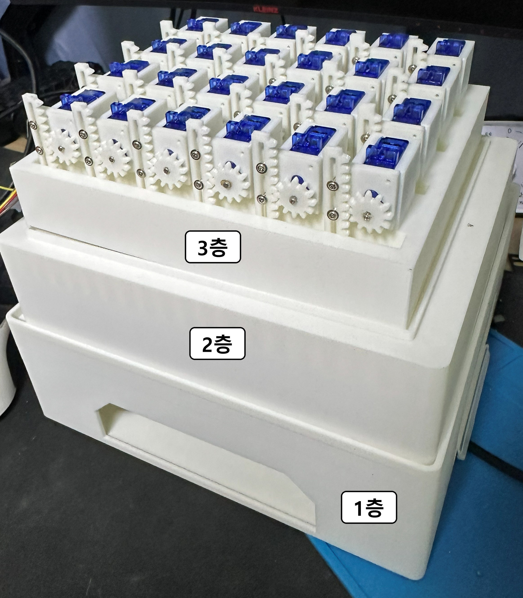
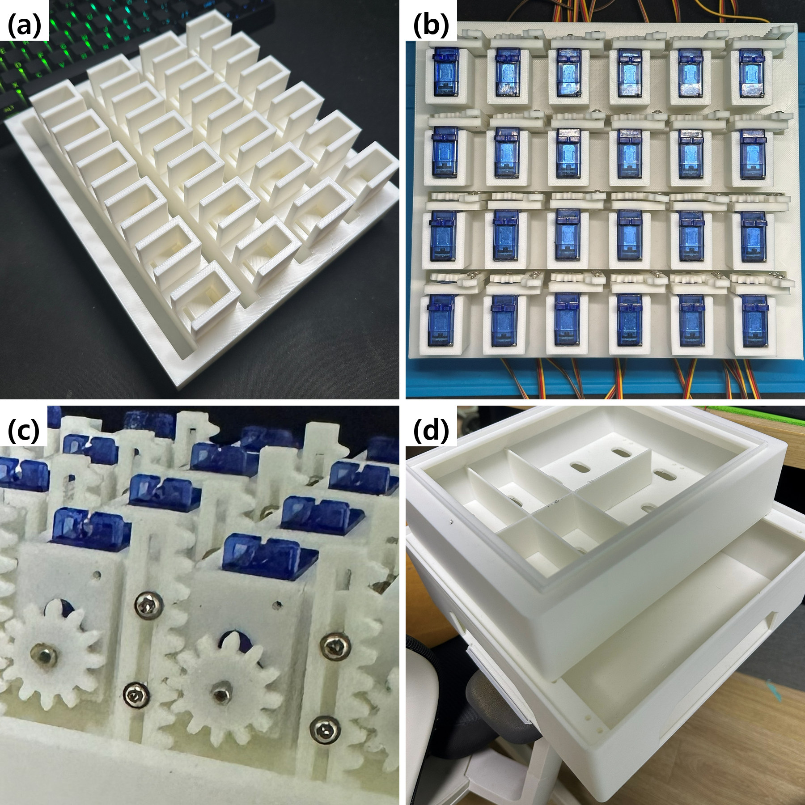
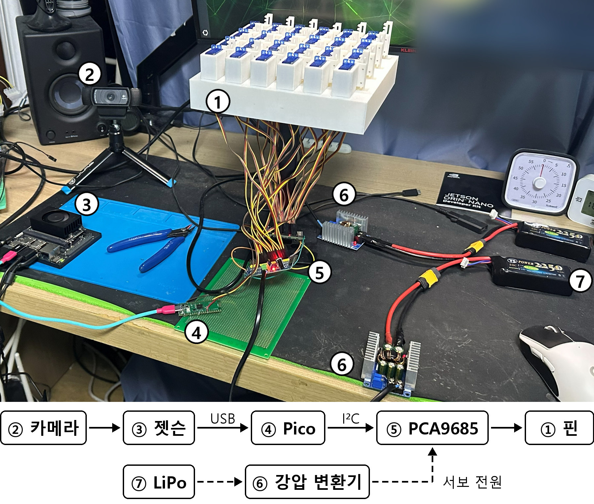
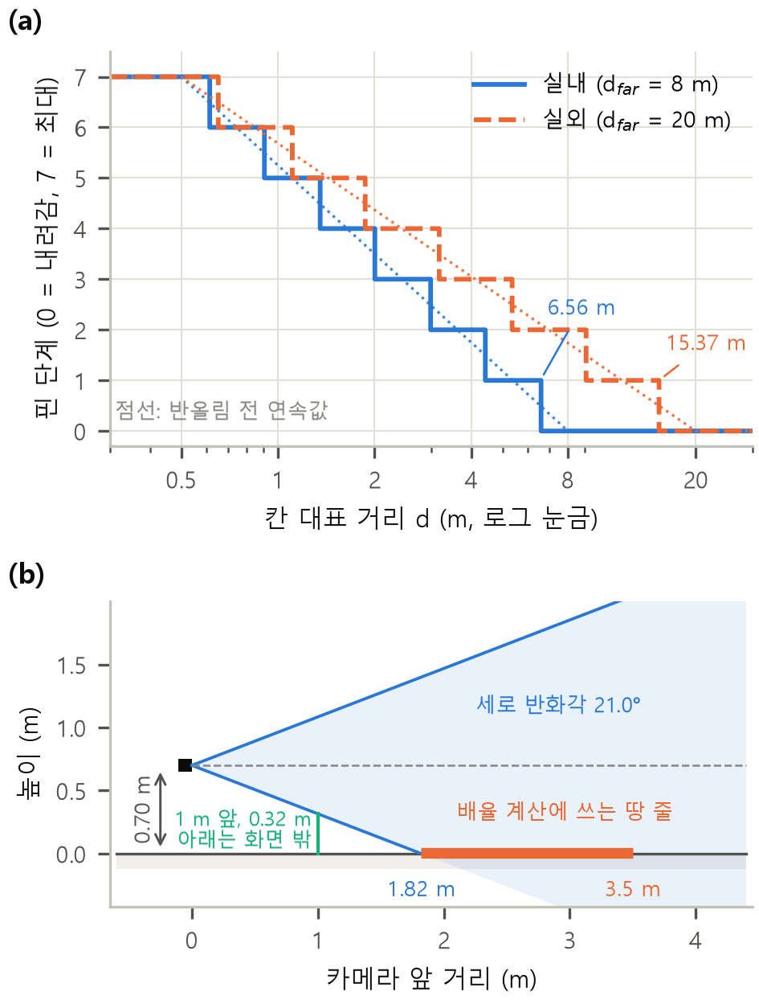
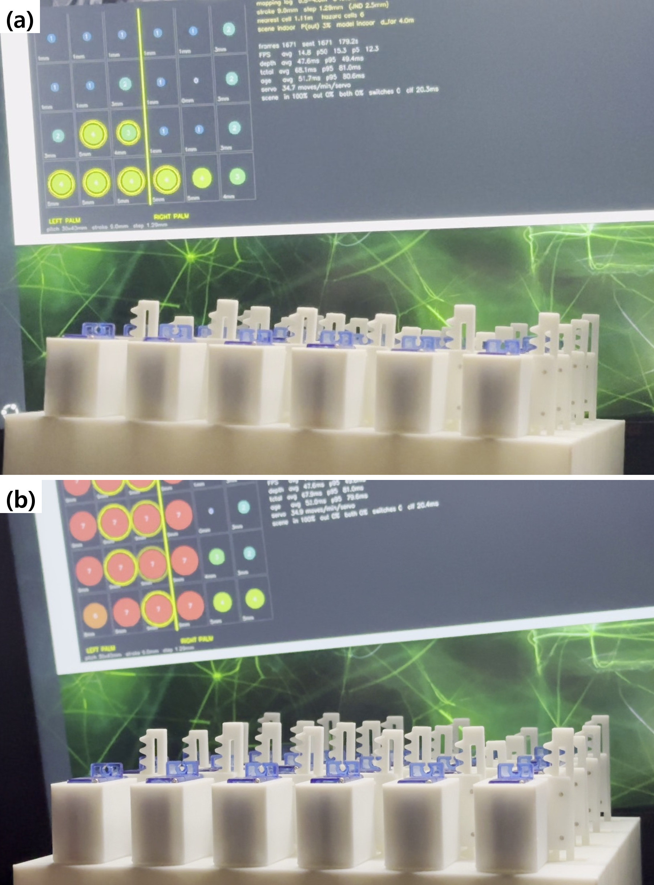
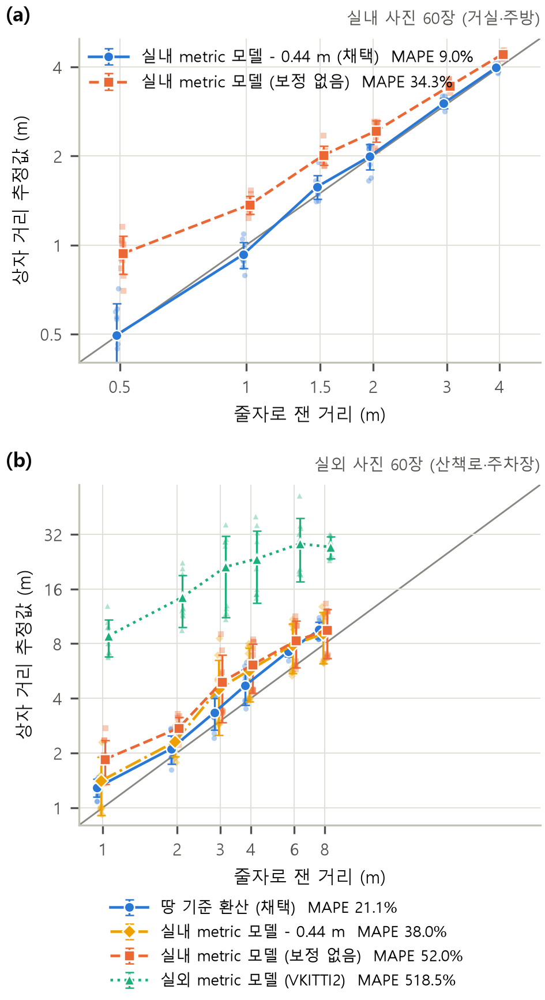
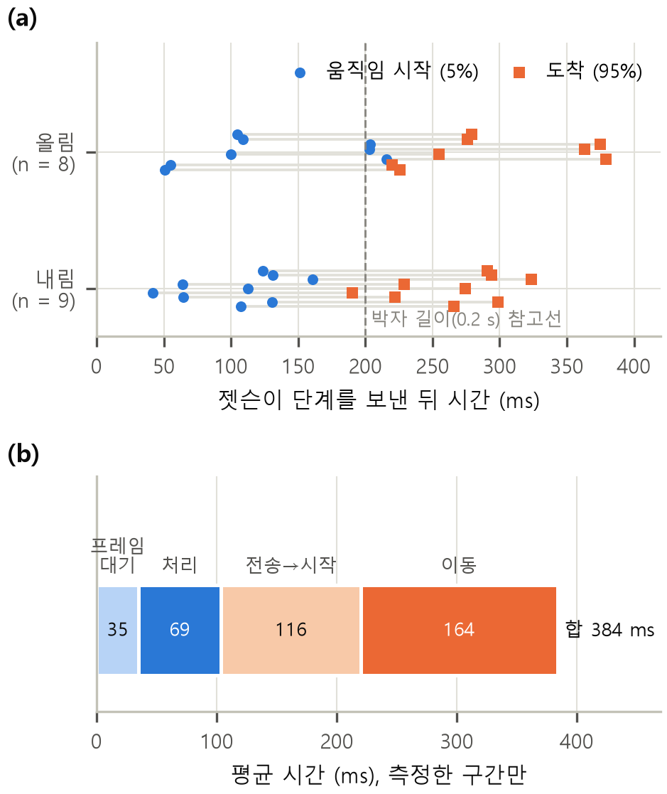
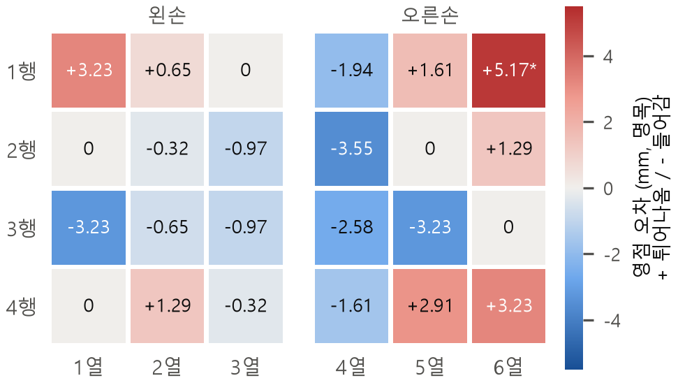

# 단안 카메라 깊이 추정을 이용한 24핀 손바닥 촉각 보행 보조 장치의 개발과 공학적 검증

Development and Engineering Verification of a 24-Pin Palm Tactile Walking Aid Using Monocular Camera Depth Estimation

오형준 (OH HYEONGJUN)

을지대학교 의료공학과 · 지도교수 하지현

## 요 약

**목적:** 단일 RGB 카메라의 단안 깊이를 두 손바닥 아래 24개 핀의 높이로 바꾸어 앞쪽 거리를 알리는 시각장애인 보행 보조 장치를 설계·제작하고, 거리 정확도, 처리·구동 시간, 핀 영점을 공학적으로 검증하였다.

**방법:** 렌즈 높이 0.70 m의 카메라 영상에서 Depth Anything V2(ViT-S)로 깊이를 추정하였다. 실내는 metric 모델 출력에서 0.44 m를 빼고, 실외는 상대 깊이를 땅의 기하로 미터 단위로 환산하였다(땅 기준 환산). 6 × 4 칸마다 하위 10% 거리를 로그 눈금의 8단계로 바꾸어 서보 핀으로 표시하였다. 줄자로 잰 0.5~8 m 상자 사진 120장(실내·실외 각 2곳), 실행 기록 7,894프레임, 슬로 모션 영상의 단계 전환 17회, 24칸 영점 보정 기록을 분석하였다.

**결과:** 실외 두 장소의 사진 60장에서 땅 기준 환산의 평균 절대 백분율 오차(MAPE)는 21.1%로, 같은 사진에서 비교한 실외 metric 모델(518.5%)과 실내 metric 모델 − 0.44 m(38.0%)보다 작았고, 모든 사진이 실제 단계의 ±1단계 안에 들었다. 실내는 보정 뒤 MAPE 9.0%(장소 교차 9.5%)였고, 장치의 칸 규칙을 적용하면 16.1%였다. 장치는 초당 9.4~15.3회 거리 결과를 갱신하였고, 가장 큰 단계 변화의 핀 이동 시간(5→95%)은 평균 164 ms, 최대 175 ms였다. 보정 전 핀 영점 오차는 표준편차 2.2 mm였으며 칸별 보정으로 맞추었다.

**결론:** 장치는 초당 5회 이상 갱신과 한 박자(0.2 s) 안의 핀 이동이라는 두 설계 목표를 만족하였다. 땅 기준 환산은 땅이 보이는 실외에서 보행 높이 카메라의 거리 오차를 시험한 실외 metric 모델보다 크게 줄였다. 이 결과는 사람 시험에 앞선 공학적 검증이며, 다음 단계는 종단 지연 측정과 사용자 시험이다.

**주제어 :** 감각 대체, 촉각 디스플레이, 단안 깊이 추정, 시각장애, 보행 보조

## Abstract

**Purpose:** We designed and built a wearable mobility aid for the visually impaired that converts monocular depth from a single RGB camera into the heights of 24 pins under both palms, and verified its distance accuracy, processing and actuation time, and pin zero offsets.

**Methods:** Depth was estimated with Depth Anything V2 (ViT-S) from a camera with a lens height of 0.70 m. The indoor metric model output was offset by −0.44 m, and outdoor relative depth was converted to metres using ground geometry (ground-based scaling). The 10th-percentile distance of each of 6 × 4 cells was mapped to eight logarithmic levels shown by servo-driven pins. We analysed 120 photographs of a box at tape-measured distances of 0.5–8 m (two indoor and two outdoor sites), 7,894 logged frames, 17 level transitions filmed in slow motion, and zero calibration records of 24 cells.

**Results:** For the 60 outdoor photographs from two sites, ground-based scaling gave a mean absolute percentage error (MAPE) of 21.1%, lower than the outdoor metric model (518.5%) and the offset indoor metric model (38.0%) on the same photographs, and every photograph fell within ±1 level of the true level. Indoors, the MAPE was 9.0% after correction (cross-site 9.5%) and 16.1% with the device's cell rule. The device updated 9.4–15.3 times per second, and the 5–95% travel time of the largest level change averaged 164 ms (maximum 175 ms). Pin zero offsets before calibration had a standard deviation of 2.2 mm and were corrected cell by cell.

**Conclusion:** The device met both design targets: at least 5 updates per second and the largest pin travel within one 0.2 s beat. Where the ground is visible outdoors, ground-based scaling greatly reduced the distance error of a camera at walking height compared with the outdoor metric model tested. These are engineering results obtained before user testing; end-to-end latency measurement and user studies are the next steps.

**Keywords :** sensory substitution, tactile display, monocular depth estimation, visual impairment, mobility aid

## Ⅰ. 서 론

2020년 세계의 실명 인구는 약 4,330만 명, 중등도·중증 시각장애 인구는 약 2억 9,500만 명으로 추정되었고, 실명 인구는 2050년 약 6,100만 명에 이를 것으로 예측되었다 [1]. 시각장애인은 주로 흰지팡이와 안내견에 의지해 보행하며, 몸 앞의 장애물을 미리 알려 주는 전자 보행 보조기(electronic travel aid, ETA)가 오랫동안 연구되었다. 그러나 여러 장치는 기능이 제한적이었고 사용자 중심 설계가 부족하다는 비판을 받았다 [2], [3].

감각 대체 장치(sensory substitution device, SSD)는 시각 정보를 다른 감각으로 옮긴다. 촉각 감각 대체의 대표적인 초기 연구는 Bach-y-Rita 등의 1969년 실험이다 [4]. 이들은 치과 의자 등받이에 솔레노이드 자극기 400개를 20 × 20으로 배열하고(간격 12 mm, 끝 지름 1 mm), 텔레비전 카메라의 영상을 자극기의 진동으로 바꾸어 등의 피부에 전달하였다. 피험자는 시각장애인 6명(4세부터 실명 1명, 선천성 5명)이었고, 삼각대 위의 카메라를 직접 움직여 탁자 위의 물체를 살폈다. 훈련은 선의 방향과 도형을 구별하는 데서 시작해 전화기, 의자, 컵 같은 일상 물체 25개로 이어졌다. 물체를 알아보는 데 걸리는 시간은 처음 5~8분에서 10시간 이상 훈련한 뒤 5~20초로 줄었다. 피험자들은 여러 물체의 앞뒤 배치를 설명하고 사람을 구별하였으며, 자극이 등의 진동이 아니라 카메라 앞쪽에서 오는 것처럼 느낀다고 스스로 보고하였다. 다만 장치는 의자에 고정되어 있었다. 이 논문의 장치는 같은 생각을 착용형으로 옮겨, 표시 부위를 등에서 손바닥으로, 표시 내용을 영상의 형태에서 앞쪽 거리로 바꾸었다.

그 뒤의 장치들은 실용화의 어려움도 함께 보여 주었다. 카메라 영상을 혀의 전기 촉각 자극으로 바꾸는 BrainPort V100은 미국 FDA의 시판 허가를 받았지만, 흰지팡이나 안내견을 대신하지 않고 보조하는 장치로 쓰이며 훈련이 성능을 좌우한다 [5]. SSD는 실험 결과에 비해 일상 재활에서는 거의 쓰이지 않으며, 그 이유로 인간공학·신경인지·심리사회적 문제가 지적되었다 [6]. 2007년의 개관에 따르면 핀 배열형 촉각 디스플레이는 대부분 값비싼 연구 시제품에 머물렀다 [7].

깊이를 촉각으로 알리는 착용형 장치도 보고되었다. ALVU(Array of Lidars and Vibrotactile Units)는 허리에 단 비행시간(time-of-flight, ToF) 거리 센서 띠와 복부의 진동 띠로 구성되어 손을 쓰지 않으며, 시각장애인 12명의 162회 시험으로 검증되었다 [8]. 카메라, 내장 컴퓨터, 햅틱 장치로 걸을 수 있는 공간과 물체를 알리는 시스템도 있다 [9]. 손에 촉각 배열을 두는 방식으로는 핀을 올리고 내려 입체 형상을 보이는 핀 배열 디스플레이 [10]와 스마트폰 카메라 영상을 손바닥의 전기 촉각 자극으로 바꾸는 장치 [11]가 있고, 단안 깊이 추정과 YOLO 물체 검출 결과를 입체 음향으로 알리는 실내 보조 연구도 있다 [12]. 이처럼 손바닥 표시, 핀 높이 표시, 카메라 입력 각각에는 선례가 있으며, ALVU와 [9]의 시스템은 거리와 장애물을 진동으로 알렸다 [8], [9]. 이 연구는 착용한 단안 카메라의 깊이를 실시간으로 두 손바닥 아래 핀의 높이로 바꾸는 조합을 장치로 만들고 공학적으로 검증하였다.

거리 감지에는 단안 RGB 카메라를 썼다. ToF 깊이 카메라와 거리 스캐너는 거리를 직접 재지만, 카메라 하나로는 넓은 화각의 깊이와 물체 종류를 함께 얻을 수 있다. 단안 깊이 추정은 여러 데이터셋을 섞어 거리의 범위와 스케일에 불변인 상대 깊이를 학습하는 방법 [13]을 거쳐 Depth Anything V2로 발전하였다 [14]. Depth Anything V2는 미터 단위 라벨로 미세조정한 metric 모델도 제공하며, 그 학습 자료는 실내 합성 영상 Hypersim [15]과 자동차 주행 장면을 복제한 합성 영상 Virtual KITTI 2 [16]이다. 그러나 한 카메라로 학습한 깊이 모델은 다른 카메라 영상에 잘 일반화하지 못하고 [17], metric 깊이 모델은 카메라 모델에 따른 스케일 모호성을 가진다 [18]. 이를 줄이려고 카메라 내부값을 입력으로 받거나 함께 추정하는 metric 모델이 나왔고 [19], [20], 주행 분야에서는 땅 평면과 카메라 높이로 단안 깊이의 스케일을 복원하는 방법이 쓰였다 [21]. 손바닥 장치는 카메라를 허리 높이(착용 시 렌즈 높이 0.70 m, 이하 보행 높이)에 달므로, 이 높이에서 어떤 방식이 거리를 바르게 추정하는지를 직접 확인할 필요가 있다.

이 연구의 목적은 단일 RGB 카메라의 단안 깊이를 양손 손바닥 아래 6 × 4 핀의 높이로 표시하는 장치를 설계·제작하고, 사람 시험에 앞서 그 성능을 공학적으로 검증하는 것이다. 보조기의 효과는 결국 사용자 시험으로 확인해야 하지만, 그 결과에는 장치의 오차와 사람의 지각·학습이 섞여 나오므로 장치의 오차와 지연을 먼저 알아 두어야 결과를 해석할 수 있다. 기여는 세 가지이다. 첫째, 촉각 패드, 구동 기구, 전장, 펌웨어, 하우징을 직접 만들어 카메라에서 핀까지 동작하는 장치를 완성하고 처리·구동 시간을 재었다. 둘째, 주행 분야의 땅 기준 스케일 복원을 보행 높이 카메라에 옮겨 쓰고, 이를 metric 모델과 같은 사진으로 비교하였다. 셋째, 24개 핀 영점의 흩어짐을 정량화하고 칸별로 보정하였다. 검증한 항목은 다음 세 가지이다.

1) 거리 추정 정확도: 보행 높이 사진에서 거리 추정이 얼마나 정확하며, 장치의 칸 규칙을 거치면 어떻게 달라지는가
2) 처리·구동 시간: 장치가 설계 목표, 즉 초당 5회 이상 갱신하고 어떤 단계 변화도 한 박자(0.2 s) 안에 이동을 마치는 조건을 만족하는가
3) 핀 영점: 24개 핀의 영점이 얼마나 흩어져 있으며, 칸별 보정에 얼마의 보정량이 필요한가

## Ⅱ. 연구 방법

### 2.1 설계 목표와 장치 개요

연구 대상은 직접 설계·제작한 장치 1대이다([그림 1], [표 1]). 장치는 배꼽 높이에 차고, 걷는 동안 두 손바닥을 핀 위에 올려 쓴다. 왼쪽 3열은 왼손, 오른쪽 3열은 오른손 아래에 온다. 앞이 가까워지면 그 방향의 핀이 올라오고, 사람이나 자동차 같은 위험 물체가 가까이 있으면 그 칸의 핀이 진동한다. 장치 전체의 무게는 약 3 kg이다.

**[그림 1]** 3단으로 조립한 장치. 아래에서부터 1·2층은 전장을 넣는 하우징, 3층은 촉각 패드이다.

펌웨어 박자와 핀 행정을 정하기 위해 다음 두 가지 설계 목표를 세웠다.

- R1(갱신): 장치는 초당 5회 이상 거리 결과를 내고 핀을 갱신한다.
- R2(이동): 어떤 단계 값이 와도 핀 이동은 한 박자(0.2 s) 안에 끝난다.

이 연구는 장치가 설계 목표를 만족하는지를 확인하는 공학적 검증 단계이며, 사용자가 이 장치로 보행에 도움을 받는지를 확인하는 사용자 평가는 그 다음 단계이다. 따라서 사람 참여자는 모집하지 않았고, 핀 영점 맞춤과 진동 확인은 연구자 본인이 장치를 조작하며 하였다.

### 2.2 장치 제작

**(1) 촉각 패드.** 3D 프린팅한 뼈대에 서보 자리 24칸을 6열 × 4행으로 두고([그림 2](a)), SG90 서보 24개를 끼웠다([그림 2](b)). 서보의 회전은 3D 프린팅한 랙·피니언(12톱니, 피치원 지름 16.00 mm)이 핀의 오르내림으로 바꾼다([그림 2](c)). 핀은 가로 30.0 mm, 세로 40.0 mm 간격으로 놓인다. 서보는 역방향으로 조립되어 소프트웨어에서 방향을 뒤집었다.

서보의 사용 범위는 140 tick(232~372 tick, 64.8°)이고, 1 tick은 4.88 µs 펄스폭에 해당한다. SG90의 500~2400 µs가 180°에 대응한다고 보고 피치원으로 환산하면 핀 행정은 9.04 mm, 한 단계(20 tick)는 1.29 mm이다. 이하 mm로 적은 핀 높이는 모두 이 환산에 따른 명목값이며 손바닥 하중이 없는 상태의 값이다. 처음 설계한 행정은 20.9 mm(단계 간격 2.99 mm)였으나, 가장 큰 이동도 한 박자 안에 끝나도록(R2) 행정을 9.0 mm로 정하였다.

**[그림 2]** 제작 과정. (a) 3D 프린팅한 뼈대. (b) 서보 24개를 끼운 모습. (c) 서보 축의 피니언과 핀을 올리고 내리는 랙. (d) 하우징 2층(위)과 1층(아래)의 속.

**(2) 전장과 전원.** [그림 3]은 시험대 구성과 신호 흐름이다. 카메라(Logitech C920)는 자동초점을 끄고 초점값을 0으로 고정하였고, 케이스 밑에 달아 렌즈 높이가 0.70 m가 되도록 하였다. 연산은 Jetson Orin Nano Super(8 GB, 25 W 모드)가 TensorRT FP16으로 한다. 젯슨은 USB로 Raspberry Pi Pico(RP2040)에 결과를 보내고, Pico는 I²C 직렬 버스(400 kHz)로 PCA9685 PWM 드라이버 두 개(1~2행, 3~4행)를 거쳐 서보 24개를 구동한다. 서보 전원은 3S1P LiPo(공칭 11.1 V, 제품 표기 2250 mAh) 2개를 강압 변환기 2개(출력 5 V)로 낮추어 PCA9685마다 한 계통씩 공급하고, 젯슨은 PD 보조 배터리(20,000 mAh)로, Pico는 젯슨의 USB로 구동한다.

**[그림 3]** 시험대 구성과 신호 흐름. ① 촉각 패드, ② 카메라, ③ 젯슨, ④ Pico, ⑤ PCA9685 2개, ⑥ 강압 변환기 2개, ⑦ LiPo 2개. 아래 도식의 실선은 신호, 점선은 서보 전원이다.

**(3) 3단 하우징.** 장치를 한 덩어리로 착용할 수 있도록 3단 하우징을 설계하고 3D 프린터로 출력하였다([그림 1], [그림 2](d)). 맨 아래 1층(252 × 250 × 86 mm)은 젯슨, 보조 배터리, 카메라를 넣는 칸이며, 카메라는 앞벽 아래의 창으로 밖을 본다. 2층(200 × 236 × 65 mm)은 Pico, PCA9685 2개, 강압 변환기 2개, LiPo 2개를 넣는 칸이며, 가운데 칸막이로 두 PCA9685의 전원 계통을 좌우로 나누었다. 맨 위 3층은 촉각 패드이고, 서보 선은 판 바닥의 구멍으로 내려간다. 쌓은 전체 크기는 252 × 250 × 203 mm(설계 파일 값)이다. 하우징은 2.4의 실험을 마친 뒤에 제작하였으므로, 실험은 [그림 3]의 시험대 구성에서 하였다.

**[표 1]** 제작 사양과 최종 설정(장치 코드 ground-scale 가지 439d1cb)

| 구분 | 내용 |
|---|---|
| 촉각 패드 | SG90 × 24, 6열 × 4행, 핀 간격 30.0 × 40.0 mm, 본체 200.0 × 173.0 × 62.3 mm |
| 기구 | 3D 프린팅 랙·피니언(12톱니, 피치원 16.00 mm), 행정 140 tick = 64.8° = 9.04 mm, 1단계 1.29 mm |
| 구동·제어 | PCA9685 PWM 드라이버 × 2(I²C 400 kHz, 50 Hz PWM), Raspberry Pi Pico(RP2040) |
| 연산 | Jetson Orin Nano Super 개발자 키트(8 GB, 25 W 모드), TensorRT FP16 |
| 카메라 | Logitech C920, 1280 × 720 MJPG 30 fps, 자동초점 끔·초점 0, 렌즈 높이 0.70 m |
| 전원 | 서보: 3S1P LiPo × 2 → 강압 변환기 × 2(출력 5 V), 젯슨: PD 보조 배터리 20,000 mAh, Pico: 젯슨 USB |
| 하우징 | 3단: 1층 252 × 250 × 86 mm, 2층 200 × 236 × 65 mm, 쌓은 전체 252 × 250 × 203 mm |
| 무게 | 장치 전체 약 3 kg |
| 깊이 입력 | 가운데 1280 × 698 → 924 × 504 |
| 실내 거리 | Depth Anything V2 ViT-S metric(Hypersim) 엔진 출력 − 0.44 m |
| 실외 거리 | 땅 기준 배율 A ÷ Depth Anything V2 ViT-S 상대 깊이 엔진의 출력 r(h 0.70 m, 기울기 0°, f 908 px, 땅 1.82~3.5 m, A 평활 1 s) |
| 장면 판별 | Places365 ResNet18, 초당 2회, 평활 1 s, 문턱 0.65/0.35, 1.5 s 유지 |
| 칸·단계 | 6 × 4 칸, 칸별 하위 10% 거리, 로그 매핑 0.5 m~d_far(실내 8 m, 실외 20 m), 0~7단계 |
| 시간 필터 | 거리 지수 평활 α 0.65(접근)/0.25(후퇴), 단계 변경 문턱 0.65/0.95단계, 내림 확인 3프레임 |
| 위험 진동 | YOLO26n(COCO, 512 × 288), 4 m 이내 최대 6칸, 2/4/6 tick, 초당 10회 |
| 전송 | USB, 31바이트 프레임(동기 2, 종류·순번·길이 3, 내용 25, CRC-8 1) |
| 펌웨어 | 0.2 s 박자마다 최신 값 적용, 5 ms당 최대 4 tick, 0.5 s 끊기면 0단계로 복귀 |

### 2.3 거리에서 핀까지의 처리

**(1) 거리 추정.** 1280 × 720 영상의 가운데 1280 × 698을 924 × 504로 줄여 Depth Anything V2 ViT-S 엔진에 넣는다 [14]. 실내용 metric 엔진과 실외용 상대 깊이 엔진을 함께 올려 두고, 확정된 장면의 엔진 하나만 매 프레임 실행한다. 장치가 내는 거리는 광축 방향의 깊이(Z)이다.

실내에서는 Hypersim으로 미세조정한 metric 모델의 출력에서 0.44 m를 뺀다. 0.44 m는 2.4 (1)의 실내 사진 60장에서 추정 거리와 실제 거리의 차이를 평균한 값이다.

실외에서는 땅을 기준으로 상대 깊이를 미터로 바꾼다(이하 땅 기준 환산). 상대 깊이 모델의 출력 r은 아핀 불변 역깊이로, 클수록 가깝다. 이 장치는 이동 항을 0으로 보고 거리 = A / r로 바꾼다. 카메라가 높이 h에서 수평으로 앞을 보면, 영상의 y번째 줄에 보이는 땅까지의 깊이는

Z(y) = f · h / (y − c_y)

이다. 화면 아래에서 땅이 1.82~3.5 m에 해당하는 120줄(이하 땅 줄)마다 r의 중앙값 × Z(y)를 구하고, 그 중앙값을 땅 기준 배율 A로 하였다. A는 로그 영역에서 시간상수 1 s로 평활하였다. 가정값은 h = 0.70 m, 기울기 0°, f = 908 px(C920의 공개 화각에서 원본 1280 × 720 기준으로 환산, 924 × 504 깊이맵에서는 약 655 px), c_y = 깊이맵 가운데(252번째 줄)이다. 이 방법은 주행 분야의 땅 평면 기반 스케일 복원 [21]을 보행 높이에 옮긴 것이며, 상자까지의 거리로 맞춘 매개변수는 없다. 이 기하에서 세로 반화각은 약 21°이고, 화면 맨 아래 줄의 땅은 1.82 m 앞이다([그림 4](b)).

**(2) 장면 판별.** Places365로 학습한 ResNet18 [22], [23]이 초당 2회 장면을 분류한다. 실외로 분류되는 204개 장면 확률의 합을 시간상수 1 s로 평활하여 실외 확률로 쓰고, 이 값이 0.65를 넘거나 0.35 아래로 내려간 상태가 1.5 s 이어지면 장면을 바꾼다. 장면이 바뀌면 d_far를 0.7 s 동안 로그 영역에서 이어 바꾼다.

**(3) 칸 거리와 핀 단계.** 924 × 504 깊이맵을 6 × 4 칸(칸당 154 × 126 화소)으로 나누고, 칸마다 가까운 쪽인 하위 10% 거리를 대표값으로 한다(이하 칸 규칙). 평균을 쓰면 기둥이나 의자 다리처럼 칸의 일부만 차지하는 가까운 물체가 배경과 섞여 사라지기 때문이다. 단계 L은 다음과 같이 정한다.

- d ≤ 0.5 m이면 L = 7, d ≥ d_far이면 L = 0
- 그 사이는 L = round(7 · ln(d_far / d) / ln(d_far / 0.5))

d_far는 실내 8 m, 실외 20 m이다. 따라서 핀은 실내 6.56 m, 실외 15.37 m부터 올라오기 시작하고, 한 단계는 거리 비 1.49배(실내), 1.69배(실외)에 해당한다([그림 4](a)). 로그 눈금을 쓴 것은 가까운 거리에 단계를 더 촘촘히 배정하기 위해서이다. 칸 대표값에는 바닥 화소도 포함된다. 평지를 수평으로 볼 때 이 기하와 칸 규칙으로 계산하면 맨 아래 행은 약 1.92 m(4단계), 셋째 행은 약 4.06 m(실내 2단계, 실외 3단계)를 기준 단계로 표시한다.

**[그림 4]** (a) 칸 대표 거리에 따른 핀 단계(실선·파선: 반올림한 단계, 점선: 반올림 전 값). (b) 렌즈 높이 0.70 m, 수평 카메라의 세로 화각과 땅 기준 배율에 쓰는 땅 줄(1.82~3.5 m).

표시가 흔들리지 않도록 시간 필터를 두었다. 거리는 가까워질 때 α = 0.65, 멀어질 때 α = 0.25로 지수 평활한다. 단계는 올릴 때 0.65단계, 내릴 때 0.95단계를 넘어야 바꾸고, 내릴 때는 3프레임 연속 확인한 뒤 한 번에 1단계씩만 내린다. 즉 가까워지는 변화에는 빠르게, 멀어지는 변화에는 느리게 반응한다.

**(4) 위험 물체 진동.** YOLO26n [24]이 COCO [25] 물체를 검출하고 종류별 위험도 1~3을 정한다(예: 사람 2, 자동차 3). 4 m 이내에 있는 칸 가운데 가까운 순서로 최대 6칸에 위험도를 붙인다. Pico는 0.2 s 박자의 두 번째와 네 번째 1/4 구간에 그 칸의 핀을 위험도에 따라 2/4/6 tick(1/2/3°)만큼 비켜 놓아, 핀이 초당 10회 진동하게 한다.

**(5) 전송과 펌웨어.** 젯슨은 결과가 나올 때마다 USB로 31바이트 프레임을 보낸다. 프레임은 동기 2바이트(0xAA, 0x55), 종류·순번·길이 각 1바이트, 내용 25바이트(칸마다 단계 4비트와 위험도 4비트를 담은 24바이트와 비상 정지 플래그 1바이트), 순환 중복 검사(CRC-8, 다항식 0x07) 1바이트로 이루어진다. Pico 펌웨어는 다음 규칙으로 동작한다.

- 0.2 s 박자마다 받은 값 가운데 가장 최근 값 하나만 적용한다.
- 5 ms마다 서보 목표를 최대 4 tick씩 옮긴다. 따라서 140 tick의 끝→끝 이동은 명령 기준 175 ms이다.
- CRC가 맞지 않는 프레임은 버린다. 유효 프레임이 0.5 s 동안 오지 않으면 모든 핀을 10 ms에 1 tick씩 0단계로 내린다.
- 칸별 영점 보정값(2.4 (4))을 펌웨어 기본값으로 저장한다.

### 2.4 검증 실험

실험은 2026년 10월에 하였다. 실험별 자료와 장치 설정을 [표 2]에 정리하였다. 처리 시간과 장면 전환은 실내 보정과 땅 기준 환산을 넣기 전의 구성(실내 metric 모델, d_far 4 m)에서 기록하였다. 거리 정확도는 장치 코드의 전처리와 TensorRT 엔진을 분석 스크립트로 재현해 구하였다.

**[표 2]** 실험별 원본 자료와 장치 설정

| 실험 | 원본 자료 | 장치 설정 |
|---|---|---|
| 거리 정확도 | 사진 120장, 상자 영역 120개 | 장치 전처리·엔진을 분석 스크립트로 재현, 정지 사진 |
| 처리 시간 | 실행 기록 2개, 7,894프레임 | 실내 metric 모델, d_far 4 m, Pico 연결, 확인 창 켬 |
| 처리 시간(보조) | 실행 기록 918프레임, 전력 76회 | 위와 같은 모델, Pico·확인 창 없음 |
| 장면 전환 | 사진 입력 전환 기록 288프레임 | 전환 규칙은 최종 설정과 같음 |
| 구동 지연 | 슬로 모션 영상 1개, 전환 20회 | 칸 9만 0↔7단계, 무부하. 17회 분석 |
| 핀 영점 | 보정 파일 3개(전·1차·최종) | 최종 설정 |

**(1) 거리 정확도.** 장치의 C920을 장치와 같은 설정(1280 × 720, 자동초점 끔, 초점 0)으로 두고, 렌즈 높이 0.70 m에서 수평으로 상자 사진을 찍었다. 표적은 손수레에 올린 흰 상자의 앞면(가로 30 cm × 세로 27 cm)이며, 앞면 가운데를 렌즈 높이 근처에 맞추고 렌즈에서 앞면까지의 거리를 줄자로 쟀다. 실외 2곳(산책로, 주차장)에서는 1, 2, 3, 4, 6, 8 m, 실내 2곳(거실, 주방)에서는 0.5, 1, 1.5, 2, 3, 4 m에서 거리마다 5장씩 모두 120장을 찍었다. 실외는 맑은 날 오전, 실내는 같은 날 오후에 촬영하였다.

사진마다 상자 앞면 영역을 표시하고, 그 영역을 사방 20%씩 줄인 안쪽의 깊이 중앙값을 상자 거리로 하였다. 실내 metric 모델에서는 상자 가운데가 든 칸의 하위 10% 값, 즉 장치가 실제로 핀에 싣는 칸 규칙 값도 함께 구하였다. 비교한 추정 방법은 실내 metric 모델(Hypersim, 보정 없음), 실내 metric 모델 − 0.44 m, 실외 metric 모델(Virtual KITTI 2), 땅 기준 환산의 네 가지이다.

**(2) 처리 시간.** 확인 창을 켜고 Pico를 연결한 두 번의 실행 기록(총 7,894프레임)을 분석하였다. 처리 경로는 카메라 → 깊이 → YOLO26n → 장면 판별(초당 2회) → 단계 → Pico 전송이다. 프레임마다 프레임 대기(카메라 프레임이 소프트웨어에 도착한 뒤 처리가 시작될 때까지의 시간), 단계별 시간, 프레임 처리 합계를 기록하였다. 보조 자료로 Pico와 확인 창 없이 약 60 s 동안 돌린 기록(918프레임)과 그 무렵의 젯슨 입력 전력(1 s 간격 76회)을 썼다.

**(3) 구동 지연.** 젯슨이 칸 9의 단계를 0과 7로 번갈아 바꾸며 초당 15회 보냈고, 바꾸는 간격은 2.5~3.5 s에서 무작위로 정하였다. 단계를 바꾼 프레임을 보낸 직후 모니터 전체 화면을 흰색(올림) 또는 검은색(내림)으로 바꾸고, 화면과 핀을 Galaxy S10 5G의 슬로 모션으로 함께 찍었다. 영상의 화면 전환 시각과 기록의 화면 표시 시각을 직선으로 맞추어 실효 촬영 속도를 235.05 fps(프레임 간격 4.25 ms)로 정하였다(잔차 SD 17.7 ms). 핀 윗부분을 정규화 상호상관으로 추적하고 고정 구조물의 움직임을 빼서 흔들림을 보정하였다. 핀 이동량(약 43.4 화소)의 5%를 지난 시각을 시작, 95%를 지난 시각을 도착으로 하였다. 전환 20회 가운데 고정 구조물이 1 화소 넘게 흔들린 2회와 핀 추적에 실패한 1회를 빼고 17회(올림 8, 내림 9)를 분석하였다. 측정은 핀 1개를 손바닥 하중 없이 구동한 조건이며, 기준 시각이 화면이 실제로 바뀐 시각이 아니라 화면 갱신 명령 시각이므로 전송→시작·도착 시간은 모니터 표시 지연만큼 짧게 측정될 수 있다.

**(4) 핀 영점.** 연구자가 보정 도구에서 칸을 하나씩 골라, 0단계 핀의 윗면이 패드 표면과 같아지도록 눈과 손끝으로 맞추었다. 0단계와 7단계 tick을 같은 양만큼 옮겨 행정 140 tick을 유지하였고, 조정은 대부분 5 tick(0.32 mm) 단위로 하였다. 두 차례 실행하였으며 공통 기본값(372/232 tick) 대비 조정 한계는 1차 ±40 tick, 2차 ±80 tick이었다. 칸별 보정량을 보정 전의 영점 오차로 보았고, 부호는 +가 튀어나옴이다.

### 2.5 분석과 판정 기준

**거리.** 오차 지표로 평균 절대 백분율 오차(mean absolute percentage error, MAPE)를 평균(|추정 − 실제| / 실제) × 100으로 구하였다. 2.3 (3)의 식으로 실제 거리와 추정 거리를 단계로 바꾸어 단계 일치율과 ±1단계 안 일치율도 구하였다. 실내 보정량은 한 장소로 정하고 다른 장소에 적용하는 장소 교차로 검증하였다. 실외에서는 땅 기준 환산과 실내 metric 모델 − 0.44 m를 비교하였다. 같은 거리의 5장은 같은 장면이라 독립 표본이 아니므로 장소 × 거리 12묶음 단위로 MAPE 차이의 평균, 부트스트랩 95% 구간(10,000회 복원 추출), 정확 윌콕슨 부호순위검정을 계산하였다. 보조 분석으로 metric 모델에 곱하기 배율 k를 맞추어 장소 교차로 평가하였고, 땅 기준 환산은 가정값(기울기, 높이, 초점거리)을 바꾼 민감도를 구하였다.

**시간.** 평균, 표준편차(SD), 95번째 백분위(p95), 최대를 구하였다. 구동 지연은 단계를 보낸 시각을 기준으로 시작·도착·이동 시간을 구하고 1 ms 단위로 보고하였다.

**판정 기준.** 설계 목표는 다음 기준으로 판정하였다.

- R1(갱신): 프레임 처리 p95 < 200 ms이고 실측 갱신 ≥ 5회/s
- R2(이동): 가장 큰 변화(0↔7단계)의 이동 시간(5→95%) 최댓값 < 200 ms

**영점.** tick 값을 0.0646 mm/tick으로 mm로 바꾸고, 20 tick을 1단계로 하여 단계 단위로도 나타내었다. 계산은 Python(NumPy, SciPy)으로 하였고, 모든 수치는 원본 기록에서 다시 계산하였다.

## Ⅲ. 결 과

### 3.1 작동 확인

[그림 5]는 처리 시간을 기록한 실행 중에 장치를 찍은 영상의 두 프레임이다. 앞이 먼 프레임에서 가장 가까운 칸은 1.11 m, 가장 높은 단계는 4였고, 앞이 가까운 프레임에서는 가장 가까운 칸이 약 0.5 m, 7단계가 15칸이었다. 화면에 보이는 칸 단계는 같은 실행 기록의 값과 모두 일치하였고, 앞이 가까운 프레임에서 핀이 더 올라온 것을 볼 수 있다. 카메라에서 핀까지의 전 경로가 이어져 동작함을 확인하였다.

**[그림 5]** 작동 중의 화면과 핀(한 영상의 두 프레임, 약 4 s 간격). (a) 앞이 멀 때(가장 가까운 칸 1.11 m). (b) 앞이 가까울 때(약 0.5 m). 화면의 원은 칸별 단계이다.

### 3.2 거리 추정 정확도

[표 3]과 [그림 6]에 결과를 정리하였다.

**실내.** 실내 metric 모델은 거리와 관계없이 평균 0.37~0.51 m 멀게 추정하였다(MAPE 34.3%). 0.44 m를 빼면 MAPE는 9.0%로 줄었고, 한 장소에서 정한 보정량을 다른 장소에 적용한 장소 교차 MAPE는 8.5%와 10.5%, 평균 9.5%였다. 보정 뒤 거리별 오차는 0.5 m에서 22.7%, 1 m 이상에서 2.5~10.0%였으며, 단계 일치는 75%, ±1단계 안 일치는 100%였다. 장치의 칸 규칙을 적용하면 MAPE는 16.1%, 단계 일치는 63%, ±1단계 안 일치는 93%였다. 3 m와 4 m에서 칸 값은 평균 2.81 m와 3.11 m로 실제보다 가까웠다. 곱하기 배율 k로 보정한 경우의 장소 교차 MAPE는 18.3%와 17.8%로, 0.44 m를 빼는 보정보다 컸다.

**실외.** 실외 metric 모델(Virtual KITTI 2)의 MAPE는 518.5%였다. 1 m를 평균 8.82 m로, 8 m를 평균 27.28 m로 추정하였고 ±1단계 안 일치는 0%였다. 실내 metric 모델은 보정 없이 52.0%, 0.44 m를 빼면 38.0%였다. 땅 기준 환산은 21.1%로 가장 작았고, 단계 일치는 60%, ±1단계 안 일치는 100%였다. 땅 기준 환산은 사진의 78%에서 실제보다 멀게 추정하였으며(부호 있는 오차 평균 +17.3%), 단계가 어긋난 사진 24장 가운데 22장이 1단계 낮았다. 실외 d_far를 8~30 m로 바꾸어도 ±1단계 안 일치는 100%, 단계 일치는 52~65%였다.

장소별로는 산책로에서 실내 metric 모델 − 0.44 m(6.7%)가 땅 기준 환산(10.9%)보다 작았고, 주차장에서는 땅 기준 환산(31.2%)이 실내 metric 모델 − 0.44 m(69.3%)보다 작았다. 12묶음 단위로 비교하면 땅 기준 환산의 MAPE가 평균 16.9%p 작았고(부트스트랩 95% 구간 −32.1~−2.9%p), 12묶음 가운데 7묶음에서 땅 기준 환산이 작았다. 윌콕슨 부호순위검정의 정확 p는 0.092였다. 가정값을 바꾼 민감도 분석에서 땅 기준 환산의 MAPE는 기울기 ±1°에서 16.8~26.3%, 높이 ±5 cm에서 16.1~27.3%, 초점거리 ±5%에서 17.2~25.2%였다.

**[표 3]** 거리 추정 정확도(상자 거리, 사진 단위)

| 추정 방법 | MAPE % (장소 1/2) | 단계 일치/±1단계 % |
|---|---|---|
| **실내 사진 60장 (d_far 8 m)** | | |
| 실내 metric 모델(보정 없음) | 34.3 (34.6/34.0) | 60/92 |
| 실내 metric 모델 − 0.44 m | 9.0 (10.1/7.9) | 75/100 |
| 같은 값, 장치의 칸 규칙 | 16.1 (13.2/19.0) | 63/93 |
| 땅 기준 환산 | 54.8 (52.0/57.6) | 57/70 |
| 실외 metric 모델(VKITTI2) | 460.6 (404.7/516.5) | 0/0 |
| **실외 사진 60장 (d_far 20 m)** | | |
| 실외 metric 모델(VKITTI2) | 518.5 (447.2/589.8) | 0/0 |
| 실내 metric 모델(보정 없음) | 52.0 (17.2/86.7) | 38/85 |
| 실내 metric 모델 − 0.44 m | 38.0 (6.7/69.3) | 55/92 |
| 땅 기준 환산 | 21.1 (10.9/31.2) | 60/100 |

**[그림 6]** 줄자로 잰 거리와 상자 거리(로그 눈금). 작은 점은 사진 1장, 큰 표식과 막대는 거리별 평균 ± SD, 회색 선은 추정 = 실제. (a) 실내 사진 60장, (b) 실외 사진 60장.

### 3.3 처리 시간과 구동 지연

**처리 시간.** [표 4]에 처리 시간을 정리하였다. 확인 창을 켠 기록(7,894프레임)에서 프레임 처리 시간은 평균 68.8 ms(SD 7.3, p95 82.4, 최대 114.4)였고, 그중 깊이 추정이 평균 48.5 ms, YOLO26n이 14.7 ms였다. 프레임 대기는 평균 34.8 ms였고, 대기와 처리의 합은 평균 103.6 ms(p95 137.4)였다. 갱신 횟수는 초당 약 9.4회였다. 확인 창과 Pico 없이 돌린 기록(918프레임)에서는 초당 15.3회 갱신하였고 프레임 처리 시간은 평균 65.1 ms(p95 85.9)였으며, 젯슨 모듈 입력 전력은 중앙값 14.33 W(최대 15.10 W)였다.

**[표 4]** 처리 시간(ms, 평균 ± SD, 괄호는 p95)

| 항목 | 확인 창 켬 (7,894프레임) | 확인 창·Pico 없음 (918프레임) |
|---|---|---|
| 깊이 추정 | 48.5 ± 3.4 (55.2) | 47.5 ± 4.8 (55.8) |
| YOLO26n | 14.7 ± 1.4 (16.3) | 14.4 ± 1.8 (17.0) |
| 장면 판별(실행 프레임) | 20.4 ± 2.1 (22.4) | 21.2 ± 2.9 (23.8) |
| 단계·필터 | 0.5 ± 0.1 (0.7) | - |
| 전송 | 0.6 ± 0.4 (0.7) | - |
| 프레임 처리 합계 | 68.8 ± 7.3 (82.4) | 65.1 ± 8.5 (85.9) |
| 프레임 대기 | 34.8 ± 15.5 (70.1) | 30.8 ± 9.8 (45.7) |
| 대기 + 처리 | 103.6 ± 16.6 (137.4) | - |
| 갱신 횟수 | 약 9.4회/s | 15.3회/s |

**구동 지연.** [표 5]와 [그림 7]에 17회의 결과를 정리하였다. 단계를 보낸 뒤 핀이 움직이기 시작할 때까지 평균 116 ms(범위 42~216), 도착할 때까지 평균 280 ms(범위 190~379)가 걸렸다. 이동 시간(5→95%)은 평균 164 ms(SD 7, 범위 149~175)였고, 흔들림으로 뺀 2회를 포함한 19회에서도 최댓값은 175 ms였다. 프레임 대기와 처리(103.6 ms)에 전송→도착(280 ms)을 더한 측정 구간의 평균 합은 약 384 ms였다.

**[표 5]** 구동 지연(ms, 단계를 보낸 시각 기준, 평균 ± SD). 핀 1개, 무부하

| 구분 | 전송→시작 | 전송→도착 | 이동(5→95%) |
|---|---|---|---|
| 전체(17회) | 116 ± 54 | 280 ± 56 | 164 ± 7 |
| 범위 | 42~216 | 190~379 | 149~175 |
| 올림 0→7(8회) | 130 ± 68 | 297 ± 66 | 167 ± 7 |
| 내림 7→0(9회) | 104 ± 39 | 265 ± 43 | 161 ± 6 |

**[그림 7]** 핀 구동 지연(17회, 핀 1개, 무부하). (a) 단계를 보낸 뒤 핀이 움직이기 시작(5%)하고 도착(95%)한 시각. 점선은 박자 길이(0.2 s) 참고선이다. (b) 측정한 구간의 평균 시간 구성.

**설계 목표 판정.** R1(갱신)은 [표 2]의 처리 시간 구성에서 만족하였다. 프레임 처리 p95는 82.4 ms(확인 창 켬)와 85.9 ms(확인 창 없음)로 200 ms보다 작았고, 갱신 횟수는 초당 9.4회와 15.3회로 모두 5회 이상이었다. R2(이동)도 핀 1개의 무부하 구동에서 만족하였다. 0↔7단계 이동 시간(5→95%)의 최댓값은 175 ms로 17회 모두 200 ms 미만이었고, 펌웨어 명령 기준 끝→끝 시간도 175 ms이다.

### 3.4 핀 영점 오차

[그림 8]에 보정 전 영점 오차를 화면과 같은 배치로 나타내었다. 24칸의 영점 오차는 표준편차 2.20 mm, 절댓값 평균 1.61 mm, 범위 −3.55~+5.17 mm였다. 단계로 보면 1단계 이하가 13칸, 1단계를 넘는 칸이 11칸, 2단계를 넘는 칸이 7칸이었고 최대는 4.0단계였다. 절댓값 평균은 왼손 쪽 3열이 0.97 mm, 오른손 쪽 3열이 2.26 mm였다. 1행 6열(칸 5)은 조정 한계(+80 tick)에 닿아, 이 칸의 실제 오차는 4단계보다 클 수 있다. 칸별 보정값은 펌웨어 기본값으로 저장하여, 장치는 보정된 영점에서 동작한다.

**[그림 8]** 보정 전 핀 영점 오차(칸별 보정량, mm, + 튀어나옴). 배치는 화면과 같으며 왼쪽 3열은 왼손, 오른쪽 3열은 오른손 아래에 있다. *: 조정 한계(+80 tick)에 닿은 칸.

### 3.5 장면 전환과 위험 진동

사진 입력을 실내와 실외로 바꾼 기록에서, 판별기가 새 장면을 처음 인식한 프레임부터 확정 전환까지 실내→실외, 실외→실내 모두 37프레임(약 2.4 s)이 걸렸고, d_far는 전환 뒤 10프레임(약 0.66 s)에 걸쳐 바뀌었다. 위험 진동은 가장 약한 1° 진동(2 tick 명령)도 손으로 느낄 수 있었다.

## Ⅳ. 고 찰

### 4.1 거리 추정: 땅 기준 환산이 실외 오차를 크게 줄였다

시험한 실외 metric 모델은 1 m를 8.82 m로 보는 등 거리를 3~9배 멀게 추정하였다. 이 모델은 자동차 주행 장면을 복제한 합성 영상으로 미세조정되었으므로 [16], 한 카메라로 학습한 깊이 모델이 다른 카메라 영상에 잘 일반화하지 못하고 [17] metric 모델이 카메라에 따른 스케일 모호성을 가진다는 보고 [18]와 같은 방향의 결과이다. 허리 높이에 카메라를 다는 보행 보조 장치에서는 주행용 metric 모델을 그대로 쓰기 어렵다는 점을 실측으로 확인한 셈이다.

땅 기준 환산은 모델이 내는 미터 값에 기대지 않고 카메라 높이와 화각만으로 스케일을 정한다. 상자 거리에 맞춘 매개변수 없이 실외 오차를 518.5%에서 21.1%로 줄였고, 모든 사진이 실제 단계의 ±1단계 안에 들었다. 오차는 대부분 실제보다 멀게 추정하는 한 방향으로 났으므로(사진의 78%), 무작위 오차보다 가정값에서 오는 계통 오차의 비중이 크다고 볼 수 있다. 실제로 기울기 1°, 높이 5 cm의 차이만으로 MAPE가 약 4~6%p 바뀌었으므로, 평면 패턴을 이용한 카메라 보정과 프레임별 기울기 추정으로 오차를 더 줄일 수 있을 것이다. 카메라 내부값을 입력받거나 추정하는 metric 모델 [19], [20]도 같은 사진으로 비교할 수 있는 대안이다.

이 결과가 성립하는 범위는 다음과 같다. 두 장소 가운데 산책로에서는 실내 metric 모델 − 0.44 m가 더 정확하였고, 묶음 단위 검정은 유의수준 0.05에 이르지 않았다(p = 0.092). 또 21.1%는 방법과 가정값을 정할 때 본 사진에서 얻은 값이므로, 독립된 장소에서 다시 확인할 필요가 있다. 땅 기준 환산은 화면 아래 땅 줄에 평평한 땅이 보인다는 전제에 서므로, 약 1.8 m 안의 벽처럼 넓은 장애물이 땅 줄 전체를 덮으면 배율이 장애물에서 계산되어 실제보다 먼 약 2.4 m(4단계)로 표시될 수 있다. 따라서 땅 줄이 가려졌는지를 판정하는 처리가 다음 설계 과제이다.

실내 metric 모델의 오차는 거리와 거의 무관한 더하기 꼴(+0.37~0.51 m)이어서, 곱하기 배율(장소 교차 약 18%)보다 일정 거리를 빼는 보정(장소 교차 9.5%)이 잘 맞았다. 칸 규칙을 적용하면 오차가 16.1%로 커졌는데, 이는 칸 규칙의 설계에서 나온 결과이다. 30 × 27 cm 상자는 약 4.2 m보다 멀면 칸 면적의 10%보다 작아지므로, 먼 거리에서는 상자가 아니라 칸 안의 더 가까운 바닥이나 물체가 칸 값을 정한다. 즉 장치는 칸 안에서 가장 가까운 것을 알리도록 설계되었고, 이때의 오차는 실제보다 가깝게 표시하는 쪽으로 난다.

단계 지표를 읽을 때는 한 단계의 폭을 함께 보아야 한다. 실외에서 한 단계는 거리 비 1.69배에 해당하므로 ±1단계 안 일치는 너그러운 지표이고, 엄격한 단계 일치는 52~65%였다.

### 4.2 응답 시간: 박자와 이동 속도 제한이 비전 처리보다 컸다

측정한 구간을 더한 장치 응답 시간은 평균 약 384 ms였다. 성인의 편한 보행 속도는 1.27~1.46 m/s이고 [26], 1.2 m/s로 걸으면 이 시간 동안 약 0.46 m를 간다. 시각장애인은 혼자 걸을 때 선호 속도보다 느리게 걸으므로 [27] 실제 이동 거리는 이보다 짧을 수 있다.

시간 구성에서 두 가지를 알 수 있다. 첫째, 시작 시간은 박자 대기가 대부분이다. 시작 시간은 42~216 ms에 고르게 퍼졌고 그 폭(174 ms)은 Pico 박자 0.2 s에 가까웠다. 둘째, 이동 시간은 펌웨어의 속도 제한이 정한다. 측정한 이동 시간 164 ms는 속도 제한(5 ms당 4 tick)으로 계산한 5→95% 구간 157.5 ms에 가까웠다. 결국 비전 처리(프레임당 68.8 ms)보다 Pico의 박자와 이동 속도 제한이 응답 시간을 더 크게 좌우하였다. 이는 응답 시간을 줄이려면 깊이 모델을 가볍게 하기보다 구동 쪽 설계를 바꾸어야 함을 뜻한다.

이것은 설계에서 선택한 교환이다. R2를 지키기 위해 행정을 20.9 mm에서 9.0 mm로 줄여, 시간 목표를 얻는 대신 높이 분해능(단계 간격 2.99 mm → 1.29 mm)을 내주었다. 새 값이 오면 박자를 기다리지 않고 목표를 바꾸는 방식, 속도 제한을 높이는 방식이 다음 대안이며, 그 선택은 사용자 시험의 결과로 정하는 것이 맞다.

시간 필터까지 포함해 계산하면, 갑자기 나타난 가까운 장애물에 대해 첫 단계 변화는 첫 프레임에서 일어나고 핀이 최고 단계에 이르기까지는 약 0.7 s가 걸린다(초당 15.3회 갱신 기준). 1.2 m/s로 걸으면 약 0.8 m를 가는 시간이다. 카메라가 실제 장면 변화를 보는 조건에서 끝에서 끝까지의 지연을 고속 촬영으로 재는 것 [28]이 다음 측정이다.

### 4.3 핀 표시: 칸별 영점 보정과 높이 단계

3D 프린팅 랙·피니언과 SG90 서보로 만든 24개 핀은 조립 직후 영점이 최대 4단계 이상 어긋나 있었다. 보정하지 않으면 0단계 핀이 4단계처럼 느껴질 수 있으므로, 이런 구조의 핀 배열에는 칸별 영점 보정이 반드시 필요하다. 이 연구에서는 보정 도구를 만들어 24칸을 맞추고 그 값을 펌웨어에 넣었다. 큰 오차들은 피니언 이 하나의 간격(π × 16 / 12 = 4.19 mm, 약 65 tick)과 비슷하여, 조립할 때 랙과 피니언이 한 이 어긋나 물렸을 가능성이 있다. 이 경우 조립할 때 맞물림 위치를 맞추는 것만으로도 큰 오차를 줄일 수 있다.

핀 간격 30 × 40 mm는 손바닥의 감각 특성을 고려한 값이다. 손바닥의 저역치 기계수용 단위 밀도(58개/cm²)는 손끝(241개/cm²)의 약 1/4이고 [29], 손바닥의 공간 예민도는 손끝보다 낮다 [30]. 높이 8단계와 단계 간격 1.29 mm를 사용자가 구별하는지는 사용자 시험으로 정할 항목이며, 그 결과에 따라 단계 수를 조정할 수 있다.

표시 방식에서 개선할 점도 확인하였다. 칸 대표값에 바닥이 포함되어 평지에서도 아래 두 행이 기준 단계를 표시하므로, 예상 땅 깊이 Z(y)보다 솟거나 꺼진 정도만 표시하는 방식이 다음 설계 후보이다. 현재 방식에서는 연석이나 내려가는 계단이 바닥의 기준 단계와 1단계 남짓밖에 차이 나지 않을 수 있는데, 이 방식은 그런 낮은 장애물을 드러내는 데에도 유리하다. 위험 진동은 COCO에 있는 물체만 알리므로, 계단과 연석은 깊이 표시가 맡아야 한다. 또 장면이 바뀌어 d_far가 실내 8 m에서 실외 20 m로 바뀌면 같은 거리도 더 높은 단계로 표시되므로(2 m에서 약 0.9단계), 이 변화를 사용자가 어떻게 받아들이는지도 사용자 시험에서 확인할 항목이다.

### 4.4 선행 장치와의 비교와 의의

깊이를 촉각으로 알리는 선행 장치 가운데 ALVU [8]는 ToF 거리 센서와 복부의 진동으로, [9]의 시스템은 카메라와 햅틱 장치로 거리와 장애물을 알렸고, HamsaTouch [11]는 카메라 영상을 손바닥의 전기 촉각 자극으로 바꾸었다. 이 장치는 단안 RGB 카메라 하나로 깊이와 물체 종류를 함께 얻고, 6 × 4 방향의 거리를 진동이 아닌 핀의 높이로 두 손바닥에 동시에 표시한다는 점에서 이들과 다르다. 범용 부품과 3D 프린팅 부품으로 만들었고 장치 코드와 설계 파일을 공개하였으므로, 다른 연구자가 같은 장치를 다시 만들어 볼 수 있다. 한편 ALVU는 시각장애인 12명의 162회 시험으로 검증되었다 [8]. 이 장치가 보조기로서 선행 장치와 비교되려면 같은 수준의 사용자 시험이 필요하며, 이 연구에서 얻은 장치의 거리 오차와 응답 시간은 그 시험을 설계하고 결과를 해석하는 기준이 된다.

### 4.5 한계와 향후 과제

이 연구는 사람 시험에 앞선 공학적 검증이다. SSD가 실험실 밖으로 퍼지지 못한 이유로 인간공학·신경인지·심리사회적 문제가 지적된 점 [6]을 생각하면, 보조기로서의 효과는 사용자 시험으로 확인해야 한다. 측정 조건에도 범위가 있다. 시간은 최종 설정을 넣기 전의 구성에서 구성 요소별로 재었고 구동 지연은 핀 1개의 무부하 조건이었으며, 거리는 실내·실외 각 2곳의 정지 사진(실내 4 m, 실외 8 m까지)으로 평가하였다. 실외의 칸 규칙 값, 여러 핀의 동시 구동, 손바닥 하중, 하우징에 넣은 상태의 측정은 다음 실험의 대상이다. 사용 면에서는 두 손바닥을 모두 쓰므로 흰지팡이와 함께 쓸 때의 한 손 배치를 정해야 하고, 화면 아래 1.82 m 안의 땅과 머리 높이 장애물(아래 끝 높이 1.7 m이면 2.6 m 안)은 카메라 화각을 벗어난다. 또 통신이 끊기면 핀이 0단계로 내려가 '앞이 비었음'과 같은 표시가 되므로, 사람 시험 전에 고장을 구별되는 신호로 알리고 전원과 접촉면의 전기 안전을 점검해야 한다.

향후 과제는 다음 순서로 진행한다.

1) 전장을 넣은 3단 하우징에서 최종 설정으로 카메라부터 핀까지의 종단 지연과 전력, 여러 핀 동시 구동과 하중 조건의 이동 시간을 잰다.
2) 카메라 내부값 보정, 프레임별 기울기 추정, 땅 줄 가림 판정, 바닥을 뺀 칸 대표값을 넣고, 독립된 장소의 사진과 영상에서 장치의 칸 규칙으로 거리 표시를 다시 평가한다.
3) 핀 하나의 단계를 맞히는 식별 시험으로 혼동 행렬과 정보 전달률을 구해 단계 수와 갱신 속도를 정한다.
4) 고장(통신 끊김, Pico 멈춤)을 '앞이 비었음'과 구별되는 신호로 알리게 하고, 흰지팡이와 함께 쓸 때의 한 손 배치를 정한다.
5) 연구 윤리 심의를 거쳐 정지 장애물 감지 시험(감지율, 오경보, 반응 시간)과 보행 시험(보행 속도, 충돌·접촉, 경로 이탈, 인지 부하)을 한다. 흰지팡이만, 장치만, 둘 다 쓰는 조건을 비교하고 훈련 계획을 포함한다.

## Ⅴ. 결 론

단일 RGB 카메라의 단안 깊이 추정과 24개 서보 핀을 써서, 앞쪽 거리를 양손 손바닥의 핀 높이로 알리는 착용형 시각-촉각 장치를 직접 설계하고 제작하였다. 촉각 패드, 랙·피니언 구동 기구, 전장, 펌웨어, 3단 하우징을 만들었고, 카메라에서 핀까지의 전 경로가 동작함을 확인하였다.

보행 높이(렌즈 높이 0.70 m)의 카메라에서 주행용 실외 metric 모델은 MAPE 518.5%로 그대로 쓸 수 없었으나, 카메라 높이와 땅의 기하를 이용한 땅 기준 환산으로 이를 21.1%로 줄였고, 실내는 0.44 m 보정으로 9.0%(장치의 칸 규칙 16.1%)를 얻었다. 장치는 초당 9.4~15.3회 갱신하고 가장 큰 단계 변화의 이동을 최대 175 ms에 마쳐, 초당 5회 이상 갱신(R1)과 한 박자 안의 이동(R2)이라는 두 설계 목표를 모두 만족하였다. 측정 구간의 장치 응답 시간은 평균 약 384 ms였고, 응답 시간은 비전 처리보다 구동부의 박자와 속도 제한이 좌우하였다. 24개 핀의 영점은 조립 직후 표준편차 2.2 mm로 흩어져 있었으며 칸별 보정으로 맞추었다.

이 연구는 단안 카메라와 손바닥 핀 배열로 거리를 알리는 장치가 실시간으로 동작할 수 있음을 실물로 보였다. 다음 연구에서는 종단 지연을 측정하고, 사용자가 이 표시를 구별하고 보행에 쓸 수 있는지를 사용자 시험으로 확인할 것이다.

## 연구 윤리 및 고지

- 연구 윤리: 사람 참여자를 모집하지 않았다. 영점 맞춤과 진동 확인의 감각 판단은 연구자 본인이 장치를 조작하며 한 것이다.
- 자료·코드: 장치 코드는 공개 저장소(github.com/MuakTiger/tactile-vision, ground-scale 가지, 커밋 439d1cb)에, 하우징 설계 파일은 공개 저장소(github.com/MuakTiger/tactile-vision-device, 커밋 28d9281)에 있다. 원본 사진, 상자 영역 좌표, 실행 기록, 시행별 지연 표, 보정 파일과 분석 스크립트는 연구자의 논문 저장소(tactile-vision-thesis, 커밋 5feee82)에 보관하며 요청하면 제공한다.
- 생성형 AI 사용: 원본 자료 재계산 스크립트 작성, 문헌 검색과 서지 확인, 사진 그림의 자르기와 번호·글자 표시, [그림 3]의 모니터에 보이던 개인 정보를 흐리게 하는 처리, 신호 흐름 도식 작성, 원고 초안 작성과 수정에 생성형 AI(Anthropic Claude)를 사용하였다. 모든 수치는 원본 자료에서 다시 계산해 확인하였고, 내용의 최종 책임은 저자에게 있다.
- 저자 기여: 오형준 — 개념화, 장치 제작, 소프트웨어, 실험, 분석, 원고 작성. 지도교수 하지현 — 지도.

## 참고문헌

[1] R. Bourne et al., “Trends in prevalence of blindness and distance and near vision impairment over 30 years: an analysis for the Global Burden of Disease Study,” The Lancet Global Health, vol. 9, no. 2, pp. e130–e143, Feb. 2021. https://doi.org/10.1016/S2214-109X(20)30425-3

[2] W. Elmannai and K. Elleithy, “Sensor-Based Assistive Devices for Visually-Impaired People: Current Status, Challenges, and Future Directions,” Sensors, vol. 17, no. 3, Art. no. 565, Mar. 2017. https://doi.org/10.3390/s17030565

[3] S. Real and A. Araujo, “Navigation Systems for the Blind and Visually Impaired: Past Work, Challenges, and Open Problems,” Sensors, vol. 19, no. 15, Art. no. 3404, Aug. 2019. https://doi.org/10.3390/s19153404

[4] P. Bach-y-Rita, C. C. Collins, F. A. Saunders, B. White, and L. Scadden, “Vision Substitution by Tactile Image Projection,” Nature, vol. 221, no. 5184, pp. 963–964, Mar. 1969. https://doi.org/10.1038/221963a0

[5] H. C. Stronks, E. B. Mitchell, A. C. Nau, and N. Barnes, “Visual task performance in the blind with the BrainPort V100 Vision Aid,” Expert Review of Medical Devices, vol. 13, no. 10, pp. 919–931, Oct. 2016. https://doi.org/10.1080/17434440.2016.1237287

[6] G. V. Elli, S. Benetti, and O. Collignon, “Is There a Future for Sensory Substitution Outside Academic Laboratories?,” Multisensory Research, vol. 27, no. 5-6, pp. 271–291, 2014. https://doi.org/10.1163/22134808-00002460

[7] F. Vidal-Verdu and M. Hafez, “Graphical Tactile Displays for Visually-Impaired People,” IEEE Transactions on Neural Systems and Rehabilitation Engineering, vol. 15, no. 1, pp. 119–130, Mar. 2007. https://doi.org/10.1109/TNSRE.2007.891375

[8] R. K. Katzschmann, B. Araki, and D. Rus, “Safe Local Navigation for Visually Impaired Users With a Time-of-Flight and Haptic Feedback Device,” IEEE Transactions on Neural Systems and Rehabilitation Engineering, vol. 26, no. 3, pp. 583–593, Mar. 2018. https://doi.org/10.1109/TNSRE.2018.2800665

[9] H.-C. Wang, R. K. Katzschmann, S. Teng, B. Araki, L. Giarre, and D. Rus, “Enabling independent navigation for visually impaired people through a wearable vision-based feedback system,” in 2017 IEEE International Conference on Robotics and Automation (ICRA), 2017, pp. 6533–6540. https://doi.org/10.1109/ICRA.2017.7989772

[10] M. Shinohara, Y. Shimizu, and A. Mochizuki, “Three-dimensional tactile display for the blind,” IEEE Transactions on Rehabilitation Engineering, vol. 6, no. 3, pp. 249–256, 1998. https://doi.org/10.1109/86.712218

[11] H. Kajimoto, M. Suzuki, and Y. Kanno, “HamsaTouch: Tactile Vision Substitution with Smartphone and Electro-Tactile Display,” in CHI ’14 Extended Abstracts on Human Factors in Computing Systems, 2014, pp. 1273–1278. https://doi.org/10.1145/2559206.2581164

[12] S. Davanthapuram, X. Yu, and J. Saniie, “Visually Impaired Indoor Navigation using YOLO Based Object Recognition, Monocular Depth Estimation and Binaural Sounds,” in 2021 IEEE International Conference on Electro Information Technology (EIT), 2021, pp. 173–177. https://doi.org/10.1109/EIT51626.2021.9491913

[13] R. Ranftl, K. Lasinger, D. Hafner, K. Schindler, and V. Koltun, “Towards Robust Monocular Depth Estimation: Mixing Datasets for Zero-Shot Cross-Dataset Transfer,” IEEE Transactions on Pattern Analysis and Machine Intelligence, vol. 44, no. 3, pp. 1623–1637, Mar. 2022. https://doi.org/10.1109/TPAMI.2020.3019967

[14] L. Yang et al., “Depth Anything V2,” in Advances in Neural Information Processing Systems 37, 2024, pp. 21875–21911. https://doi.org/10.52202/079017-0688

[15] M. Roberts et al., “Hypersim: A Photorealistic Synthetic Dataset for Holistic Indoor Scene Understanding,” in 2021 IEEE/CVF International Conference on Computer Vision (ICCV), 2021, pp. 10892–10902. https://doi.org/10.1109/ICCV48922.2021.01073

[16] Y. Cabon, N. Murray, and M. Humenberger, “Virtual KITTI 2,” arXiv:2001.10773, 2020. https://doi.org/10.48550/arXiv.2001.10773

[17] J. M. Facil, B. Ummenhofer, H. Zhou, L. Montesano, T. Brox, and J. Civera, “CAM-Convs: Camera-Aware Multi-Scale Convolutions for Single-View Depth,” in 2019 IEEE/CVF Conference on Computer Vision and Pattern Recognition (CVPR), 2019, pp. 11818–11827. https://doi.org/10.1109/CVPR.2019.01210

[18] W. Yin et al., “Metric3D: Towards Zero-shot Metric 3D Prediction from A Single Image,” in 2023 IEEE/CVF International Conference on Computer Vision (ICCV), 2023, pp. 9009–9019. https://doi.org/10.1109/ICCV51070.2023.00830

[19] M. Hu et al., “Metric3D v2: A Versatile Monocular Geometric Foundation Model for Zero-Shot Metric Depth and Surface Normal Estimation,” IEEE Transactions on Pattern Analysis and Machine Intelligence, vol. 46, no. 12, pp. 10579–10596, Dec. 2024. https://doi.org/10.1109/TPAMI.2024.3444912

[20] L. Piccinelli et al., “UniDepth: Universal Monocular Metric Depth Estimation,” in 2024 IEEE/CVF Conference on Computer Vision and Pattern Recognition (CVPR), 2024, pp. 10106–10116. https://doi.org/10.1109/CVPR52733.2024.00963

[21] S. Song and M. Chandraker, “Robust Scale Estimation in Real-Time Monocular SFM for Autonomous Driving,” in 2014 IEEE Conference on Computer Vision and Pattern Recognition, 2014, pp. 1566–1573. https://doi.org/10.1109/CVPR.2014.203

[22] B. Zhou, A. Lapedriza, A. Khosla, A. Oliva, and A. Torralba, “Places: A 10 Million Image Database for Scene Recognition,” IEEE Transactions on Pattern Analysis and Machine Intelligence, vol. 40, no. 6, pp. 1452–1464, Jun. 2018. https://doi.org/10.1109/TPAMI.2017.2723009

[23] K. He, X. Zhang, S. Ren, and J. Sun, “Deep Residual Learning for Image Recognition,” in 2016 IEEE Conference on Computer Vision and Pattern Recognition (CVPR), 2016, pp. 770–778. https://doi.org/10.1109/CVPR.2016.90

[24] G. Jocher, J. Qiu, M. Liu, S. Lyu, F. C. Akyon, and M. E. Kalfaoglu, “Ultralytics YOLO26: Unified Real-Time End-to-End Vision Models,” arXiv:2606.03748, 2026. https://doi.org/10.48550/arXiv.2606.03748

[25] T.-Y. Lin et al., “Microsoft COCO: Common Objects in Context,” in Computer Vision – ECCV 2014 (Lecture Notes in Computer Science), Springer, 2014, pp. 740–755. https://doi.org/10.1007/978-3-319-10602-1_48

[26] R. W. Bohannon, “Comfortable and maximum walking speed of adults aged 20–79 years: reference values and determinants,” Age and Ageing, vol. 26, no. 1, pp. 15–19, 1997. https://doi.org/10.1093/ageing/26.1.15

[27] D. D. Clark-Carter, A. D. Heyes, and C. I. Howarth, “The efficiency and walking speed of visually impaired people,” Ergonomics, vol. 29, no. 6, pp. 779–789, Jun. 1986. https://doi.org/10.1080/00140138608968314

[28] S. Friston and A. Steed, “Measuring Latency in Virtual Environments,” IEEE Transactions on Visualization and Computer Graphics, vol. 20, no. 4, pp. 616–625, Apr. 2014. https://doi.org/10.1109/TVCG.2014.30

[29] R. S. Johansson and A. B. Vallbo, “Tactile sensibility in the human hand: relative and absolute densities of four types of mechanoreceptive units in glabrous skin,” The Journal of Physiology, vol. 286, no. 1, pp. 283–300, Jan. 1979. https://doi.org/10.1113/jphysiol.1979.sp012619

[30] F. Mancini et al., “Whole‐body mapping of spatial acuity for pain and touch,” Annals of Neurology, vol. 75, no. 6, pp. 917–924, Jun. 2014. https://doi.org/10.1002/ana.24179
