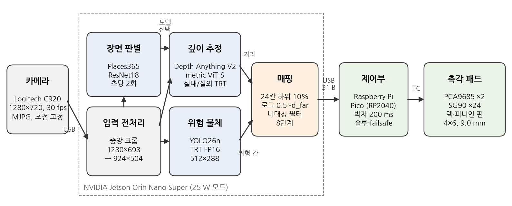
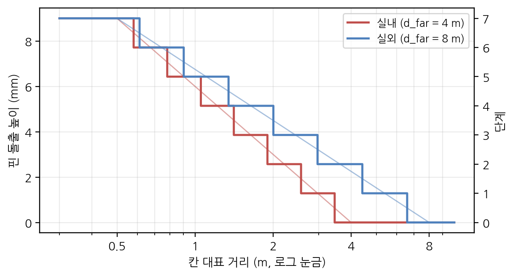
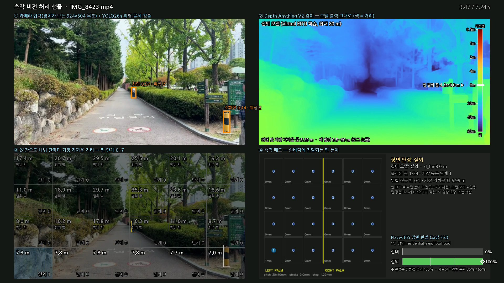
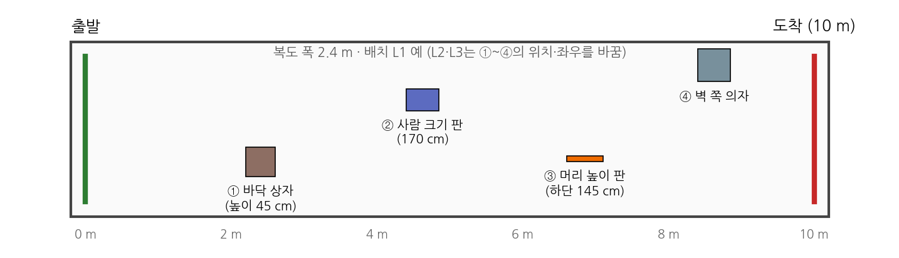
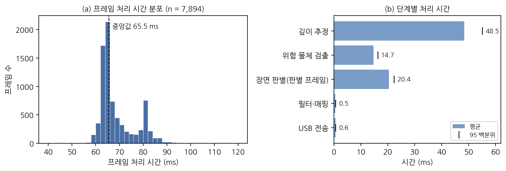
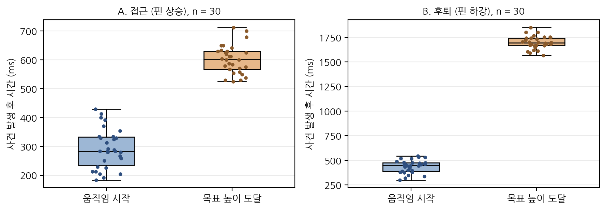
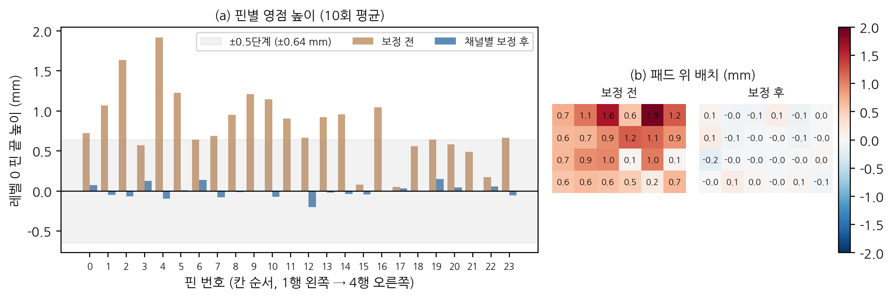
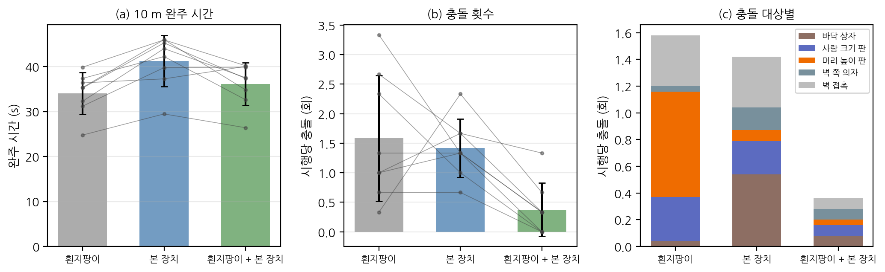

> 작성 메모 (제출 전 이 상자와 본문의 〔예시〕 표시를 모두 지울 것)
>
> 1. 4.2~4.4절 실험 1~3(반응 시간, 핀 영점 편차, 실내 보행)의 수치는 실험 전에 넣은 예시값이며 〔예시〕로 표시하였다. 실험 후 thesis/analysis/data/의 CSV를 실측값으로 바꾸고 analyze.py를 다시 실행하면 표와 그림 값이 바뀐다. 본문 문장의 수치도 함께 고칠 것.
> 2. 실측값: 4.1절 소프트웨어 처리 시간(2026-10-05 실기 기록 7,894프레임), 4.5절 녹화 영상 14편, 2장의 설계값과 시험 결과, Jetson 전력 14.5 W.
> 3. 실험 3은 사람이 참여하므로 시작 전에 을지대학교 기관생명윤리위원회(IRB) 심의를 받아야 한다. 3.4.1절의 참여자 정보와 승인번호를 실제 값으로 채울 것.
> 4. 제출 연월과 인준지는 학과 양식에 맞출 것.

학사학위논문

  

# 단안 절대 깊이 추정과 실내·실외 모델 전환을 이용한 24점 핀 배열 촉각 보행 보조 장치의 설계 및 평가

**Design and Evaluation of a 24-Pin Tactile Walking Aid Using Monocular Metric Depth Estimation with Indoor–Outdoor Model Switching**

   

을지대학교 의료공학과

2021148015 오형준

 

지도교수 하지현

  

2026년 　월

---

## 인준지

이 논문을 오형준의 공학사 학위논문으로 인준함

 

2026년 　월

 

지도교수 　하 지 현 　(인)

 

을지대학교 의료공학과

---

## 국문 요약

시각장애인이 혼자 걸을 때 가장 어려운 일은 앞쪽 공간 가운데 어디가 막혀 있고 어디가 비어 있는지를 미리 아는 것이다. 흰지팡이는 몸 앞 약 1 m 안의 바닥만 알려 주고, 음성 안내 기기는 주변 소리를 듣는 데 써야 할 청각을 차지한다. 본 연구에서는 카메라 한 대의 영상에서 추정한 미터 단위 거리를 양 손바닥 아래 24개 핀의 높이로 바꾸어 주는 착용형 시각-촉각 감각 대체 장치를 설계하고 구현하였다.

장치는 NVIDIA Jetson Orin Nano에서 Depth Anything V2의 절대 깊이 모델로 거리를 추정하고, Places365 장면 분류 결과에 따라 실내 모델(Hypersim 학습)과 실외 모델(Virtual KITTI 2 학습)을 바꾸어 쓴다. 깊이맵은 가로 6 × 세로 4칸으로 나누어 칸마다 가까운 쪽 10번째 백분위 거리를 대표값으로 삼고, 0.5 m부터 실내 4 m·실외 8 m까지를 로그 눈금 8단계로 나누어 핀 높이(0~9.0 mm)에 대응시켰다. 사람이나 차량처럼 위험한 물체는 YOLO26n으로 따로 검출하여 해당 칸의 핀을 1~3°씩 떨게 하였다. 핀은 3D 프린팅 랙·피니언 기구와 SG90 서보 24개로 움직이며, Raspberry Pi Pico가 0.2초 박자로 최신 값을 적용하고 통신이 끊기면 모든 핀을 천천히 내린다.

실기에서 한 프레임 처리에는 평균 68.8 ms가 걸렸고 이 중 깊이 추정이 48.5 ms로 가장 컸으며, 화면 표시 없이 60초 동안 잰 처리율은 초당 15.3프레임이었다. 고속 촬영으로 잰 종단 반응 시간은 가까운 물체가 나타난 뒤 핀이 움직이기 시작할 때까지 평균 292 ms, 목표 높이에 이를 때까지 602 ms였다〔예시〕. 핀 24개의 영점 높이는 조립 직후 평균 0.81 mm, 핀 사이 표준편차 0.44 mm였고, 채널별 보정 후 각각 −0.01 mm, 0.08 mm로 줄었다〔예시〕. 눈을 가린 성인 8명이 장애물 4개가 놓인 10 m 복도를 걸은 실험에서 시행당 충돌은 흰지팡이만 쓸 때 1.58회, 흰지팡이와 본 장치를 함께 쓸 때 0.37회였고, 줄어든 충돌은 대부분 지팡이로 알 수 없는 머리 높이 장애물에서 나왔다〔예시〕. 완주 시간은 각각 34.1초와 36.1초로 큰 차이가 없었다〔예시〕. 녹화 보행 영상 14편에 같은 처리를 적용한 결과, 실외 모델은 화면상 1~2 m로 보이는 사람까지 4 m 넘게 추정하는 경향을 보였으며, 이는 모델 전환만으로는 핀 높이의 의미가 장면마다 같게 유지되지 않음을 보여 준다.

주제어: 감각 대체, 촉각 디스플레이, 단안 깊이 추정, 신경가소성, 시각장애, 보행 보조기기

---

## Abstract

The hardest part of independent walking for people with visual impairment is knowing in advance which parts of the space ahead are blocked and which are free. A white cane reports only the ground within about one meter, and speech-based aids occupy the hearing that users rely on to monitor their surroundings. This study designed and built a wearable visual-to-tactile sensory substitution device that converts metric distance, estimated from a single camera, into the heights of 24 pins under the user's palms.

Running on an NVIDIA Jetson Orin Nano, the device estimates distance with the metric versions of Depth Anything V2 and switches between an indoor model (trained on Hypersim) and an outdoor model (trained on Virtual KITTI 2) according to a Places365 scene classifier. The depth map is divided into 6 × 4 cells, each represented by its 10th-percentile distance, and distances from 0.5 m to 4 m indoors or 8 m outdoors are mapped on a logarithmic scale to eight pin heights (0–9.0 mm). Hazardous objects such as people and vehicles are detected separately with YOLO26n and signaled by a 1–3° vibration of the corresponding pins. The pins are driven by 24 SG90 servos through 3D-printed rack-and-pinion units; a Raspberry Pi Pico applies the latest values on a 0.2 s beat and lowers all pins slowly when communication is lost.

On the device, one frame took 68.8 ms on average, of which depth estimation accounted for 48.5 ms, and the throughput without the debug display was 15.3 frames/s over 60 s. High-speed video showed an end-to-end latency of 292 ms from the appearance of a near object to the onset of pin motion and 602 ms to the target height [example values]. The zero-level height of the 24 pins averaged 0.81 mm with an inter-pin standard deviation of 0.44 mm after assembly, reduced to −0.01 mm and 0.08 mm after per-channel calibration [example values]. In a 10 m corridor with four obstacles, eight blindfolded adults collided 1.58 times per trial with the cane alone and 0.37 times with the cane plus the device [example values], mostly through fewer collisions with a head-height obstacle, while completion time (34.1 s vs. 36.1 s) changed little [example values]. Applying the same pipeline to 14 recorded walking videos showed that the outdoor model tended to place people who appear 1–2 m away at more than 4 m, indicating that model switching alone does not keep the meaning of pin height consistent across scenes.

Keywords: sensory substitution, tactile display, monocular depth estimation, neuroplasticity, visual impairment, mobility aid

---

## 목차

제1장 서론  
　1.1 연구 배경  
　1.2 감각 대체와 TVSS  
　1.3 신경가소성  
　1.4 촉각 수용 기관  
　1.5 기존 보행 보조기기의 한계  
　1.6 연구 목적과 논문 구성  

제2장 시스템 설계  
　2.1 설계 요구사항  
　2.2 전체 구성  
　2.3 하드웨어  
　2.4 소프트웨어 처리 과정  
　2.5 안전 설계  
　2.6 구현 검증  

제3장 실험 방법  
　3.1 공통 조건  
　3.2 실험 1: 전체 동작 반응 시간  
　3.3 실험 2: 기구 핀 영점 편차  
　3.4 실험 3: 실내 보행 과제  
　3.5 통계 분석  

제4장 결과  
　4.1 소프트웨어 단계별 처리 시간  
　4.2 실험 1 결과  
　4.3 실험 2 결과  
　4.4 실험 3 결과  
　4.5 녹화 보행 영상 적용 결과  

제5장 고찰  
　5.1 반응 시간을 결정하는 요소  
　5.2 핀 영점 편차와 높이 단계  
　5.3 보행 결과의 해석  
　5.4 실외 모델의 거리 과대 추정  
　5.5 연구의 한계  

제6장 결론  

참고문헌  

부록 A. 주요 설정값  
부록 B. 구현 코드  

---

# 제1장 서론

## 1.1 연구 배경

세계보건기구(WHO)는 전 세계에서 적어도 22억 명이 가까운 곳이나 먼 곳을 보는 데 손상을 가지고 있으며, 그중 적어도 10억 명은 예방할 수 있었거나 아직 적절한 처치를 받지 못한 경우라고 보고하였다 [1]. 세계질병부담(GBD) 연구는 2020년 기준 실명 인구를 4,330만 명, 중등도 이상의 원거리 시각 손상 인구를 2억 9,500만 명으로 추정하였다 [2]. 인구가 늘고 고령화되면서 이 숫자는 계속 커지는 추세이다. 국내에서는 2023년 말 등록장애인이 약 264만 명으로 전체 인구의 5.1%였고, 이 가운데 시각장애가 9.4%를 차지하여 약 25만 명이 시각장애인으로 등록되어 있다 [3].

시각을 잃은 사람이 일상에서 가장 크게 제약을 느끼는 영역 중 하나가 혼자 걷는 일이다. 걷는 동안 필요한 정보는 단순히 앞에 무엇이 있느냐가 아니라, 어느 방향에, 어느 높이에, 얼마나 가까이 있느냐는 공간 배치에 관한 정보이다. Manduchi와 Kurniawan은 시각장애인 300여 명을 면담 조사하여 머리 높이의 장애물과 부딪히는 사고와 넘어지는 사고가 흔하게 일어나며, 흰지팡이나 안내견을 쓰는 사람도 이런 사고에서 자유롭지 않다고 보고하였다 [4]. 지팡이는 바닥 근처를 훑기 때문에 허리 위로 튀어나온 간판, 나뭇가지, 트럭 적재함 같은 물체는 몸에 닿기 전까지 알기 어렵다.

이 문제를 다른 감각으로 풀어 보려는 시도가 감각 대체(sensory substitution)이다. 본 연구는 그중에서도 촉각을 이용하여, 카메라로 본 앞쪽 공간의 거리 분포를 손바닥 위의 핀 높이로 옮기는 장치를 다룬다.

## 1.2 감각 대체와 TVSS

감각 대체 연구의 출발점은 Paul Bach-y-Rita의 촉각-시각 감각 대체 장치(tactile-visual sensory substitution, TVSS)이다. Bach-y-Rita는 1967년에 뇌가 한 감각의 정보를 다른 감각 통로로 받아들일 수 있다는 감각 가소성의 관점을 제시하였고 [5], 1969년 Nature에 그 첫 실험 결과를 보고하였다 [6]. 이 장치는 텔레비전 카메라의 영상을 치과 의자 등받이에 20 × 20으로 배열한 400개의 진동 자극기로 옮겨, 사람의 등에 영상의 밝고 어두운 패턴을 눌러 주는 방식이었다. 선천성 시각장애인 피험자들은 훈련을 거친 뒤 등에 전해지는 자극만으로 전화기, 컵 같은 일상 물체를 구별하고 물체들의 앞뒤 배치와 원근을 말할 수 있었다.

이어진 연구에서 White 등은 피험자가 카메라를 손으로 직접 움직여 볼 수 있을 때 자극을 피부 위의 느낌이 아니라 바깥 공간에 놓인 물체로 느끼게 된다고 보고하였다 [7]. 자극이 주어지는 피부의 위치와 상관없이 지각이 바깥 세계로 옮겨 간다는 이 관찰은, 감각 대체가 단순히 피부로 그림을 읽는 일이 아니라 새로운 방식으로 공간을 보는 일이 될 수 있음을 보여 주었다. Bach-y-Rita는 이러한 결과를 정리하면서 우리가 보는 것은 눈이 아니라 뇌라고 표현하였다 [8].

TVSS의 생각은 이후 여러 형태로 이어졌다. 자극 부위를 감각이 예민하고 전기 전도가 좋은 혀로 옮긴 BrainPort는 20 × 20 전극으로 영상을 전달하며, 2015년 미국 식품의약국(FDA)에서 흰지팡이나 안내견을 보조하는 기기로 판매 허가를 받았다 [9]. 다기관 임상 연구에서 전맹에 가까운 사용자들은 BrainPort를 쓸 때 물체 인식과 이동 과제를 더 잘 수행하였고, 훈련 후 1년 동안 그 성적이 유지되거나 나아졌다 [10]. 청각을 쓰는 방식으로는 영상을 왼쪽에서 오른쪽으로 훑으며 높이를 음높이로, 밝기를 소리 크기로 바꾸는 vOICe가 있다 [11]. 손가락 끝에 진동 핀 배열로 인쇄 글자를 전한 Optacon은 핀 배열로 모양을 직접 제시하는 촉각 장치의 초기 사례이다 [12].

## 1.3 신경가소성

감각 대체가 가능한 생물학적 근거는 신경가소성, 그중에서도 감각 양식 사이의 가소성(cross-modal plasticity)이다. 대뇌 피질의 감각 영역은 태어날 때 정해진 대로만 일하지 않고, 실제로 들어오는 입력에 맞추어 기능을 바꾼다.

Sadato 등은 양전자 방출 단층촬영으로 시각장애인이 점자를 읽을 때 일차 시각 피질이 활성화되고, 정상 시력 대조군에서는 오히려 활동이 줄어드는 것을 보였다 [13]. Cohen 등은 같은 영역에 경두개 자기자극을 주면 조기 시각장애인의 점자 읽기 정확도가 떨어지는 것을 확인하여, 시각 피질의 이 활동이 실제로 촉각 과제에 쓰이고 있음을 보였다 [14]. 감각 대체 장치와 직접 관련된 결과로는 Ptito 등의 연구가 있다. 선천성 시각장애인에게 혀 전기 자극 장치로 방향 구별을 일주일 동안 훈련시키자 훈련 뒤에는 혀 자극만으로 후두엽 시각 피질이 활성화되었으나, 같은 훈련을 받은 눈가림 정상인에게서는 이런 변화가 나타나지 않았다 [15]. 이 결과는 감각 양식 사이의 재조직이 짧은 훈련으로도 빠르게 일어날 수 있음을 보여 준다. Merabet과 Pascual-Leone은 이러한 연구들을 정리하면서, 감각을 잃은 뒤 일어나는 뇌의 재조직이 재활과 보조기기 설계에 활용할 수 있는 기회라고 보았다 [16].

이 관점은 장치를 설계할 때 몇 가지 원칙을 준다. 첫째, 바깥 공간과 자극 위치의 대응이 단순해야 한다. 왼쪽에 있는 물체는 왼쪽 핀에, 위쪽 물체는 위쪽 핀에 나타나야 학습 부담이 줄어든다. 둘째, 같은 상황은 늘 같은 자극을 만들어야 한다. 똑같은 거리에 있는 물체가 주변 장면에 따라 다른 높이로 표시되면 뇌가 일관된 규칙을 배울 수 없다. 셋째, 사용자가 몸을 움직여 능동적으로 탐색할 수 있어야 하고, 자극이 그 움직임을 늦지 않게 따라와야 한다. 본 연구의 설계 결정 가운데 상당수는 이 세 원칙에서 나왔다.

## 1.4 촉각 수용 기관

피부에는 압력과 진동에 반응하는 네 종류의 기계 수용기가 있다. Johansson과 Vallbo는 사람 손바닥 쪽 피부의 신경 단위 334개를 기록하여 이들을 순응 속도와 수용장 크기에 따라 RA, PC, SA I, SA II의 네 종류로 나누고, 손바닥에서 손가락 끝으로 갈수록 RA와 SA I 단위의 밀도가 크게 높아진다는 것을 보였다 [17]. 표 1-1은 각 수용기의 성질과 본 장치와의 관계를 정리한 것이다 [17, 18].

표 1-1. 피부 기계 수용기와 본 장치의 관계

| 수용기 (신경 단위) | 순응 | 주로 느끼는 자극 | 본 장치와의 관계 |
|---|---|---|---|
| 메르켈 원반 (SA I) | 느림 | 지속적인 눌림, 모서리, 형태 | 핀의 정적인 돌출 높이를 읽는 주된 통로 |
| 마이스너 소체 (RA) | 빠름 | 낮은 주파수 진동, 미끄러짐 | 핀이 움직이는 순간과 위험 진동(10 Hz)을 감지 |
| 파치니 소체 (PC) | 빠름 | 높은 주파수 진동(약 250 Hz 부근) | 서보 기어의 떨림이 잡음으로 전해지는 경로 |
| 루피니 종말 (SA II) | 느림 | 피부가 늘어나는 것 | 손바닥 위치 감각에 부차적으로 관여 |

본 장치는 핀의 높이라는 정적인 변위로 거리를 전하므로 주로 SA I 수용기를 쓴다. 진동만으로 정보를 전하는 장치는 계속 자극하면 순응 때문에 감각이 흐려지기 쉽지만, 핀이 일정한 높이로 눌려 있는 자극은 상대적으로 오래 유지되고, 사용자가 손을 다시 대어 확인할 수도 있다.

공간 분해능은 부위에 따라 크게 다르다. 손가락 끝은 격자의 방향을 구별하는 과제에서 약 0.94 mm 폭의 홈까지 구별한다 [19]. 손바닥은 이보다 거칠어서, 두 점을 두 점으로 느끼는 최소 간격이 1 cm 안팎으로 보고된다 [20]. 본 장치의 핀 간격은 가로 30 mm, 세로 40 mm로 손바닥 분해능보다 훨씬 넓기 때문에, 어느 핀이 올라왔는지를 구별하는 데에는 피부보다 핀 개수가 먼저 제약이 된다. 반면 핀 높이의 차이를 손바닥이 얼마나 잘 구별하는지는 잘 알려져 있지 않다. 본 연구는 설계 단계에서 손바닥이 2.5 mm 정도의 높이 차를 구별한다고 가정하였으며, 이 가정은 5.2절에서 다시 논의한다.

손바닥을 고른 이유는 두 가지이다. 손가락 끝보다 넓어서 6 × 4 배열을 양손에 3열씩 나누어 얹을 수 있고, 걷는 동안 손을 패드 위에 올려 둔 채로 있을 수 있다. 손가락 끝은 분해능은 높지만 한 번에 덮는 면적이 작아 전체 배열을 동시에 읽으려면 손을 옮겨 다녀야 한다.

## 1.5 기존 보행 보조기기의 한계

시각장애인이 실제로 쓰는 보행 보조 수단과 그동안 제안된 전자 기기들은 각각 분명한 장점이 있지만, 앞쪽 공간 전체의 배치를 실시간으로 알려 주는 일에서는 한계가 있다. 표 1-2에 그 특징을 정리하였다.

표 1-2. 보행 보조 수단의 비교

| 수단 | 알 수 있는 범위 | 장점 | 한계 |
|---|---|---|---|
| 흰지팡이 | 몸 앞 약 1 m, 바닥에서 허리 아래 | 지연 없음, 신뢰성 높음, 값쌈 | 머리·가슴 높이 장애물과 먼 곳의 상황을 알 수 없음 [4] |
| 안내견 | 개가 판단하는 범위 | 높은 수준의 판단을 맡길 수 있음 | 공급이 적고 훈련·유지 비용이 큼, 개를 돌보는 부담 |
| 초음파 거리 기기 | 한 방향, 0.5~8 m 중 선택 | 작고 가벼움 | 한 번에 한 방향만 앎, 4 m 넘으면 큰 물체만 감지 [21] |
| 음성 안내 기기 | 카메라 화면 | 물체의 이름까지 알려 줌 | 정보가 순서대로 나와 느림, 청각을 차지함 |
| 진동 벨트·조끼 | 몇 개 방향 | 가볍고 값쌈 | 해상도가 낮고 인접 진동이 섞임 [22] |
| TVSS·BrainPort | 카메라 화면 | 2차원 영상을 전달 | 비싸고 훈련이 오래 걸림, 혀 장치는 말하거나 먹을 때 쓸 수 없음 [9, 10] |

흰지팡이는 가장 널리 쓰이고 믿을 만한 도구이지만 닿는 범위가 정해져 있다. 전자 보행 보조기기(electronic travel aid)는 이 범위를 넓히려는 목적으로 개발되어 왔다. 초기 기기는 초음파 센서 하나로 한 방향의 거리를 재어 소리나 진동으로 알렸다. 대표적인 상용 기기인 Miniguide는 탐지 범위를 0.5 m에서 8 m까지 단계별로 고르게 되어 있으나 4 m를 넘으면 벽 같은 큰 물체만 감지되며, 제조사도 흰지팡이나 안내견을 대신하지 않는 보조 도구로만 쓰도록 안내한다 [21]. 이후 깊이 카메라와 소형 컴퓨터가 보급되면서 여러 방향의 거리를 진동이나 소리로 알려 주는 장치들이 다수 제안되었으나, 조사 연구들은 이들이 사용자 평가와 일상 사용으로 이어진 경우가 드물다고 지적한다 [23, 24]. 시간 비행(time-of-flight) 센서 배열과 진동 벨트를 결합한 Katzschmann 등의 장치처럼 실제 보행에서 효과를 보인 연구도 있으나, 이런 장치는 몇 개의 방향만 구분하는 저해상도 진동에 머문다 [22].

정보를 전달하는 통로에도 문제가 있다. 음성 안내는 물체의 이름처럼 의미가 분명한 정보를 줄 수 있지만 한 번에 하나씩 말해야 하므로 공간 전체를 동시에 전할 수 없다. 무엇보다 시각장애인은 다가오는 차 소리, 발소리, 소리의 울림으로 주변을 파악하므로, 귀를 가리는 장치는 그 자체로 위험할 수 있다. 진동은 귀를 쓰지 않는다는 장점이 있지만, 가까운 정도를 진동의 세기나 주기로만 나타내야 하고, 진동자가 가까이 붙어 있으면 자극이 섞여 위치를 구별하기 어렵다.

핀의 높이로 모양을 보여 주는 형상 제시형 촉각 디스플레이는 정적인 높이로 거리를 나타낼 수 있어 이런 문제가 적다. 그러나 핀 하나하나에 구동기가 필요하기 때문에 고해상도 장치는 크고 비싸며, 촘촘한 피치를 얻으려면 압전 소자 같은 특수 구동기가 필요하다 [25]. 정리하면, 기존 수단들은 (1) 탐지 범위가 바닥이나 한 방향에 한정되거나, (2) 청각을 차지하거나, (3) 해상도와 비용 가운데 하나를 크게 희생하였다. 거리를 얻는 방법도 문제였다. 깊이 카메라는 값이 비싸고 햇빛 아래에서 적외선 방식의 성능이 떨어지며, 일반 카메라 한 대로 추정하는 깊이는 최근까지 상대적인 순서만 알려 줄 뿐 몇 미터인지를 알려 주지 못했다.

## 1.6 연구 목적과 논문 구성

본 연구의 목적은 일반 카메라 한 대와 쉽게 구할 수 있는 부품만으로, 앞쪽 공간의 방향별 거리를 양 손바닥 아래 24개 핀의 높이로 실시간 전달하는 착용형 보행 보조 장치를 만들고, 그 성능을 기계적 측면과 사용 측면에서 평가하는 것이다. 최근 공개된 단안 절대 깊이 모델은 카메라 한 대의 영상에서 미터 단위의 거리를 직접 출력하므로, 같은 거리의 물체를 늘 같은 높이로 표시할 수 있는 바탕이 된다. 해상도가 24칸이므로 물체가 무엇인지를 알려 주는 것은 목표로 삼지 않고, 어느 방향이 얼마나 가까이 막혀 있는지와 어디가 비어 있는지를 전하는 것으로 범위를 정하였다.

구체적인 목표는 다음과 같다. 첫째, 깊이 추정, 실내·실외 판별, 위험 물체 검출, 거리-높이 변환, 핀 구동을 하나의 착용형 장치로 구현한다. 둘째, 물체가 나타나거나 사라진 뒤 핀이 반응하기까지 걸리는 전체 시간을 측정하고, 그 시간을 이루는 요소를 나누어 본다. 셋째, 3D 프린팅으로 만든 24개 핀 기구의 영점 높이가 얼마나 고르지 않은지와 채널별 보정의 효과를 측정한다. 넷째, 눈을 가린 참여자가 실내 복도를 걸을 때 흰지팡이만 쓰는 경우와 비교하여 이동 시간과 충돌 횟수가 어떻게 달라지는지 확인한다.

논문의 구성은 다음과 같다. 제2장에서는 장치의 하드웨어와 소프트웨어 처리 과정을 설명하고, 제3장에서는 세 가지 실험의 방법을, 제4장에서는 결과를 제시한다. 제5장에서는 결과의 의미와 연구의 한계를 논의하고, 제6장에서 결론을 맺는다.

# 제2장 시스템 설계

## 2.1 설계 요구사항

1.3절의 원칙과 보행 상황을 바탕으로 표 2-1의 요구사항을 정하였다. 보통 사람이 걷는 속도를 약 1.2 m/s로 보면, 4 m 앞의 장애물은 부딪히기 약 3초 전에, 8 m 앞의 장애물은 약 6초 전에 알 수 있다. 장치가 반응하는 데 1초가 걸린다면 그동안 1.2 m를 더 걷게 되므로, 실내에서 4 m까지를 표시하려면 반응 시간이 1초보다 충분히 짧아야 한다.

표 2-1. 설계 요구사항

| 번호 | 항목 | 요구사항 | 근거 |
|---|---|---|---|
| R1 | 표시 거리 | 0.5 m부터 실내 4 m, 실외 8 m까지 | 걷는 속도로 3~6초 앞, 실외는 공간이 넓음 |
| R2 | 방향 해상도 | 가로 6 × 세로 4 = 24칸 | 양손에 3열씩, 위아래 4단 |
| R3 | 반응 시간 | 물체가 나타난 뒤 핀이 0.5초 안에 움직이기 시작하고 1초 안에 목표 높이에 도달 | 1초에 약 1.2 m 이동 |
| R4 | 높이 단계 | 8단계, 0~9.0 mm | 2.3.2절 기구 범위 |
| R5 | 안전 | 통신이 끊기면 0.5초 안에 알아채고 핀을 천천히 내림, 설정 범위 밖으로 구동하지 않음 | 손바닥 보호, 기구 보호 |
| R6 | 청각 | 소리를 쓰지 않음 | 주변 소리 듣기를 방해하지 않음 |
| R7 | 부품 | 범용 부품만 사용, 별도의 깊이 센서 없음 | 비용과 재현성 |

## 2.2 전체 구성

그림 2-1은 장치의 전체 구성이다. 카메라 영상은 USB로 NVIDIA Jetson Orin Nano에 들어가고, Jetson은 장면 판별, 깊이 추정, 위험 물체 검출, 거리-높이 변환을 거쳐 24칸의 단계와 위험도를 만든다. 이 결과는 31바이트 크기의 패킷으로 USB를 통해 Raspberry Pi Pico로 보내지고, Pico는 I²C로 연결된 PWM 드라이버 두 개를 통해 서보 24개를 움직인다. 서보마다 랙·피니언 기구가 달려 있어 서보의 회전이 핀의 위아래 움직임으로 바뀐다.

그림 2-1. 시스템 구성도

계산을 Jetson과 Pico로 나눈 이유는 두 장치가 잘하는 일이 다르기 때문이다. 딥러닝 모델 세 개를 돌리는 일은 GPU가 있는 Jetson이 맡고, 서보를 일정한 주기로 부드럽게 움직이며 통신이 끊겼는지 감시하는 일은 운영체제의 일정에 흔들리지 않는 마이크로컨트롤러가 맡는다. Jetson의 처리 속도는 장면에 따라 조금씩 달라지지만, 핀은 Pico가 정한 일정한 박자에 맞추어 움직인다.

## 2.3 하드웨어

### 2.3.1 연산부와 카메라

연산부는 NVIDIA Jetson Orin Nano Super 개발자 키트(메모리 8 GB)이며, 전력 모드는 25 W로 두었다. 운영체제는 L4T R39, 추론 엔진은 TensorRT 10.16을 사용하였다 [26].

카메라는 Logitech C920을 사용하였다. 1280 × 720 해상도, MJPG 형식, 초당 30프레임으로 받고, 대각 화각은 제조사 사양으로 78°이다 [27]. 이 카메라는 연결할 때마다 자동 초점이 켜지는데, 걷는 동안 초점이 앞뒤로 움직이면 같은 장면에서도 영상의 선명도가 달라져 깊이 추정이 흔들릴 수 있다. 그래서 장치 프로그램이 카메라를 열 때마다 자동 초점을 끄고 초점 값을 0(무한대 쪽)으로 고정하도록 하였다. 방 안 장면에서 선명도를 비교했을 때 초점 0이 자동 초점과 같은 수준으로 가장 선명하였다.

카메라는 촉각 패드 앞면, 배꼽 높이(약 1.0 m)에 수평으로 붙인다. 이렇게 하면 시점이 머리가 아니라 몸통의 방향을 따르므로, 사용자는 고개 대신 몸을 돌려 주변을 살피게 된다. 장치 입력으로 쓰는 영상의 세로 화각은 약 42°이므로 화면 아래쪽 끝은 수평에서 약 21° 아래를 향한다. 따라서 높이 1.0 m에서 바닥은 약 2.6 m보다 먼 곳만 화면에 들어오고, 높이 45 cm인 상자의 윗면은 약 1.4 m 안으로 들어오면 화면 아래로 사라진다. 이 사각지대는 본 장치가 흰지팡이를 대신하지 않고 보완하는 도구로 설계된 이유 중 하나이다.

### 2.3.2 촉각 패드

촉각 패드는 4행 6열, 모두 24개의 핀 단위로 이루어진다. 핀 사이 간격은 가로 30 mm, 세로 40 mm이고 배열 전체는 150 × 120 mm이다. 왼쪽 3열은 왼손 손바닥이, 오른쪽 3열은 오른손 손바닥이 맡으며, 칸의 위치는 카메라 화면의 위치와 그대로 대응한다. 화면 왼쪽 위 칸의 거리가 왼손 손바닥 위쪽 핀의 높이가 된다.

핀 단위 하나는 SG90 서보, 12잇수 피니언(모듈 1.3333, 피치원 지름 16.00 mm), 길이 55.86 mm의 랙으로 이루어져 있으며 모두 3D 프린팅으로 만들었다. 피치원 지름이 16 mm이므로 서보가 1° 돌면 핀은 0.1396 mm 움직인다. 서보는 50 Hz PWM으로 제어하며, PCA9685의 12비트 분해능에서 1 tick은 4.88 µs이다 [28]. SG90의 명목 사양(500~2400 µs에서 0~180°)을 따르면 1°는 약 2.16 tick이고, 1 tick은 핀 높이로 약 0.065 mm에 해당한다.

핀의 구동 범위는 232~372 tick(60.0~124.7°, 64.8°)으로 정하였고, 이는 핀 높이 9.0 mm에 해당한다. 이 범위는 Pico의 속도 제한(5 ms마다 4 tick)으로 끝에서 끝까지 약 0.18초에 움직일 수 있는 크기로, 핀을 갱신하는 박자(0.2초) 안에 전체 이동이 끝나도록 고른 것이다. 조립 과정에서 서보가 반대 방향으로 끼워져 tick 값이 클수록 핀이 내려가게 되었으므로, 핀이 가장 낮은 위치(단계 0, 먼 곳)를 372 tick, 가장 높은 위치(단계 7, 가까운 곳)를 232 tick으로 두었다. 단계 k의 tick은 372 − 20k이고, 한 단계는 핀 높이 1.29 mm이다. 이렇게 방향을 소프트웨어의 보정 값으로 처리하면 기구를 다시 조립하지 않아도 되며, 채널마다 방향이 달라도 같은 방식으로 다룰 수 있다. 표 2-2에 패드의 주요 수치를 정리하였다.

표 2-2. 촉각 패드의 주요 수치

| 항목 | 값 |
|---|---|
| 배열 | 4행 × 6열 = 24핀 (양손 3열씩) |
| 핀 간격 | 가로 30 mm, 세로 40 mm (배열 150 × 120 mm) |
| 구동기 | SG90 서보 24개, PCA9685 PWM 드라이버 2개 (I²C 주소 0x40, 0x41) |
| 변환 기구 | 12잇수 피니언(피치원 16.00 mm) + 랙 55.86 mm, 0.1396 mm/° |
| 구동 범위 | 232~372 tick (60.0~124.7°), 핀 높이 0~9.0 mm |
| 단계 | 8단계, 단계당 20 tick = 1.29 mm |
| 분해능 | 1 tick ≈ 0.46° ≈ 0.065 mm |

### 2.3.3 제어부

제어부는 Raspberry Pi Pico(RP2040)이다 [29]. Jetson과는 USB로 연결되며, Pico는 USB CDC 장치로 보이므로 통신 속도는 USB Full Speed 대역을 따른다. PWM 드라이버 두 개는 Pico의 I²C1 버스(SDA GP10, SCL GP7)에 400 kHz로 연결하였다. 0x40 보드는 패드의 1~2행, 0x41 보드는 3~4행을 맡고, 각 보드 안에서는 왼쪽 위부터 세로 두 칸을 한 쌍으로 묶어 1·3행은 채널 0, 2, 4, 6, 8, 10에, 2·4행은 채널 1, 3, 5, 7, 9, 11에 연결하였다. 이렇게 하면 한쪽 손이 맡는 열(채널 0~5와 6~11)이 보드 안에서 나뉘어 배선이 짧아진다. 칸과 채널의 대응은 펌웨어의 표 한 곳에서만 정의하고, 컴파일할 때 보드마다 채널 0~11이 한 번씩만 쓰였는지 검사하도록 하였다.

### 2.3.4 전원

서보 전원은 3셀 리튬폴리머 배터리 두 개를 쓰며, 각 배터리가 강압 컨버터를 거쳐 PWM 드라이버 한 개(서보 12개)에 전원을 공급한다. 서보를 두 계통으로 나눈 것은 여러 서보가 동시에 움직일 때 생기는 큰 순간 전류를 나누기 위해서이다. Jetson은 USB-C PD 보조배터리(20,000 mAh, 한 포트 최대 45 W)에서 PD 트리거 케이블로 전원을 받고, Pico는 Jetson의 USB 포트에서 전원을 받는다. 카메라와 세 모델을 모두 돌리는 상태에서 Jetson 모듈의 입력 전력은 60초 동안 중앙값 14.5 W(최대 15.1 W)로 측정되었다(서보 제외). 보조배터리의 정격 에너지를 약 74 Wh로 보면 변환 손실을 고려해도 3시간 정도 쓸 수 있을 것으로 계산된다.

## 2.4 소프트웨어 처리 과정

Jetson 쪽 프로그램은 Python으로 작성하였고, 한 프레임은 다음 순서로 처리된다. 카메라 입력을 받아 크기를 맞추고, 초당 두 번 장면을 판별하여 쓸 깊이 모델을 고른 뒤, 깊이를 추정하여 24칸의 대표 거리를 구한다. 같은 영상에서 위험 물체를 검출하고, 거리를 핀 단계로 바꾼 다음 시간 필터를 거쳐 Pico로 보낸다. 구현 코드는 공개 저장소에 있다 [30].

### 2.4.1 입력 전처리

카메라 읽기는 별도의 스레드에서 하고, 가장 최근 프레임 하나만 남겨 둔다. 처리가 늦어졌을 때 오래된 프레임이 쌓여 지연이 커지는 것을 막기 위해서이다. 1280 × 720 영상은 가운데 1280 × 698 영역을 잘라 924 × 504로 줄인다. 924 × 504는 모델이 요구하는 14의 배수이면서 카메라 영상과 비율이 거의 같아, 버려지는 화각이 3% 정도에 그친다. 이 크기에서 24칸 하나는 154 × 126 화소가 된다.

### 2.4.2 장면 판별과 모델 전환

절대 깊이 모델은 실내용과 실외용이 따로 학습되어 있으므로 지금 어느 장면인지 판단해야 한다. 장면 판별에는 Places365 데이터셋 [31]으로 학습된 ResNet18 [32] 분류기를 썼다. Places365는 365개 장면 범주마다 실내와 실외 표시를 제공하며, 그중 161개가 실내, 204개가 실외이다 [33]. 프레임 전체를 224 × 224로 줄여 분류한 뒤, 실외 범주 204개의 확률을 모두 더한 값을 실외 확률 P로 쓴다.

분류는 초당 2회 실행하고, P는 시간 상수 1.0초의 지수 평활로 다듬는다. 평활된 확률이 0.65 이상인 상태가 1.5초 동안 이어지면 실외로, 0.35 이하인 상태가 1.5초 동안 이어지면 실내로 전환한다. 두 문턱 사이에서는 직전 판정을 유지한다. 문턱을 두 개 두고 머무는 시간을 요구한 것은, 확률이 문턱 근처에서 흔들릴 때 모델이 프레임마다 바뀌는 것을 막기 위해서이다. 장면에 따라 핀으로 표시하는 가장 먼 거리 d_far도 실내 4 m, 실외 8 m로 바꾸며, 갑자기 바뀌지 않도록 ln d_far를 0.7초에 걸쳐 직선으로 바꾼다. 실내 사진과 실외 사진을 번갈아 입력한 시험에서 판정이 확정되기까지 2.56~3.05초가 걸렸다. 평활된 확률이 0에서 0.65를 넘기까지 약 1.05초, 머무는 시간 1.5초, 판별 간격 0.5초를 더한 값과 맞는다.

### 2.4.3 절대 깊이 추정

깊이 추정에는 Depth Anything V2 [34]를 기반으로 절대 거리를 회귀하도록 미세 조정한 모델 두 개를 썼다 [35]. 실내 모델은 합성 실내 데이터셋 Hypersim [36], 실외 모델은 합성 주행 데이터셋 Virtual KITTI 2 [37]로 학습되었고, 둘 다 가장 작은 ViT-S 백본이다. 두 모델은 출력층의 0~1 값에 각각 20 m와 80 m를 곱하여 미터 단위의 거리를 낸다. 두 모델을 924 × 504 고정 입력의 TensorRT FP16 엔진으로 바꾸었고, 엔진 출력은 PyTorch 32비트 출력과 중앙값 비 0.997~1.002로 일치하였다. 엔진 하나의 추론 시간은 실내 48.1 ms, 실외 50.0 ms였다. 한 프레임에는 판정된 장면의 모델 하나만 돌린다.

### 2.4.4 칸 대표 거리와 핀 단계

깊이맵을 6 × 4칸으로 나누고, 칸마다 화소 거리의 하위 10번째 백분위 값을 대표 거리로 삼는다. 평균을 쓰면 칸 안의 가는 기둥이나 사람처럼 일부만 가까운 물체가 먼 배경에 묻혀 사라지고, 최솟값을 쓰면 화소 하나의 잡음에 핀이 흔들린다. 10번째 백분위는 칸 넓이의 10% 정도만 가까운 물체가 차지해도 그 거리를 반영한다.

대표 거리 d는 다음 식으로 0~1 사이의 근접도 p로 바꾼다.

　　p = ln(d_far / d) / ln(d_far / d_near),　d_near = 0.5 m,　d는 [d_near, d_far]로 제한

p에 7을 곱한 값을 가장 가까운 정수로 반올림하여 단계 0~7을 얻는다. 로그 눈금을 쓴 것은 가까운 곳의 차이를 더 잘게 나누기 위해서이다. 0.5 m와 1 m의 차이는 충돌을 피하는 데 결정적이지만 3 m와 3.5 m의 차이는 그만큼 급하지 않다. 그림 2-2와 표 2-3은 실내와 실외에서 거리와 핀 높이의 관계를 보인 것이다.

그림 2-2. 칸 대표 거리와 핀 높이의 관계 (가는 선은 반올림 전 연속 값)

표 2-3. 단계별 거리 구간

| 단계 | 핀 높이 | 실내 (d_far 4 m) | 실외 (d_far 8 m) |
|---|---|---|---|
| 7 | 9.0 mm | 0.50~0.58 m | 0.50~0.61 m |
| 6 | 7.7 mm | 0.58~0.78 m | 0.61~0.91 m |
| 5 | 6.4 mm | 0.78~1.05 m | 0.91~1.35 m |
| 4 | 5.1 mm | 1.05~1.41 m | 1.35~2.00 m |
| 3 | 3.9 mm | 1.41~1.90 m | 2.00~2.97 m |
| 2 | 2.6 mm | 1.90~2.56 m | 2.97~4.42 m |
| 1 | 1.3 mm | 2.56~3.45 m | 4.42~6.56 m |
| 0 | 0 mm | 3.45 m 이상 | 6.56 m 이상 |

### 2.4.5 시간 필터

깊이 추정 값은 프레임마다 조금씩 흔들리므로 그대로 핀에 보내면 핀이 계속 떨린다. 그렇다고 강하게 평활하면 다가오는 물체에 늦게 반응한다. 그래서 다가오는 경우와 멀어지는 경우를 다르게 다루었다. 대표 거리의 지수 평활 계수를 가까워질 때 0.65, 멀어질 때 0.25로 두어 접근은 빨리 따라가고 후퇴는 천천히 놓아 준다. 단계를 바꿀 때에도 올라갈 때는 0.15단계, 내려갈 때는 0.45단계의 여유를 두고, 올라가는 변화는 바로 반영하되 내려가는 변화는 3프레임 연속으로 확인된 뒤 한 단계씩만 반영한다. 위험한 쪽(가까워짐)의 오류는 빨리 알리고 안전한 쪽(멀어짐)의 변화는 확실할 때만 알리는 비대칭 설계이다. 이 필터를 실제 코드로 모의하면(실내, 초당 14.5프레임), 5 m에 있던 칸에 0.5 m의 물체가 갑자기 나타났을 때 단계는 2, 4, 6, 6, 7로 올라가 5프레임(약 0.34초) 만에 최고 단계에 이르고, 반대로 물체가 사라지면 단계 0까지 내려오는 데 21프레임(약 1.45초)이 걸린다.

### 2.4.6 위험 물체 검출과 진동

깊이만으로는 앞에 있는 것이 벽인지 사람인지 구별할 수 없다. 사람, 자전거, 자동차처럼 움직이거나 부딪혔을 때 위험한 물체를 따로 알리기 위해 YOLO26n [38] 검출기를 512 × 288 입력의 TensorRT FP16 엔진으로 돌린다. 신뢰도 0.40 이상인 검출 가운데, 자동차·버스·트럭·자전거·오토바이 등에는 위험도 3, 사람·의자·벤치·소화전 등에는 2, 신호등이나 화분 등에는 1을 준다. 검출 상자가 겹치는 칸에 위험도를 주되, 칸의 대표 거리가 4 m 이내인 경우만 알리고, 동시에 진동하는 칸은 가까운 순서로 6개까지로 제한한다. 멀리 있는 사람까지 모두 알리면 사용자가 금방 무감각해지고 서보 전류도 커지기 때문이다.

위험 칸의 핀은 원래 높이에서 위험도 1, 2, 3에 따라 1°, 2°, 3°(2, 4, 6 tick)만큼 아래로 비켜났다가 돌아오기를 반복한다. 비켜나는 시점은 0.2초 박자를 넷으로 나눈 구간 중 두 번째와 네 번째 구간이므로 진동은 초당 10회가 된다. 핀이 이미 가장 낮은 위치에 있으면 위로 비켜나고, 어떤 경우에도 보정 범위 밖으로는 나가지 않는다.

### 2.4.7 통신

Jetson과 Pico는 표 2-4의 프레임으로 통신한다. 핀 값을 담는 GRID 프레임은 칸마다 1바이트(아래 4비트 단계, 위 4비트 위험도)와 비상 정지 플래그 1바이트를 담아 모두 31바이트이다. 동기 바이트, 순번, 길이, CRC-8 검사값을 두어, 잡음으로 바이트가 깨지거나 빠져도 다음 프레임에서 다시 맞출 수 있고 빠진 프레임 수를 셀 수 있다. Jetson은 계산이 끝날 때마다(초당 약 15회) 결과를 보낸다.

표 2-4. 통신 프레임 형식

| 필드 | 크기 | 내용 |
|---|---|---|
| 동기 | 2 B | 0xAA 0x55 |
| 종류 | 1 B | GRID, RAW_TICK(보정용 직접 지령), HOME_ALL, SET_LIMIT(채널별 범위), PING, SET_CONFIG, KEEPALIVE |
| 순번 | 1 B | 0~255 반복, 유실 계산용 |
| 길이 | 1 B | 내용 바이트 수 |
| 내용 | 0~64 B | GRID: 24칸 × 1 B + 플래그 1 B |
| 검사값 | 1 B | CRC-8 (다항식 0x07), 종류부터 내용까지 |

### 2.4.8 Pico 펌웨어

펌웨어는 Arduino 환경(arduino-pico)으로 작성하였다. 동작 규칙은 하드웨어를 직접 다루지 않는 헤더 파일 하나에 모으고, 실제 장치와 PC 시험 프로그램이 이 파일을 함께 쓰게 하였다. 덕분에 서보가 없는 PC에서도 실제 펌웨어 코드를 가상 시간으로 돌려 동작을 시험할 수 있었다.

Pico는 받은 GRID 값을 바로 핀에 쓰지 않고 최신 값으로 보관만 해 두었다가, 0.2초 박자마다 그 순간의 최신 값 하나를 핀의 목표로 정한다. Jetson의 처리 시간은 프레임마다 다르지만 핀은 일정한 박자로 움직이고, 박자 사이에 들어온 오래된 값은 쌓이지 않고 버려진다. 서보 위치는 5 ms마다 갱신하며, 한 번에 최대 4 tick씩만 목표에 다가가도록 속도를 제한하였다. 이 속도는 초당 800 tick(약 370°/s, 핀 속도 약 52 mm/s)으로, 무부하 SG90의 명목 속도보다 조금 느리게 잡아 서보가 지령을 따라가지 못해 생기는 오차를 줄였다. 값이 바뀐 채널만 I²C로 쓰므로 통신 부담도 작다.

## 2.5 안전 설계

손바닥이 핀 위에 놓여 있으므로, 프로그램이 멈추거나 케이블이 빠졌을 때 핀이 갑자기 튀어 오르거나 올라간 채로 남는 일은 막아야 한다. 펌웨어는 유효한 프레임이 0.5초 동안 들어오지 않으면 통신이 끊긴 것으로 보고 모든 핀의 목표를 가장 낮은 위치로 바꾼다. 이때는 보통 속도가 아니라 10 ms마다 1 tick씩, 즉 초당 100 tick으로 천천히 내려 끝에서 끝까지 약 1.4초가 걸린다. Jetson 프로그램이 정상적으로 끝날 때 보내는 HOME_ALL 명령도 같은 방식으로 핀을 천천히 내린다. 비상 정지 플래그만은 기다리지 않고 바로 가장 낮은 위치로 보낸다. 내려오는 도중 새로운 값이 박자에 맞춰 들어오면 보통 속도로 돌아간다.

Pico가 켜질 때 서보에 처음 주는 위치도 이 장치의 가장 낮은 위치(372 tick)로 정하여, Jetson이 연결되기 전에 전원이 들어와도 핀이 범위 밖으로 움직이지 않게 하였다. 처음 켤 때는 채널마다 25 ms씩 간격을 두고 위치를 써서 24개 서보가 한꺼번에 움직이며 생기는 순간 전류를 줄였다. 모든 지령은 SG90의 절대 한계(82~533 tick, 400~2600 µs)와 채널별 보정 범위 안으로 잘라서 쓴다. 다만 Pico의 전원 자체가 끊기면 PWM 신호가 사라져 서보가 힘을 잃으므로, 이 경우에는 소프트웨어로 핀을 내릴 수 없다.

## 2.6 구현 검증

구현이 설계대로 동작하는지 확인하기 위해 자동 시험 다섯 묶음, 모두 199개 항목을 만들었다. 거리-단계 변환과 필터(14개), 통신 프레임의 생성·검사·재동기(34개), 장면 판별기(26개), 실내·실외 전환과 d_far 보간(42개), Pico 펌웨어(83개)이며 모두 통과하였다. 펌웨어 시험은 실제 펌웨어 코드를 PC에서 컴파일하여, 박자에 맞춘 적용, 진동의 시점과 크기, 통신이 끊겼을 때 천천히 내려오는 시간(140 tick에 1,390 ms), 비상 정지, Python 쪽과 펌웨어 쪽의 단계-tick 계산이 같은지(150개 조합) 등을 확인한다.

실제 장치에서는 PWM 드라이버 두 개가 모두 I²C에 응답하는 것을 확인하였고, 24개 서보를 함께 천천히 오르내리게 하는 시험에서 연속 250,718회의 지령을 오류 없이 보냈다. 카메라부터 핀까지 전체를 연결한 실전 실행 두 번(모두 7,894프레임)에서도 전송 오류와 검사값 오류는 없었으며, 종료와 통신 끊김 때 Pico가 보낸 응답(HOMED, FAILSAFE)도 확인하였다. 그림 2-3은 녹화한 보행 영상을 같은 처리 과정에 넣어 각 단계의 결과를 한 화면에 모은 것이다.

그림 2-3. 처리 과정 화면 (녹화 영상 IMG_8423, 3.5초 시점). ① 장치 입력과 YOLO26n 검출, ② 깊이 추정 결과, ③ 24칸 대표 거리와 단계, ④ 촉각 패드와 Places365 실내·실외 확률

# 제3장 실험 방법

## 3.1 공통 조건

모든 실험은 2장의 장치를 그대로 사용하였다. 설정은 부록 A와 같고, 깊이 입력 924 × 504, 장면 판별 초당 2회, 핀 갱신 박자 0.2초, 8단계, 구동 범위 232~372 tick이다. Jetson은 25 W 전력 모드로 두었고, 측정 중에는 다른 프로그램을 띄우지 않았다. 실험 1과 실험 3은 조명이 일정한 실내에서 하였으며, 장면 판별은 계속 실내로 판정되었다.

이와 별도로, 소프트웨어 각 단계의 처리 시간은 장치가 프레임마다 남기는 기록 파일에서 구하였다. 이 기록에는 프레임마다 카메라 프레임을 받은 뒤 처리를 시작하기까지의 대기 시간, 장면 판별, 깊이 추정, 위험 물체 검출, 필터, 전송에 걸린 시간과 24칸의 거리·단계가 남는다.

## 3.2 실험 1: 전체 동작 반응 시간

실험 1은 앞에 물체가 나타나거나 사라진 순간부터 핀이 움직일 때까지의 전체 시간을 잰다. 소프트웨어 기록만으로는 카메라 내부의 지연과 서보의 기계적 지연을 알 수 없으므로, 사건과 핀을 한 화면에 담아 고속 촬영하였다.

장치를 책상 위에 고정하고, 카메라 정면 0.5 m 위치에 가로 40 cm, 세로 60 cm의 검은 판을 줄에 매달아 두었다. 판 뒤쪽 벽까지는 5 m 이상이어서, 판이 없으면 화면 가운데 칸들은 단계 0이다. 조건 A(접근)에서는 판을 위에서 떨어뜨려 화면 가운데를 가리게 하고, 조건 B(후퇴)에서는 판을 빠르게 끌어올려 치웠다. 판의 위치와 패드를 함께 비추도록 스마트폰을 초당 240프레임 슬로 모션으로 두고, 패드 옆에 눈금자를 세워 핀 높이를 읽었다. 측정 대상은 화면 가운데 칸 9의 핀이다.

시간의 기준(0 ms)은 판이 칸 9에 해당하는 화면 영역을 다 덮은 프레임(A) 또는 다 벗어난 프레임(B)으로 하였다. 반응 시작 시간은 핀이 원래 높이에서 0.2 mm 이상 움직인 첫 프레임까지, 도달 시간은 핀이 최종 높이의 ±0.2 mm 안에 들어와 그 뒤로 벗어나지 않는 첫 프레임까지의 시간이다. 조건마다 30회씩 반복하였고, 시행 사이에는 장치가 안정될 수 있도록 5초 이상 기다렸다. 촬영 프레임 간격이 4.2 ms이므로 시간 측정의 분해능도 4.2 ms이다.

## 3.3 실험 2: 기구 핀 영점 편차

실험 2는 같은 지령을 주었을 때 24개 핀의 높이가 얼마나 다른지를 잰다. 랙, 피니언, 서보 혼이 모두 3D 프린팅 부품이고 손으로 조립하므로, 피니언이 랙에 물리는 위치가 한 잇수만 어긋나도 핀 높이는 달라진다.

모든 핀에 단계 0(372 tick)을 지령하고, 패드 윗면을 기준으로 핀 끝의 높이를 디지털 깊이 게이지(분해능 0.01 mm)로 쟀다. 패드 윗면보다 튀어나오면 양수이다. 이어서 단계 7(232 tick)의 높이를 재고, 다시 단계 0으로 돌아오게 하는 과정을 10회 반복하였다. 매번 핀을 단계 7까지 올렸다가 내려 같은 방향에서 영점에 접근하게 하였다. 핀마다 10회 측정의 평균을 그 핀의 영점 높이로, 10회 측정의 표준편차를 반복 편차로 보았다. 단계 7과 단계 0의 높이 차이는 실제 스트로크이다.

같은 측정을 채널별 보정 전과 후에 한 번씩 하였다. 보정은 보정 도구(tools/calibrate_pins.py)로 핀마다 영점 높이가 0 mm가 되도록 단계 0의 tick 값을 옮겨 저장하는 방식이며, 단계 7의 tick은 영점과 같은 양만큼 함께 옮겨 스트로크가 유지되게 하였다. 보정 전후의 영점 높이 절댓값은 윌콕슨 부호순위 검정으로, 핀 사이 산포의 차이는 Levene 검정으로 비교하였다.

## 3.4 실험 3: 실내 보행 과제

### 3.4.1 참여자

시력이 정상(교정 포함)이고 보행이나 균형에 문제가 없는 성인 8명(남 5명, 여 3명, 21~26세)이 참여하였다. 모두 흰지팡이와 감각 대체 장치를 써 본 적이 없었다. 실험 전 목적과 절차, 위험 요소를 설명하고 서면 동의를 받았으며, 본 실험은 을지대학교 기관생명윤리위원회의 승인(승인번호 〔　　　〕)을 받아 수행하였다. 참여자는 수면 안대로 눈을 가렸고 귀는 막지 않았다. 실험자 한 명이 항상 1 m 뒤에서 따라가며 넘어지거나 크게 부딪힐 상황이면 바로 멈추게 하였다.

### 3.4.2 코스

복도에 폭 2.4 m, 길이 10 m의 코스를 만들고 그 안에 장애물 네 개를 두었다(그림 3-1). ① 높이 45 cm의 바닥 상자, ② 사람 크기의 세움판(높이 170 cm, 폭 45 cm), ③ 천장에 매달아 아랫면이 바닥에서 145 cm 높이에 있는 판(지팡이로는 닿지 않는 머리 높이 장애물), ④ 벽 쪽에 놓은 의자이다. 장애물의 위치와 좌우를 바꾼 세 가지 배치(L1~L3)를 만들어, 참여자가 경로를 외우지 못하게 하였다.

그림 3-1. 실내 보행 코스 (배치 L1)

### 3.4.3 조건과 절차

조건은 흰지팡이만 쓰는 경우(C), 본 장치만 쓰는 경우(D), 흰지팡이와 본 장치를 함께 쓰는 경우(C+D)의 세 가지이다. 실험에 앞서 참여자는 지팡이를 좌우로 짚는 이점 접촉법을 10분, 장치의 핀을 읽는 법을 20분 동안 연습하였다. 장치 연습은 눈을 뜬 상태에서 패드를 만지며 벽과 사람에 다가갔다 멀어지기를 반복하고, 이어서 눈을 가린 채 연습용 상자를 찾아가는 순서로 하였다.

조건마다 세 번씩, 모두 아홉 번 걸었다. 조건의 순서는 참여자마다 바꾸었고(라틴 방격), 같은 조건 안에서는 배치 L1~L3를 한 번씩 썼다. 참여자에게는 출발선에서 도착선까지 장애물에 부딪히지 않도록 평소처럼 걸으라고 하였다. 본 실험 전에 눈을 뜨고 같은 코스(장애물 없음)를 걷는 시간을 재어 평소 걷는 속도의 기준으로 삼았다.

### 3.4.4 측정 항목

완주 시간은 출발 신호부터 몸이 도착선을 넘을 때까지로, 실험자가 초시계로 재고 뒤에서 찍은 영상으로 확인하였다. 충돌은 몸이나 장치가 장애물에 닿은 경우와 벽에 몸이 닿은 경우를 모두 세었고, 지팡이 끝이 장애물에 닿는 것은 충돌로 세지 않았다. 충돌은 어떤 장애물에서 일어났는지도 함께 기록하였다. 상대 보행 속도는 평소 속도에 대한 각 시행 속도의 비율(%)이다.

## 3.5 통계 분석

결과는 평균과 표준편차로 나타내고, 필요한 경우 중앙값, 범위, 95번째 백분위를 함께 적었다. 실험 3은 참여자 수가 8명이므로 정규성을 가정하지 않는 방법을 썼다. 참여자별로 조건마다 세 번의 평균을 구하고, 세 조건의 차이는 프리드먼 검정으로, 사후 비교는 윌콕슨 부호순위 검정에 본페로니 보정(3회 비교)을 적용하였다. 유의수준은 0.05로 하였다. 분석에는 Python의 SciPy 1.11을 사용하였다.

# 제4장 결과

## 4.1 소프트웨어 단계별 처리 시간

카메라, Jetson, Pico, 서보를 모두 연결하고 실내에서 장치를 실행한 두 번의 기록(모두 7,894프레임)으로 소프트웨어 각 단계의 처리 시간을 구하였다(표 4-1, 그림 4-1). 한 프레임의 처리 시간은 평균 68.8 ms, 중앙값 65.5 ms, 95번째 백분위 82.4 ms였다. 가장 큰 부분은 깊이 추정(평균 48.5 ms)이었고, 위험 물체 검출이 14.7 ms로 뒤를 이었다. 장면 판별은 판별을 실행한 프레임에서만 평균 20.4 ms가 더해졌는데, 그림 4-1(a)의 두 번째 봉우리(약 81 ms)가 이 프레임들이다. 필터·매핑과 USB 전송은 합쳐서 1.1 ms로 무시할 만하였다.

표 4-1. 소프트웨어 단계별 처리 시간 (실기 기록 7,894프레임, ms)

| 단계 | 평균 | 표준편차 | 중앙값 | 95 백분위 | 최대 |
|---|---|---|---|---|---|
| 프레임 대기 (카메라 수신 → 처리 시작) | 34.8 | 15.5 | 32.5 | 70.1 | 87.3 |
| 깊이 추정 (실내 모델) | 48.5 | 3.5 | 48.2 | 55.2 | 78.5 |
| 위험 물체 검출 (YOLO26n) | 14.7 | 1.4 | 15.1 | 16.3 | 21.9 |
| 장면 판별 (실행한 프레임만) | 20.4 | 2.1 | 21.0 | 22.4 | 50.1 |
| 필터·매핑 | 0.5 | 0.1 | 0.5 | 0.7 | 3.1 |
| USB 전송 | 0.6 | 0.4 | 0.6 | 0.7 | 9.5 |
| 프레임 전체 | 68.8 | 7.3 | 65.5 | 82.4 | 114.4 |

그림 4-1. 소프트웨어 처리 시간. (a) 프레임 처리 시간 분포, (b) 단계별 평균과 95번째 백분위

이 기록은 확인용 화면을 띄운 상태에서 남긴 것이어서, 화면을 그리는 시간 때문에 실제 갱신 횟수는 처리 시간으로 계산한 값보다 적었다(장면 판별 횟수로 환산하면 초당 약 9.4프레임). 화면을 띄우지 않고 60초 동안 실행한 측정에서는 918프레임을 처리하여 초당 15.3프레임이었고, 이때 Jetson 모듈의 입력 전력은 중앙값 14.5 W였다. 프레임 처리 시간만 보면 장치는 초당 14~15회 거리를 갱신할 수 있으며, 이는 핀 갱신 박자(초당 5회)의 약 세 배이다.

## 4.2 실험 1 결과: 전체 동작 반응 시간

표 4-2와 그림 4-2는 고속 촬영으로 잰 반응 시간이다〔예시〕. 조건 A에서 판이 나타나면 칸 9의 핀은 단계 0에서 단계 7(9.0 mm)까지 올라갔다. 움직이기 시작하기까지 평균 292 ms(183~429 ms)가 걸렸고, 목표 높이에 도달하기까지 평균 602 ms(525~713 ms)가 걸렸다. 30회 모두 요구사항 R3(시작 0.5초, 도달 1초 이내)를 만족하였다.

표 4-2. 실험 1 반응 시간 (각 30회, ms)〔예시〕

| 조건 | 구분 | 평균 | 표준편차 | 중앙값 | 최소 | 최대 | 95 백분위 |
|---|---|---|---|---|---|---|---|
| A. 접근 (단계 0 → 7) | 움직임 시작 | 291.5 | 68.3 | 283.3 | 183.3 | 429.2 | 406.9 |
| | 목표 높이 도달 | 602.4 | 49.0 | 602.1 | 525.0 | 712.5 | 690.6 |
| B. 후퇴 (단계 7 → 0) | 움직임 시작 | 437.9 | 64.5 | 447.9 | 300.0 | 545.8 | 531.5 |
| | 목표 높이 도달 | 1697.5 | 65.0 | 1693.8 | 1566.7 | 1850.0 | 1800.0 |

그림 4-2. 실험 1 반응 시간 분포〔예시〕

조건 B에서는 판을 치운 뒤 핀이 움직이기 시작하기까지 평균 438 ms, 단계 0에 이르기까지 평균 1.70초가 걸려 조건 A보다 훨씬 느렸다. 핀은 한 번에 내려오지 않고 0.2~0.4초 간격으로 한 단계씩 내려왔다. 이는 2.4.5절의 필터가 멀어지는 변화를 3프레임 확인한 뒤 한 단계씩만 반영하도록 설계된 결과이다.

반응 시간의 표준편차(약 65 ms)는 대부분 Pico 박자를 기다리는 시간에서 왔다. 결과가 박자 직전에 도착하면 바로 적용되고 직후에 도착하면 거의 0.2초를 기다리므로, 이 대기 시간은 0~200 ms 사이에 고르게 퍼지며 표준편차는 약 58 ms가 된다. 표 4-3은 조건 A의 시간을 이루는 요소를 정리한 것이다.

표 4-3. 조건 A 반응 시간의 구성 요소

| 요소 | 시간 | 근거 |
|---|---|---|
| 카메라 노출 중심 → Jetson 수신 | 약 40 ms | 가정 (30 fps 한 프레임 이내) |
| 프레임 대기 | 평균 34.8 ms | 실측 (표 4-1) |
| 첫 프레임 처리 | 평균 68.8 ms | 실측 (표 4-1) |
| USB 전송 | 0.6 ms | 실측 (표 4-1) |
| Pico 박자 대기 | 0~200 ms, 평균 100 ms | 설계값 |
| 서보 지령 → 움직임 시작 | 약 30 ms | 가정 |
| 움직임 시작까지 합 | 약 274 ms | 측정 평균 292 ms〔예시〕 |
| 필터가 단계 7에 이를 때까지 추가 프레임 | 4프레임, 약 275 ms | 코드 모의 (2.4.5절) |
| 단계 0 → 7 이동 (140 tick, 4 tick/5 ms) | 175 ms | 펌웨어 설정 |

움직임이 시작된 뒤 목표 높이까지 걸린 약 310 ms는 서보의 이동 시간만으로는 설명되지 않는다. 첫 프레임에서 필터가 내는 단계는 2이고, 4, 6, 7로 올라가는 동안 Pico는 박자마다 그때의 단계를 목표로 정하므로, 핀은 두세 번에 걸쳐 올라간다. 즉 지연의 큰 부분은 깊이 추정 자체가 아니라 박자 대기와 시간 필터에서 나온다.

## 4.3 실험 2 결과: 기구 핀 영점 편차

표 4-4와 그림 4-3은 24개 핀의 영점 높이를 보정 전후로 비교한 것이다〔예시〕. 조립한 그대로의 상태에서 단계 0의 핀 끝은 패드 윗면보다 평균 0.81 mm 튀어나와 있었고, 핀 사이 표준편차는 0.44 mm, 가장 낮은 핀과 높은 핀의 차이는 1.87 mm였다. 핀 4(1.92 mm)와 핀 2(1.64 mm)는 영점이 핀 높이 한 단계(1.29 mm)보다 더 어긋나 있어, 보정하지 않으면 아무것도 없는 칸에서 단계 1의 물체가 있는 것처럼 느껴질 수 있는 수준이었다.

표 4-4. 단계 0에서의 핀 끝 높이 (핀 24개, 핀마다 10회 평균, mm)〔예시〕

| 항목 | 보정 전 | 채널별 보정 후 |
|---|---|---|
| 평균 | 0.81 | −0.01 |
| 핀 사이 표준편차 | 0.44 | 0.08 |
| 범위 (최소 ~ 최대) | 0.05 ~ 1.92 | −0.20 ~ 0.15 |
| 절대 편차 평균 | 0.81 | 0.06 |
| 한 단계(1.29 mm)를 넘는 핀 | 2개 | 0개 |
| 반복 편차 (핀 안 표준편차, 합동) | 0.078 | 0.073 |
| 반복 편차 최대 | 0.103 | 0.105 |
| 실제 스트로크 (단계 0 → 7) | 8.73 ± 0.33 (7.94 ~ 9.28) | 8.72 ± 0.33 (7.94 ~ 9.27) |

그림 4-3. 핀별 영점 높이. (a) 보정 전후 비교, (b) 패드 위 배치〔예시〕

채널별 보정 후 영점의 절대 편차는 평균 0.06 mm로 줄었고(윌콕슨 W = 0, p < 0.001), 핀 사이의 산포도 유의하게 작아졌다(Levene F = 18.56, p < 0.001). 보정 후 남은 편차의 범위(−0.20~0.15 mm)는 tick 하나(0.065 mm)의 세 배 정도로, 보정 단위보다는 기어의 틈과 서보의 불감대에서 온 것으로 보인다. 같은 핀을 열 번 잴 때의 반복 편차(약 0.08 mm)는 보정 전후가 거의 같았다. 이는 반복성은 서보와 기어에 달려 있고, 보정은 핀 사이의 고정된 차이만 없앤다는 뜻이다. 실제 스트로크는 평균 8.73 mm로 설계값 9.0 mm보다 0.27 mm 짧았으며, 핀 사이에서 7.94~9.28 mm로 달랐다. 영점만 맞추는 현재 보정으로는 이 스트로크 차이가 남는다.

## 4.4 실험 3 결과: 실내 보행 과제

참여자 8명의 결과를 표 4-5와 그림 4-4에 정리하였다〔예시〕. 눈을 뜨고 10 m를 걷는 데에는 평균 7.99초(1.25 m/s)가 걸렸다.

표 4-5. 조건별 완주 시간과 충돌 (참여자 8명, 참여자별 3회 평균)〔예시〕

| 항목 | 흰지팡이 (C) | 본 장치 (D) | 흰지팡이 + 본 장치 (C+D) |
|---|---|---|---|
| 완주 시간 (s) | 34.1 ± 4.6 | 41.2 ± 5.7 | 36.1 ± 4.8 |
| 상대 보행 속도 (%) | 23.9 ± 3.8 | 19.8 ± 3.6 | 22.5 ± 3.8 |
| 시행당 충돌 (회) | 1.58 ± 1.07 | 1.42 ± 0.50 | 0.37 ± 0.45 |
| 충돌 없는 시행 | 8 / 24 | 6 / 24 | 17 / 24 |

그림 4-4. 실험 3 결과. (a) 완주 시간, (b) 시행당 충돌, (c) 충돌 대상별 (가는 선은 참여자 한 명)〔예시〕

완주 시간은 조건에 따라 차이가 있었다(프리드먼 χ²(2) = 9.00, p = 0.011). 본 장치만 쓸 때(41.2초)는 흰지팡이만 쓸 때(34.1초)보다 유의하게 느렸으나(p = 0.023), 둘을 함께 쓸 때(36.1초)는 흰지팡이만 쓸 때와 차이가 없었다(p = 0.586). 충돌 횟수도 조건에 따라 달랐다(χ²(2) = 7.47, p = 0.024). 함께 쓸 때는 시행당 0.37회로, 장치만 쓸 때(1.42회)보다 유의하게 적었고(p = 0.023), 흰지팡이만 쓸 때(1.58회)보다 77% 적었지만 보정 후 유의하지는 않았다(p = 0.117). 흰지팡이와 장치를 각각 따로 쓸 때의 충돌 횟수는 비슷하였다(p = 1.000). 사후 비교의 p값은 모두 본페로니 보정한 값이다.

표 4-6. 장애물별 시행당 충돌 횟수〔예시〕

| 충돌 대상 | 흰지팡이 (C) | 본 장치 (D) | 흰지팡이 + 본 장치 (C+D) |
|---|---|---|---|
| ① 바닥 상자 (45 cm) | 0.04 | 0.54 | 0.08 |
| ② 사람 크기 판 | 0.33 | 0.25 | 0.08 |
| ③ 머리 높이 판 | 0.79 | 0.08 | 0.04 |
| ④ 벽 쪽 의자 | 0.04 | 0.17 | 0.08 |
| 벽 접촉 | 0.38 | 0.38 | 0.08 |
| 합계 | 1.58 | 1.42 | 0.37 |

충돌의 내용은 조건마다 뚜렷이 달랐다(표 4-6). 흰지팡이만 쓸 때 충돌의 절반은 지팡이가 닿지 않는 머리 높이 판(③)에서 일어났다. 본 장치만 쓸 때는 머리 높이 판 충돌이 0.08회로 거의 없었던 반면 바닥 상자(①) 충돌이 0.54회로 가장 많았다. 둘을 함께 쓸 때는 두 종류의 충돌이 모두 0.1회 미만이었다. 두 도구가 알려 주는 영역이 서로 겹치지 않고 보완적이라는 것을 보여 준다.

표 4-7. 시행 순서에 따른 평균 완주 시간 (s)〔예시〕

| 조건 | 1회째 | 2회째 | 3회째 |
|---|---|---|---|
| 흰지팡이 (C) | 36.7 | 33.3 | 32.2 |
| 본 장치 (D) | 44.1 | 40.0 | 39.6 |
| 흰지팡이 + 본 장치 (C+D) | 41.0 | 34.3 | 33.0 |

같은 조건 안에서 시행을 거듭할수록 완주 시간이 줄었다(표 4-7). 장치만 쓴 경우 1회째 44.1초에서 3회째 39.6초로 줄었고(윌콕슨 p = 0.039), 함께 쓴 경우에는 1회째 41.0초에서 3회째 33.0초로 줄어 흰지팡이만 쓴 3회째(32.2초)와 비슷해졌다. 30분 정도의 짧은 연습만 하였으므로, 연습을 늘리면 차이가 더 줄어들 가능성이 있다. 참여자별 결과는 표 4-8과 같다.

표 4-8. 참여자별 결과 (3회 평균)〔예시〕

| 참여자 | 평소 10 m (s) | 완주 C (s) | 완주 D (s) | 완주 C+D (s) | 충돌 C | 충돌 D | 충돌 C+D |
|---|---|---|---|---|---|---|---|
| P1 | 8.1 | 35.3 | 46.0 | 34.8 | 0.33 | 2.33 | 0.67 |
| P2 | 7.3 | 31.2 | 39.8 | 39.9 | 1.33 | 1.33 | 0.33 |
| P3 | 8.5 | 36.4 | 37.3 | 40.0 | 0.67 | 0.67 | 0.00 |
| P4 | 8.2 | 39.9 | 45.9 | 40.2 | 1.00 | 1.67 | 1.33 |
| P5 | 7.9 | 37.4 | 42.2 | 32.6 | 2.33 | 1.00 | 0.00 |
| P6 | 8.1 | 24.8 | 29.5 | 26.4 | 3.33 | 1.33 | 0.33 |
| P7 | 8.1 | 35.2 | 45.3 | 37.4 | 1.00 | 1.33 | 0.00 |
| P8 | 7.7 | 32.3 | 44.0 | 37.5 | 2.67 | 1.67 | 0.33 |

## 4.5 녹화 보행 영상 적용 결과

실험과 별도로, 스마트폰으로 찍은 실내·실외 보행 영상 14편(모두 13.8분)을 장치와 같은 처리 과정에 넣어 보았다. 영상은 초당 15프레임으로 뽑아 모두 12,393프레임을 처리하였고, 필터와 장면 전환은 영상 속 시간에 맞추어 동작하게 하였다. 세로로 찍은 9편은 장치 입력 비율(가로 924 × 504)에 맞추어 가운데 띠(원본 높이의 31%)만 사용하였다. 이 영상들에는 실제 거리를 잰 값이 없으므로, 결과는 처리 과정이 어떻게 반응하는지 관찰하는 데에만 사용하였다(표 4-9).

표 4-9. 녹화 영상 14편의 처리 결과

| 영상 | 길이 (s) | 방향 | 장소 | 실내 판정 비율 | 가장 가까운 칸 (m) | 최고 단계 |
|---|---|---|---|---|---|---|
| IMG_8423 | 7.2 | 가로 | 공원 산책로 | 0% | 4.23 | 1 |
| IMG_8422 | 14.7 | 세로 | 보도 | 0% | 2.35 | 3 |
| IMG_8432 | 16.5 | 세로 | 재래시장 골목 | 0% | 2.43 | 3 |
| IMG_8421 | 19.1 | 가로 | 보도 | 0% | 4.11 | 1 |
| IMG_8435 | 28.2 | 가로 | 보도 | 0% | 2.83 | 2 |
| IMG_8420 | 31.8 | 가로 | 보도 | 0% | 3.75 | 2 |
| IMG_8431 | 39.3 | 세로 | 재래시장(지붕 있음) | 83% | 0.35 | 7 |
| IMG_8424 | 41.8 | 세로 | 공원 산책로 | 0% | 4.80 | 1 |
| IMG_8438 | 44.7 | 가로 | 횡단보도 부근 | 0% | 2.57 | 3 |
| IMG_8427 | 60.4 | 세로 | 공원 | 0% | 2.85 | 2 |
| IMG_8429 | 68.2 | 세로 | 보도 | 0% | 2.69 | 2 |
| IMG_8430 | 87.1 | 세로 | 재래시장(지붕 있음) | 83% | 0.29 | 7 |
| IMG_8428 | 142.0 | 세로 | 광장 | 0% | 4.26 | 2 |
| IMG_8426 | 225.7 | 세로 | 공원 | 0% | 2.65 | 3 |

실외로 판정된 12편에서는 영상 전체에 걸쳐 가장 가까운 칸의 거리가 2.35 m 아래로 내려가지 않았고, 핀은 최고 단계 1~3에 머물렀다. 화면상 1~2 m 앞을 지나가는 것으로 보이는 사람도 4 m 이상으로 추정되어, 위험 진동(4 m 이내)은 거의 일어나지 않았다. 지붕이 있는 재래시장 영상 두 편은 대부분의 구간이 실내로 판정되었고, 가까이 지나가는 사람과 진열대가 0.3 m 안팎으로 추정되어 단계 7까지 올라갔다. 재래시장 골목을 걸은 IMG_8432는 같은 시장 계열의 장소인데도 실외로 판정되어, 시장처럼 실내와 실외의 경계에 있는 공간에서는 판정이 찍는 위치에 따라 갈릴 수 있음을 보여 주었다. 실외 모델의 이러한 경향은 5.4절에서 논의한다.

# 제5장 고찰

## 5.1 반응 시간을 결정하는 요소

조건 A에서 핀이 움직이기 시작하기까지 걸린 약 0.29초 가운데 깊이 추정이 차지하는 시간은 50 ms 정도였다. 깊이 추정은 소프트웨어에서 가장 무거운 단계이지만 전체 반응 시간에서는 작은 부분이다. 시작 시간에서 가장 큰 요소는 Pico 박자를 기다리는 시간(평균 100 ms)이었고, 목표 높이에 이르기까지는 여기에 시간 필터가 수렴하는 데 걸리는 약 4프레임이 더해졌다. 따라서 더 큰 깊이 모델을 쓰거나 추론을 조금 빠르게 하는 것보다, 박자와 필터를 조정하는 편이 반응 시간을 줄이는 데 효과적이다.

박자를 0.1초로 줄이면 대기 시간의 평균이 50 ms로 줄어든다. 다만 지금의 구동 범위는 한 박자(0.2초) 안에 끝에서 끝까지 움직일 수 있도록 정한 것이어서, 박자를 줄이면 큰 변화는 두 박자 이상에 걸쳐 나누어 일어난다. 필터의 접근 계수(0.65)를 키우거나, 큰 폭의 접근이 감지되면 평활을 건너뛰고 바로 목표 단계를 내는 방법도 생각할 수 있다. 그러나 이 계수는 깊이 추정의 흔들림 때문에 핀이 떠는 것을 막는 역할도 하므로, 실제 보행 영상에서 오경보가 늘어나는지 함께 확인해야 한다.

조건 B에서 핀이 단계 0까지 내려오는 데 1.7초가 걸린 것은 의도한 동작이지만 단점도 있다. 사용자가 장애물을 지나친 뒤 몸을 돌렸을 때 이미 사라진 장애물이 1초 넘게 남아 있는 것처럼 느껴질 수 있다. 접근은 빠르게, 후퇴는 느리게 알리는 비대칭은 안전한 방향으로 치우친 선택이지만, 후퇴를 얼마나 늦출지는 사용자가 느끼는 답답함과 함께 조정할 문제이다.

## 5.2 핀 영점 편차와 높이 단계

보정 전 영점 편차는 최대 1.92 mm로 한 단계(1.29 mm)보다 컸다. 3D 프린팅 기구에서는 피니언이 랙과 맞물리는 위치가 한 잇수만 달라져도 약 4.2 mm(피치원 둘레 50.3 mm를 12로 나눈 값)가 어긋나므로, 조립할 때 어느 정도 맞추더라도 1 mm 안팎의 차이가 남기 쉽다. 핀마다 영점을 tick 단위로 옮기는 보정으로 이 차이는 0.2 mm 이내로 줄었으며, 이 보정은 기구를 다시 조립하지 않고 소프트웨어 설정만으로 할 수 있다는 점에서 저가 기구에 알맞다. 다만 스트로크가 핀마다 7.94~9.28 mm로 달랐으므로, 앞으로는 단계 0과 단계 7 두 점을 모두 맞추는 보정이 필요하다.

더 근본적인 문제는 단계 간격이다. 현재 설정은 9.0 mm를 8단계로 나누어 한 단계가 1.29 mm인데, 설계 단계에서 가정한 손바닥의 높이 구별 한계(2.5 mm)의 절반 정도이다. 이 가정이 맞다면 사용자는 인접한 두 단계를 확실히 구별하지 못하고, 실제로 구별되는 단계는 네다섯 개일 것이다. 구동 범위를 넓히면 단계 간격을 키울 수 있지만, 끝에서 끝까지 움직이는 시간이 길어져 박자 안에 이동이 끝나지 않는다. 반대로 단계 수를 4~5개로 줄이면 거리 구간이 넓어진다. 실험 3에서 참여자들이 장애물을 피하는 데에는 정확한 단계보다 핀이 올라왔는지와 어느 쪽에 있는지가 더 중요했을 것으로 보이며, 손바닥의 높이 구별 역치를 직접 측정한 뒤 단계 수를 정하는 것이 다음 단계이다.

## 5.3 보행 결과의 해석

실험 3의 가장 뚜렷한 결과는 흰지팡이와 본 장치가 서로 다른 장애물을 놓친다는 점이다. 지팡이만 쓸 때는 머리 높이 판에서, 장치만 쓸 때는 바닥 상자에서 충돌이 많았다. 머리 높이 장애물은 시각장애인이 실제로 자주 겪는 사고의 원인으로 보고된 바 있으며 [4], 본 장치는 카메라가 배꼽 높이에서 수평으로 앞을 보므로 이런 장애물을 잘 잡아낸다. 반면 2.3.1절에서 계산하였듯이 높이 45 cm의 상자는 약 1.4 m 안으로 들어오면 화면 아래로 벗어나고, 필터가 핀을 천천히 내리는 동안 사용자가 이미 지나쳤다고 판단하기 쉽다. 이 영역은 지팡이가 잘 알려 주는 곳이므로, 두 도구를 함께 쓸 때 충돌이 가장 적었던 것은 자연스러운 결과이다.

완주 시간에서 장치만 쓴 경우가 가장 느렸던 것은 참여자들이 패드를 읽기 위해 멈추거나 천천히 걷는 일이 잦았기 때문으로 보인다. 함께 쓴 경우의 완주 시간이 1회째 41.0초에서 3회째 33.0초로 크게 줄어든 것을 보면, 30분 정도의 연습은 장치에 익숙해지기에 충분하지 않았다. 1.3절에서 살펴본 감각 대체 연구들도 대개 수 시간에서 수십 시간의 훈련을 전제로 한다는 점에서, 더 긴 훈련 뒤의 결과를 확인할 필요가 있다.

## 5.4 실외 모델의 거리 과대 추정

녹화 영상 14편에서 실외로 판정된 영상들은 가까이 지나가는 사람조차 4 m 넘게 추정되었다. 앞서 같은 종류의 스마트폰 영상 8편에 두 모델을 함께 적용한 예비 분석에서도, 실외 모델은 모든 영상에서 실내 모델보다 거리를 2.38~2.64배 길게 추정하였다. 실내 모델이 실내에서 대체로 그럴듯한 거리를 낸다고 보면, 실외 모델은 보행 높이에서 찍은 영상의 거리를 실제보다 크게 추정한다고 볼 수 있다.

가능한 원인은 학습에 쓰인 카메라의 화각이다. 단안 영상에서 절대 거리는 물체가 영상에서 차지하는 크기와 카메라의 초점거리에 함께 묶여 있어, 학습 때와 다른 화각의 카메라를 쓰면 거리의 배율이 달라진다 [39]. 실외 모델의 학습 데이터인 Virtual KITTI 2는 가로로 긴 차량용 카메라 영상이고, 학습할 때 짧은 변을 기준으로 정사각형으로 잘라 쓰므로 실제로 본 화각은 실내 모델(Hypersim)보다 좁다. 화각이 좁은 카메라로 학습한 모델에 넓은 화각의 영상을 넣으면 물체가 작게 보여 더 멀리 있다고 추정하게 된다. 차량 높이에서 도로를 보며 학습한 모델이 보도 위 사람 높이의 장면과 다르다는 점도 영향을 주었을 수 있다.

이 문제는 실내·실외 모델을 바꾸어 쓰는 방식의 약점을 드러낸다. 1.3절에서 말했듯이 같은 거리의 물체는 늘 같은 높이로 표시되어야 하는데, 예를 들어 1.5 m 앞의 사람은 실내 모델로는 단계 3이지만, 실외 모델이 거리를 2.5배로 추정하면 3.75 m가 되어 단계 2로 표시된다. 개선 방법으로는 줄자나 레이저 거리계로 잰 실제 거리와 비교하여 모델별 배율을 보정하는 방법, 카메라의 초점거리를 반영하여 출력을 보정하는 방법이 있다. 또한 지붕이 있는 시장처럼 실내와 실외의 경계에 있는 공간에서는 장면 판정이 영상마다 달라질 수 있으므로, 장면 판정 대신 깊이 분포 자체로 모델을 고르는 방식도 검토할 만하다.

## 5.5 연구의 한계

본 연구에는 다음과 같은 한계가 있다. 첫째, 실험 3의 참여자는 눈을 가린 정상 시력 성인 8명이었다. 실제 시각장애인은 지팡이 사용에 훨씬 익숙하고 청각으로 공간을 파악하는 능력도 다르므로 결과가 다를 수 있다. 참여자 수가 적어 일부 비교는 차이가 있어 보여도 통계적으로 확인되지 않았다. 둘째, 실험은 한 곳의 실내 복도와 움직이지 않는 장애물에서만 하였다. 계단, 연석, 유리문처럼 깊이 추정이 어려운 대상과 움직이는 사람·차량에 대한 평가는 하지 않았다. 셋째, 깊이 추정의 절대 거리 정확도를 실제 거리와 비교하여 재지 않았다. 5.4절의 실외 모델 문제는 정답 거리 없이 관찰한 결과이다.

넷째, 위험 물체의 진동은 초당 10회로, 손바닥의 진동 감각이 가장 예민한 주파수보다 훨씬 낮다. 1° 진동(약 10 µs의 펄스 폭 변화)은 SG90의 불감대에 가까워 실제로 핀이 움직이는지 확인하지 못하였다. 다섯째, SG90 서보는 움직일 때 기어 소리가 나므로 소리를 쓰지 않는다는 요구사항(R6)을 완전히 만족하지는 못한다. 여섯째, 24개 서보가 동시에 움직일 때의 전류와 배터리 사용 시간, 장치의 무게와 착용감은 측정하지 않았다.

# 제6장 결론

본 연구에서는 일반 카메라 한 대의 영상에서 추정한 절대 거리를 양 손바닥 아래 24개 핀의 높이로 전달하는 착용형 시각-촉각 감각 대체 장치를 설계하고 구현하였다. Bach-y-Rita의 TVSS 이후 감각 대체 연구가 보여 준 것처럼, 뇌는 다른 감각으로 들어온 공간 정보도 훈련을 통해 받아들일 수 있다. 본 장치는 이 원리를 보행에 맞추어, 물체가 무엇인지가 아니라 어느 방향이 얼마나 가까이 막혀 있는지를 전하는 데 집중하였다.

장치는 Depth Anything V2의 실내·실외 절대 깊이 모델을 Places365 장면 판별로 바꾸어 쓰고, 칸마다 가까운 쪽 거리를 로그 눈금 8단계의 핀 높이로 바꾸며, YOLO26n으로 찾은 위험 물체를 핀의 진동으로 알린다. Raspberry Pi Pico는 일정한 박자로 핀을 움직이고, 통신이 끊기거나 프로그램이 끝나면 모든 핀을 천천히 내린다. 실기에서 한 프레임의 처리 시간은 평균 68.8 ms였으며, 지연의 대부분은 깊이 추정이 아니라 핀 갱신 박자와 시간 필터, 서보의 이동에서 나왔다.

실험에서 가까운 물체가 나타난 뒤 핀이 움직이기 시작하기까지 평균 0.29초, 목표 높이에 도달하기까지 0.60초가 걸려 설계 요구사항을 만족하였다〔예시〕. 3D 프린팅 기구의 핀 영점은 최대 1.92 mm까지 어긋났지만 채널별 보정으로 0.2 mm 이내로 맞출 수 있었다〔예시〕. 실내 보행 과제에서 흰지팡이와 본 장치를 함께 쓰면 흰지팡이만 쓸 때보다 충돌이 시행당 1.58회에서 0.37회로 줄었고, 특히 지팡이로 알 수 없는 머리 높이 장애물과의 충돌이 크게 줄었다〔예시〕. 완주 시간은 거의 늘지 않았다〔예시〕. 이 결과는 본 장치가 흰지팡이를 대신하기보다 지팡이가 닿지 않는 높이와 거리를 보완하는 도구로 쓰일 때 효과적임을 보여 준다.

한편 녹화 영상에 적용한 결과, 실외 모델은 보행 높이에서 찍은 장면의 거리를 크게 추정하는 경향이 있어 실내와 실외에서 같은 거리가 다른 높이로 표시될 수 있었다. 앞으로는 실제 거리와 비교한 모델별 배율 보정, 손바닥의 핀 높이 구별 역치 측정과 그에 맞춘 단계 수 조정, 영점과 스트로크를 함께 맞추는 보정, 그리고 시각장애 당사자를 대상으로 한 더 긴 훈련과 실외 평가가 필요하다. 장치의 구현 코드는 공개하여 [30], 같은 부품으로 다시 만들고 개선할 수 있도록 하였다.

---

# 참고문헌

[1] World Health Organization, "Blindness and vision impairment," Fact sheet, Feb. 2026. [Online]. Available: https://www.who.int/news-room/fact-sheets/detail/blindness-and-visual-impairment

[2] GBD 2019 Blindness and Vision Impairment Collaborators and Vision Loss Expert Group of the Global Burden of Disease Study, "Trends in prevalence of blindness and distance and near vision impairment over 30 years: an analysis for the Global Burden of Disease Study," *The Lancet Global Health*, vol. 9, no. 2, pp. e130–e143, 2021.

[3] 보건복지부, 「2023년 등록장애인 현황」, 2024년 4월 발표. 보도: J. Lee, "5.1% of Korean population registered as disabled in 2023: report," *The Korea Herald*, Apr. 18, 2024.

[4] R. Manduchi and S. Kurniawan, "Mobility-related accidents experienced by people with visual impairment," *Insight: Research and Practice in Visual Impairment and Blindness*, vol. 4, no. 2, pp. 44–54, 2011.

[5] P. Bach-y-Rita, "Sensory plasticity: Applications to a vision substitution system," *Acta Neurologica Scandinavica*, vol. 43, no. 4, pp. 417–426, 1967.

[6] P. Bach-y-Rita, C. C. Collins, F. A. Saunders, B. White, and L. Scadden, "Vision substitution by tactile image projection," *Nature*, vol. 221, no. 5184, pp. 963–964, 1969.

[7] B. W. White, F. A. Saunders, L. Scadden, P. Bach-y-Rita, and C. C. Collins, "Seeing with the skin," *Perception & Psychophysics*, vol. 7, no. 1, pp. 23–27, 1970.

[8] P. Bach-y-Rita and S. W. Kercel, "Sensory substitution and the human–machine interface," *Trends in Cognitive Sciences*, vol. 7, no. 12, pp. 541–546, 2003.

[9] U.S. Food and Drug Administration, "De Novo classification request for BrainPort V100 (DEN130039)," Jun. 2015.

[10] P. Grant, L. Spencer, A. Arnoldussen, R. Hogle, A. Nau, J. Szlyk, J. Nussdorf, D. C. Fletcher, K. Gordon, and W. Seiple, "The functional performance of the BrainPort V100 device in persons who are profoundly blind," *Journal of Visual Impairment & Blindness*, vol. 110, no. 2, pp. 77–88, 2016.

[11] P. B. L. Meijer, "An experimental system for auditory image representations," *IEEE Transactions on Biomedical Engineering*, vol. 39, no. 2, pp. 112–121, 1992.

[12] J. G. Linvill and J. C. Bliss, "A direct translation reading aid for the blind," *Proceedings of the IEEE*, vol. 54, no. 1, pp. 40–51, 1966.

[13] N. Sadato, A. Pascual-Leone, J. Grafman, V. Ibañez, M.-P. Deiber, G. Dold, and M. Hallett, "Activation of the primary visual cortex by Braille reading in blind subjects," *Nature*, vol. 380, no. 6574, pp. 526–528, 1996.

[14] L. G. Cohen, P. Celnik, A. Pascual-Leone, B. Corwell, L. Faiz, J. Dambrosia, M. Honda, N. Sadato, C. Gerloff, M. D. Catalá, and M. Hallett, "Functional relevance of cross-modal plasticity in blind humans," *Nature*, vol. 389, no. 6647, pp. 180–183, 1997.

[15] M. Ptito, S. M. Moesgaard, A. Gjedde, and R. Kupers, "Cross-modal plasticity revealed by electrotactile stimulation of the tongue in the congenitally blind," *Brain*, vol. 128, no. 3, pp. 606–614, 2005.

[16] L. B. Merabet and A. Pascual-Leone, "Neural reorganization following sensory loss: the opportunity of change," *Nature Reviews Neuroscience*, vol. 11, no. 1, pp. 44–52, 2010.

[17] R. S. Johansson and Å. B. Vallbo, "Tactile sensibility in the human hand: relative and absolute densities of four types of mechanoreceptive units in glabrous skin," *The Journal of Physiology*, vol. 286, pp. 283–300, 1979.

[18] K. O. Johnson, "The roles and functions of cutaneous mechanoreceptors," *Current Opinion in Neurobiology*, vol. 11, no. 4, pp. 455–461, 2001.

[19] R. W. Van Boven and K. O. Johnson, "The limit of tactile spatial resolution in humans: grating orientation discrimination at the lip, tongue, and finger," *Neurology*, vol. 44, no. 12, pp. 2361–2366, 1994.

[20] S. Weinstein, "Intensive and extensive aspects of tactile sensitivity as a function of body part, sex, and laterality," in *The Skin Senses*, D. R. Kenshalo, Ed. Springfield, IL, USA: Charles C. Thomas, 1968, pp. 195–222.

[21] GDP Research, "The Miniguide mobility aid." [Online]. Available: https://www.gdp-research.com.au/minig_1.htm

[22] R. K. Katzschmann, B. Araki, and D. Rus, "Safe local navigation for visually impaired users with a time-of-flight and haptic feedback device," *IEEE Transactions on Neural Systems and Rehabilitation Engineering*, vol. 26, no. 3, pp. 583–593, 2018.

[23] D. Dakopoulos and N. G. Bourbakis, "Wearable obstacle avoidance electronic travel aids for blind: a survey," *IEEE Transactions on Systems, Man, and Cybernetics, Part C*, vol. 40, no. 1, pp. 25–35, 2010.

[24] W. Elmannai and K. Elleithy, "Sensor-based assistive devices for visually-impaired people: current status, challenges, and future directions," *Sensors*, vol. 17, no. 3, art. 565, 2017.

[25] F. Vidal-Verdú and M. Hafez, "Graphical tactile displays for visually-impaired people," *IEEE Transactions on Neural Systems and Rehabilitation Engineering*, vol. 15, no. 1, pp. 119–130, 2007.

[26] NVIDIA, "NVIDIA TensorRT Documentation." [Online]. Available: https://docs.nvidia.com/deeplearning/tensorrt/

[27] Logitech, "HD Pro Webcam C920 technical specifications." [Online]. Available: https://support.logi.com

[28] NXP Semiconductors, "PCA9685: 16-channel, 12-bit PWM Fm+ I²C-bus LED controller," Product data sheet, Rev. 4, 2015.

[29] Raspberry Pi Ltd, "RP2040 Datasheet: A microcontroller by Raspberry Pi." [Online]. Available: https://datasheets.raspberrypi.com/rp2040/rp2040-datasheet.pdf

[30] 오형준, "tactile-vision: 단안 깊이 추정 기반 촉각 보행 보조 장치," GitHub 저장소, 커밋 632b1a1, 2026. [Online]. Available: https://github.com/MuakTiger/tactile-vision

[31] B. Zhou, A. Lapedriza, A. Khosla, A. Oliva, and A. Torralba, "Places: A 10 million image database for scene recognition," *IEEE Transactions on Pattern Analysis and Machine Intelligence*, vol. 40, no. 6, pp. 1452–1464, 2018.

[32] K. He, X. Zhang, S. Ren, and J. Sun, "Deep residual learning for image recognition," in *Proc. IEEE Conference on Computer Vision and Pattern Recognition (CVPR)*, 2016, pp. 770–778.

[33] CSAILVision, "Places365: The 365 scene categories and pretrained CNNs." [Online]. Available: https://github.com/CSAILVision/places365

[34] L. Yang, B. Kang, Z. Huang, Z. Zhao, X. Xu, J. Feng, and H. Zhao, "Depth Anything V2," in *Advances in Neural Information Processing Systems (NeurIPS)*, 2024.

[35] DepthAnything, "Depth-Anything-V2: Metric depth estimation." [Online]. Available: https://github.com/DepthAnything/Depth-Anything-V2/tree/main/metric_depth

[36] M. Roberts, J. Ramapuram, A. Ranjan, A. Kumar, M. A. Bautista, N. Paczan, R. Webb, and J. M. Susskind, "Hypersim: A photorealistic synthetic dataset for holistic indoor scene understanding," in *Proc. IEEE/CVF International Conference on Computer Vision (ICCV)*, 2021.

[37] Y. Cabon, N. Murray, and M. Humenberger, "Virtual KITTI 2," arXiv:2001.10773, 2020.

[38] Ultralytics, "Ultralytics YOLO26." [Online]. Available: https://docs.ultralytics.com/models/yolo26/

[39] W. Yin, C. Zhang, H. Chen, Z. Cai, G. Yu, K. Wang, X. Chen, and C. Shen, "Metric3D: Towards zero-shot metric 3D prediction from a single image," in *Proc. IEEE/CVF International Conference on Computer Vision (ICCV)*, 2023.

---

# 부록 A. 주요 설정값

표 A-1. 실험에 사용한 장치 설정 (config/default.yaml)

| 구분 | 항목 | 값 |
|---|---|---|
| 카메라 | 해상도, 형식, 프레임률 | 1280 × 720, MJPG, 30 fps |
| | 초점 | 자동 초점 끔, 초점 값 0 |
| 깊이 | 실내 엔진 | Depth Anything V2 metric Hypersim ViT-S, 924 × 504, TensorRT FP16 |
| | 실외 엔진 | Depth Anything V2 metric VKITTI ViT-S, 924 × 504, TensorRT FP16 |
| | 칸 대표값 | 칸 안 화소 거리의 10번째 백분위 |
| 매핑 | 방식, 범위 | 로그, 0.5 m ~ d_far |
| | 단계 수, 스트로크 | 8단계, 9.0 mm |
| 필터 | 지수 평활 계수 | 접근 0.65, 후퇴 0.25 |
| | 단계 변경 여유 | 상승 0.15단계, 하강 0.45단계 |
| | 확인 프레임 | 상승 1프레임, 하강 3프레임 |
| 장면 | 판별 | Places365 ResNet18, 초당 2회 |
| | 평활, 문턱, 머무는 시간 | 1.0 s, 0.65 / 0.35, 1.5 s |
| | d_far, 전환 보간 | 실내 4 m, 실외 8 m, 0.7 s |
| 위험 물체 | 검출기, 신뢰도 | YOLO26n 512 × 288 TensorRT FP16, 0.40 |
| | 알림 거리, 최대 칸 수 | 4 m 이내, 6칸 |
| | 진동 진폭 | 위험도 1/2/3 → 1°/2°/3° (2/4/6 tick), 초당 10회 |
| Pico | 핀 갱신 박자 | 200 ms |
| | 서보 갱신, 속도 제한 | 5 ms, 4 tick/5 ms |
| | 동시 구동 | 24개 |
| | 통신 끊김 판정, 복귀 속도 | 500 ms, 1 tick/10 ms |
| 보정 | 단계 0 / 단계 7 | 372 tick / 232 tick (24채널 공통, 실험 2 보정 전) |

# 부록 B. 구현 코드

장치의 소프트웨어와 펌웨어는 MIT 라이선스로 공개하였다 [30]. 저장소에는 Jetson 처리 프로그램(run.py, src/tactile_vision), Pico 펌웨어(firmware/pico), 보정·시험 도구(tools), 설정(config), 실기 기록(logs)이 들어 있다. 모델 가중치와 TensorRT 엔진은 용량과 라이선스 때문에 포함하지 않았으며, 받는 곳과 엔진을 만드는 명령은 저장소의 README에 정리하였다. vendor/depth_anything_v2의 모델 정의 코드는 원저작물의 Apache-2.0 라이선스를 따른다.

표 B-1. 주요 파일

| 파일 | 내용 |
|---|---|
| run.py | 실행 진입점 (카메라 → 처리 → Pico, 확인 화면) |
| src/tactile_vision/pipeline.py | 한 프레임의 처리 순서와 기록 |
| src/tactile_vision/depth.py | TensorRT 깊이 엔진, 24칸 대표값 |
| src/tactile_vision/switching.py, scene.py | Places365 장면 판별과 실내·실외 전환 |
| src/tactile_vision/mapping.py | 거리 → 단계 변환, 시간 필터 |
| src/tactile_vision/hazard.py | YOLO26n 위험 물체 검출, 진동 칸 선택 |
| src/tactile_vision/protocol.py, transport.py | 통신 프레임, Pico 연결 |
| firmware/pico/tactile_pico/tactile_core.h | Pico 동작 규칙 (박자, 진동, 속도 제한, 안전) |
| tools/calibrate_pins.py | 채널별 핀 보정 |
| tools/test_*.py | 자동 시험 199개 항목 |
