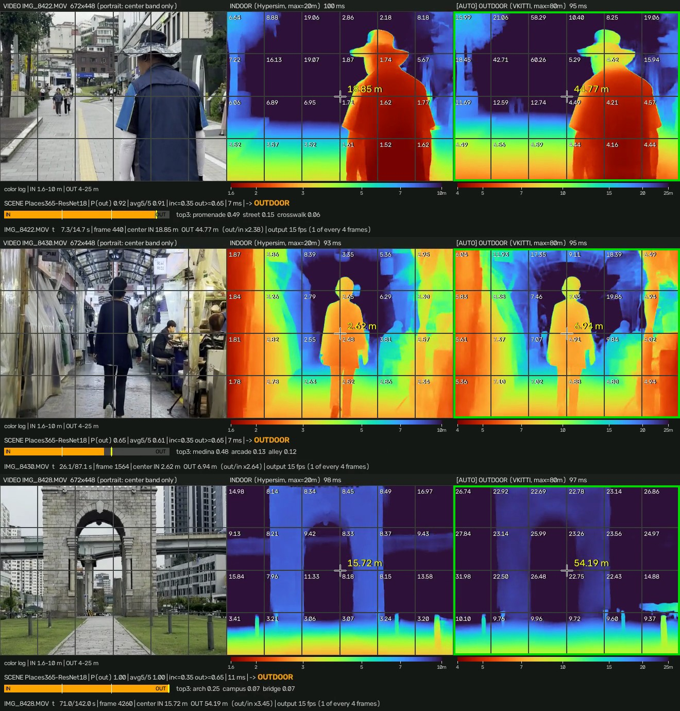

# 단안 절대 깊이 추정과 실내·실외 적응형 모델 전환을 이용한<br>24구역 촉각 감각 대체 장치의 설계 및 평가

**Design and Evaluation of a 24-Zone Tactile Sensory Substitution Device Using Monocular Metric Depth Estimation with Adaptive Indoor–Outdoor Model Switching**

| | |
|---|---|
| 학과 | 의료공학과 |
| 학번 / 성명 | 〔학번〕 / 〔성명〕 |
| 지도교수 | 〔교수명〕 |
| 제출일 | 〔YYYY년 MM월〕 |
| 구현 저장소 | https://github.com/MuakTiger/tactile-vision-device — 하드웨어·펌웨어: 커밋 `3f17469` / metric 파이프라인: 〔확인필요: 젯슨 코드 push 후 커밋 해시 기재〕 |

---

> ### ⚠️ 이 초안의 사용법 (제출 전 삭제)
>
> **v1과의 관계.** 이 문서는 2026-09-21 초안(v1, `졸업논문_초안.md`)을 절대(metric) 깊이 버전으로 개정한 v2다. v1은 그대로 두었다. 하드웨어·기구·펌웨어 서술(§3.2.2, §3.3.3, §3.3.4의 PWM 부분, §3.4)과 실험 II·III, 통계·윤리 계획은 v1에서 코드·STL로 검증한 내용을 옮겨 왔다.
>
> **v1 → v2 주요 변경**
>
> | 항목 | v1 (상대 깊이) | v2 (절대 깊이) |
> |---|---|---|
> | 깊이 모델 | Depth Anything V2 ViT-S 상대 깊이 1개 | Depth Anything V2 ViT-S metric 2개 (실내 Hypersim / 실외 VKITTI2) |
> | 모델 선택 | 없음 | Places365 장면 분류 + 5프레임 평균 + 히스테리시스(0.35/0.65) |
> | 정규화 | 프레임별 Min-Max | 없음 (미터 값을 그대로 사용) |
> | 셀 대표값 | 평균 | 하위 10 백분위 |
> | 입력 | 518 × 518 강제 리사이즈 | 3:2 중앙 크롭 → 672 × 448 (평가 프로토타입) |
> | 핀 매핑 | 정규화 값 선형 | 거리 로그 매핑 0.5 m ~ 4 m(실내) / 8 m(실외) — **설계 확정, 미구현** |
> | 핵심 결과 | 지연·전달 특성 | + 절대 거리 정확도, 두 모델의 스케일 불일치, 장면 판별 |
>
> **표기 규약**
>
> | 표기 | 뜻 |
> |---|---|
> | 〔측정필요〕 | 벤치 실험으로 반드시 실측해서 채워야 하는 값 |
> | 〔확인필요〕 | 부품 데이터시트·실물 계측·원자료·코드로 검증해야 하는 값 |
> | 〔데이터 수집 예정〕 | 실험 미수행. 표·그림 틀만 잡아 둔 자리 |
> | 〔선택〕 | 범위를 줄이고 싶으면 빼도 되는 부분 |
> | *(산정치)* | 데이터시트·이론식에서 계산한 값. **실측값 아님.** 계산 과정은 부록 D |
>
> **현재 상태**
> - 1~3장: 하드웨어는 v1의 검증 내용이다. metric 파이프라인은 평가 프로토타입(`~/Documents/depth-test/compare.py`) 코드와 Depth Anything V2 공식 코드를 확인하고 썼다. **젯슨 구현은 코드를 보지 못해 사용자 설명 기준이며 〔확인필요〕로 표시했다.**
> - 4장: 제안 단계. §4.10 최소 세트만으로도 학부 논문은 성립한다.
> - 5장: §5.1 예비 분석만 실제 데이터다(스마트폰 보행 영상, **정답 거리 없음**). 나머지는 비어 있다.
> - 6장: §6.1(예비 결과 해석)은 데이터 기반, §6.2는 결과에 따른 조건부 틀, §6.3~6.4는 설계 분석 기반.
> - 수치 근거: `FACTS.md` §1.4~1.5 (2026-09-29 등재). 여기에 없는 수치는 결과로 쓰지 않았다.

---

## 국문 요약

시각장애인의 독립 보행에서 가장 큰 제약은 전방 공간의 점유 구조를 실시간으로 파악하기 어렵다는 점이다. 흰지팡이는 신체 전방 약 1 m 이내의 지면 정보만 제공하고, 음성 기반 보조기기는 청각 채널을 점유하여 환경음 감시를 방해한다.

본 연구는 단안 카메라 영상에서 추정한 절대 거리(미터)를 손끝의 촉각 자극으로 변환하는 착용형 시각-촉각 감각 대체 장치를 설계·구현하였다. 1차 구현은 상대 깊이 모델과 프레임별 정규화를 사용하여, 같은 물체가 같은 거리에 있어도 장면 구성에 따라 핀 높이가 달라지는 구조적 한계가 있었다. 이를 해결하기 위해 Depth Anything V2의 metric 파인튜닝 모델 두 개(실내 Hypersim, 실외 Virtual KITTI 2)를 탑재하고, Places365 장면 분류기의 실외 확률을 5프레임 이동평균과 히스테리시스(0.35/0.65)로 판정하여 장면에 맞는 모델로 전환하도록 하였다. 깊이맵은 가로 6 × 세로 4 = 24구역으로 나누어 구역별 하위 10 백분위 거리를 대표값으로 취하고, 이를 0.5 m부터 실내 4 m, 실외 8 m까지의 로그 곡선으로 핀 높이에 대응시키도록 설계하였다. 촉각 디스플레이는 PCA9685 2개, SG90 서보 24개, 3D 프린팅 랙앤피니언 기구로 구성하였다(173.0 × 200.0 × 62.3 mm).

스마트폰으로 촬영한 보행 영상 8편(15 fps로 추출한 8,591 프레임)에 두 모델을 동시에 적용한 예비 분석에서, 실외 모델은 모든 영상에서 실내 모델보다 거리를 일관되게 길게 추정하였다(영상별 픽셀 중앙값 비 2.38~2.64배, 근거리 바닥 위주 영상 1편은 3.57배). 이는 metric 모델의 스케일이 학습 조건에 묶여 있어, 모델 전환만으로는 핀 높이의 의미가 일관되지 않음을 뜻한다. 또한 지붕이 있는 재래시장에서 같은 장소의 두 영상이 각각 19%, 82%의 프레임에서 실외로 판정되어 장면 분류 기반 전환의 불안정성을 확인하였다. 장면 분류기의 연산량은 깊이 모델의 2.7%였다. 〔데이터 수집 예정: 줄자 실측 기반 절대 거리 정확도와 보정 효과, 지연시간, 핀 변위 특성, 패턴 인식 정확도 요약 2~4문장〕

본 연구의 기여는 (1) 상용 깊이 센서 없이 단안 카메라와 범용 부품만으로 절대 거리를 24구역 형상 촉각 디스플레이로 전달하는 저비용 설계, (2) 실내·실외 metric 모델 간 스케일 불일치의 정량화와 학습 카메라 초점거리에 근거한 원인 가설 및 보정 방안, (3) 감각 대체 장치를 인식 정확도·기계적 특성·심리물리적 변별력·기능적 과제 수행으로 분리 평가하는 프로토콜이다.

**주제어**: 감각 대체, 촉각 디스플레이, 단안 절대 깊이 추정, 장면 분류, 시각장애, 보조공학

---

## Abstract

The primary constraint on independent mobility for people with visual impairment is the difficulty of perceiving the spatial occupancy of the forward environment in real time. The white cane conveys only ground-level information within roughly one meter of the body, and speech-based assistive devices occupy the auditory channel, interfering with the monitoring of environmental sound.

This study designed and implemented a wearable visual-to-tactile sensory substitution device that converts absolute distance (in meters), estimated from monocular camera images, into tactile stimulation on the fingertips. The first implementation used a relative-depth model with per-frame normalization, so the same object at the same distance could produce different pin heights depending on scene composition. To remove this structural limitation, the system carries two metric fine-tuned Depth Anything V2 models (indoor: Hypersim; outdoor: Virtual KITTI 2) and switches between them according to the outdoor probability of a Places365 scene classifier, smoothed by a five-frame moving average and a hysteresis band (0.35/0.65). The depth map is divided into 24 zones (6 columns × 4 rows), each represented by its 10th-percentile distance, and the design maps this distance to pin height with a logarithmic curve from 0.5 m to 4 m indoors and 8 m outdoors. The tactile display uses two PCA9685 controllers, 24 SG90 servos, and a 3D-printed rack-and-pinion mechanism (173.0 × 200.0 × 62.3 mm).

In a preliminary analysis applying both models to eight smartphone walking videos (8,591 frames sampled at 15 fps), the outdoor model consistently reported longer distances than the indoor model in every video (per-video median pixel ratio 2.38–2.64, and 3.57 in one clip dominated by near floor). This indicates that the metric scale is tied to training conditions, so model switching alone does not keep the meaning of pin height consistent. In a covered traditional market, two videos of the same place were classified as outdoor in 19% and 82% of frames, revealing the instability of scene-classification-based switching. The scene classifier required 2.7% of the depth model's computation. 〔To be completed: absolute distance accuracy against tape-measure ground truth, calibration effect, latency, pin displacement characteristics, pattern recognition accuracy〕

The contributions of this work are (1) a low-cost design that conveys absolute distance on a 24-zone shape-type tactile display using only a monocular camera and commodity components, (2) quantification of the scale disagreement between indoor and outdoor metric models, with a hypothesis based on training-camera focal length and a calibration approach, and (3) an evaluation protocol that separates perception accuracy, mechanical characteristics, psychophysical discriminability, and functional task performance.

**Keywords**: sensory substitution, tactile display, monocular metric depth estimation, scene classification, visual impairment, assistive technology

---

## 목차

1. 서론
2. 이론적 배경
3. 시스템 설계 및 구현
4. 실험 설계
5. 결과
6. 고찰
7. 결론
- 참고문헌
- 부록 A. 부품표 (BOM)
- 부록 B. 실험 프로토콜 및 기록지
- 부록 C. 핵심 소스코드
- 부록 D. 산정치 계산 근거
- 부록 E. 잔여 작업 목록

---

# 1. 서론

## 1.1 연구 배경

세계보건기구(WHO)는 전 세계적으로 최소 22억 명이 근거리 또는 원거리 시각 손상을 가지고 있으며, 이 중 절반 정도는 예방이 가능했거나 아직 교정되지 않은 상태라고 보고한다 [1]. 국내의 경우 등록장애인 약 264만 명 중 시각장애가 9.4%로, 약 25만 명 규모로 추정된다 [2]. 〔확인필요: 보건복지부 「등록장애인 현황」 최신 원자료로 교체할 것. 2차 인용보다 1차 통계가 심사에서 유리하다.〕

시각 손상이 삶의 질에 미치는 영향 중 당사자가 가장 크게 호소하는 영역은 이동성(mobility)이다. 보행 중 필요한 정보는 단순히 "장애물이 있다/없다"가 아니라 **전방 공간의 어느 방향, 어느 높이에, 얼마나 가까이 무엇이 있는지**라는 2차원 배치 정보와 깊이 정보의 결합이다. 현행 보조수단은 이 요구를 부분적으로만 충족한다.

- **흰지팡이**: 촉각으로 직접 지면을 탐색하므로 신뢰성이 높고 지연이 없다. 그러나 탐지 범위가 신체 전방 약 1 m 이내의 하부 공간으로 제한되어, 상체 높이의 돌출물(간판, 나뭇가지, 열린 창문)과 2 m 이상 전방의 상황은 감지하지 못한다.
- **안내견**: 고차원적 판단까지 위임할 수 있으나 공급량이 절대적으로 부족하고 유지 비용이 크다.
- **음성 안내형 전자 보조기기**: 객체 인식 결과를 음성으로 전달한다. 정보의 의미 전달력은 높지만 **직렬적**이어서 장면 전체를 한 번에 전달할 수 없고, 무엇보다 **청각 채널을 점유**한다. 시각장애인에게 청각은 차량 접근음·발소리·반향음을 통한 공간 파악의 주 채널이므로, 이를 가리는 것은 안전상 중대한 손실이다.

이 지점에서 **촉각**이 대안 채널로서 의미를 가진다. 촉각은 (1) 병렬적이어서 여러 지점의 정보를 동시에 제시할 수 있고, (2) 공간적으로 조직화되어 있어 체표면 위의 위치를 외부 공간의 방향으로 대응시키기 쉽고, (3) 일상적으로 유휴 상태인 넓은 표면적을 갖는다.

## 1.2 선행 연구

### 1.2.1 고전적 감각 대체 연구

감각 대체(sensory substitution)의 기원은 Bach-y-Rita 등이 1969년 *Nature*에 보고한 촉각-시각 감각 대체 시스템(TVSS)이다 [3]. Bach-y-Rita는 이에 앞서 감각 입력이 다른 양식으로 대체될 수 있다는 감각 가소성(sensory plasticity)의 개념을 제시하였고 [26], TVSS는 그 첫 실험적 검증이었다. 이 장치는 카메라 영상을 등받이에 배열된 400개(20 × 20) 진동 자극점으로 변환했고, 훈련을 거친 피험자가 일상 물체를 인식하고 3차원 공간 배치를 기술할 수 있음을 보였다 [4]. 특히 피험자가 카메라를 스스로 움직일 수 있을 때 자극을 피부 위의 감각이 아니라 외부 공간에 놓인 물체로 지각하게 되었다는 보고는 [4], 착용형 장치 설계에서 능동 탐색의 중요성을 뒷받침한다. 후속 연구는 자극 부위를 혀로 옮겨 소형화한 BrainPort로 이어졌으며, Bach-y-Rita는 이러한 결과를 "우리는 눈이 아니라 뇌로 본다"는 명제로 정리하였다 [5]. 청각을 사용한 변환으로는 영상을 사운드스케이프로 사상하는 vOICe가 있다 [6]. 한편 손끝의 핀 배열로 인쇄 문자를 전달한 Optacon은 본 연구와 같은 형상 제시형 촉각 디스플레이의 초기 사례다 [27].

이 계열 연구가 공통적으로 보여 준 핵심은 **충분한 훈련이 주어지면 비시각 채널로 들어온 공간 정보도 지각적으로 통합된다**는 점이다. 동시에 한계도 분명했다. 자극점 수가 많을수록 장치가 커지고 비싸졌으며, 정보 전달률이 시각에 비해 현저히 낮아 실사용 정착에는 이르지 못했다 [7].

### 1.2.2 착용형 보행 보조 연구

전자 보행 보조기기(electronic travel aid, ETA)는 초음파 거리센서에서 출발하였다. 대표적인 상용 기기인 Miniguide는 초음파로 한 방향의 거리를 재어 진동 주기로 알려 주며, 사용자가 탐지 범위를 0.5 / 1 / 2 / 4 / 8 m 중에서 선택하게 되어 있고, 4 m 이상에서는 담장·벽 같은 큰 물체만 감지된다고 안내한다 [28]. 또한 이 기기는 흰지팡이나 안내견을 대체하지 않는 보조 수단으로만 사용하도록 명시한다 [28]. 이후 깊이 센서와 임베디드 연산 장치가 보급되면서 RGB-D 카메라, ToF 센서, 스테레오 비전을 진동촉각 또는 음성 피드백과 결합한 착용형 장치가 다수 보고되었다 [8-11, 29-31]. 이 연구들의 경향은 다음과 같이 정리된다.

**[표 1-1]** 착용형 보행 보조 장치의 접근 방식 비교

| 구분 | 대표 접근 | 촉각 채널 | 전달 정보 |
|---|---|---|---|
| 초음파 거리형 | 초음파 1점 [28] | 진동 주기 | 한 방향의 거리 (범위 선택) |
| 방향 지시형 | ToF + 진동자 4개 [10], ToF + 햅틱 [30] | 저해상도 진동 | "왼쪽/오른쪽/정면에 장애물" |
| 스테레오 진동촉각형 | 스테레오 비전 + 진동 배열 [8, 29] | 중해상도 진동 | 방향 + 대략적 거리 |
| 교차양식 학습형 | RGB-D + 딥러닝 [9] | 진동 | 학습된 회피 신호 |
| **형상 제시형 (본 연구)** | **단안 절대 깊이 + 핀 배열 24개** | **정적 변위(형상)** | **전방 공간의 방향별 거리** |

대부분의 최근 연구는 **진동촉각(vibrotactile)** 을 채택한다. 소형·경량·저가라는 장점 때문이다. 그러나 진동은 본질적으로 시간적 자극이어서 "얼마나 가까운가"를 진동 강도나 주기로 부호화해야 하고, 인접 진동자 간 자극이 섞이는 문제(tactile masking)로 공간 해상도를 높이기 어렵다.

반면 **형상 제시형(shape display)** 은 핀의 물리적 높이라는 정적·공간적 변수로 깊이를 부호화한다. 사용자가 손을 얹고 능동적으로 탐색할 수 있고, 자극이 유지되므로 재확인이 가능하다. 다만 액추에이터 부피가 커서 고해상도화가 어렵다. 그래픽 촉각 디스플레이의 액추에이터 기술을 비교한 리뷰 [32]와 고해상도 리프레셔블 핀 배열 연구 [12, 13]에서 보듯, mm 단위 피치에 도달하려면 압전 소자나 정전 브레이크 같은 특수 액추에이터가 필요하다.

### 1.2.3 단안 깊이 추정 기반 접근의 문제: 상대 깊이와 절대 거리

단안 딥러닝 깊이 추정은 저가 카메라 하나로 조밀한 깊이맵을 얻게 해 주지만, 범용 모델 다수는 절대 거리가 아닌 **상대 깊이**만 제공한다(§2.3.1). 본 연구의 1차 구현(v1)은 상대 깊이 모델에 프레임별 정규화를 적용했기 때문에, 같은 물체가 같은 거리에 있어도 화면에 무엇이 함께 보이느냐에 따라 핀 높이가 달라졌다(§3.3.2). 이는 감각 대체의 전제인 자극-환경 대응의 일관성(§2.1)을 깨는 구조적 문제였다.

최근에는 미터 단위 거리를 직접 출력하는 metric 깊이 모델이 공개되었다. 그러나 이 모델들에는 보행 보조 장치에 적용할 때 드러나는 두 가지 문제가 있다. 첫째, 실내와 실외 도메인에 대해 따로 학습된 모델로 제공되어 [16, 34, 35] 장면에 따라 모델을 골라야 한다. 둘째, 단안 영상에서 절대 스케일은 원리적으로 카메라 내부 파라미터(초점거리)와 얽혀 있어, 학습에 쓰인 카메라와 사용하는 카메라가 다르면 스케일이 달라질 수 있다 [33]. 저가 착용형 보조기기에 두 metric 모델과 장면 분류를 결합했을 때 이 문제들이 실제로 얼마나 큰지, 그리고 어떻게 다뤄야 하는지는 본 연구가 조사한 범위에서 정량적으로 보고된 사례를 찾지 못하였다. 〔확인필요: 문헌 검색으로 이 서술을 확인하고, 유사 사례가 있으면 인용하여 표현을 조정할 것〕

### 1.2.4 본 연구의 위치

본 연구는 **저가 범용 부품(RC 서보 + 3D 프린팅 기구)** 으로 형상 제시형 촉각 디스플레이를 구성하고, **상용 깊이 센서 없이 단안 RGB 카메라와 두 개의 metric 깊이 모델, 그리고 장면 분류기만으로** 절대 거리 입력을 확보하는 조합을 취한다. 해상도는 24구역으로 선행 TVSS(400점)보다 훨씬 낮으므로, **목표를 물체 형태 인식이 아니라 전방 공간의 방향별 거리(점유 구조) 전달로 명시적으로 축소**한다. 이 범위 설정의 근거는 §2.4에서 정보 용량 관점으로 다시 다룬다.

## 1.3 연구 목적과 연구 질문

본 연구의 목적은 다음 네 가지다.

1. **설계·구현**: 단안 카메라 영상의 절대 거리를 24구역 핀 배열의 변위로 실시간 변환하고, 장면에 따라 실내·실외 깊이 모델을 전환하는 착용형 장치를 설계하고 동작 가능한 수준으로 구현한다.
2. **인식 정확도 정량화**: 두 metric 모델이 보행 보조에 필요한 0.5~8 m 범위에서 제공하는 절대 거리의 정확도와 편향을 실측하고, 편향의 원인을 분석하여 보정 방안을 제시한다. 장면 분류 기반 모델 전환의 정확도와 안정성도 함께 평가한다.
3. **물리적 특성화**: 구현된 장치의 처리 지연, 거리-핀 변위 전달 특성, 재현성을 실측하여 시스템의 물리적 성능 한계를 규명한다.
4. **지각적 타당성 검증**: 눈가림 정상시력 피험자를 대상으로, 이 장치의 출력(핀 위치·높이·패턴)을 사람이 구별할 수 있는지 평가한다.

이를 다음 네 가지 연구 질문(RQ)과 가설로 구체화한다. 각 가설의 검증 실험은 4장에서 설계한다.

**[표 1-2]** 연구 질문, 가설, 검증 실험

| RQ | 질문 | 가설 | 실험 |
|---|---|---|---|
| RQ1 | 단안 metric 모델은 0.5~8 m에서 얼마나 정확한 절대 거리를 주는가? | **H1a** 장치 카메라의 화각이 학습 화각에 가까운 실내 모델은 실외 모델보다 오차가 작다. **H1b** 실외 모델은 거리를 과대추정하며, 초점거리 보정 또는 선형 보정 후 오차가 감소한다. **H1c** 두 모델의 출력 비는 학습 카메라 초점거리 비(약 1.67)로 일부 설명되며 사용 카메라와 무관하다. | I-4 |
| RQ2 | 장면 분류 기반 전환은 장면을 올바로 판별하고 안정적으로 동작하는가? | **H2** 판별 오류는 지붕이 있는 시장·아케이드 같은 반실내 공간에 집중된다. | I-6 |
| RQ3 | 거리→핀 전달과 지연은 설계 요구사항을 만족하는가? | **H3** 종단 지연의 지배항은 비전 추론이 아니라 서보의 기계적 정착이다. | I-1~I-3 |
| RQ4 | 사람은 핀의 위치·높이·패턴을 구별할 수 있는가? | **H4** 장애물 존재·방향 판단의 정확도가 형태 변별의 정확도보다 높다. | II-1~II-3 |

## 1.4 연구 범위 및 한계

본 연구의 범위는 다음과 같이 제한한다.

- **대상 환경**: 정적 장애물이 있는 실내·실외 보행 환경. 동적 장애물(이동 차량·보행자) 대응은 범위에서 제외한다. 예비 분석 영상에 보행자가 포함되지만 정성적 관찰에만 사용한다.
- **거리 범위**: 핀으로 표현하는 거리는 0.5 m부터 실내 4 m, 실외 8 m까지로 한다(§2.4.2). 그보다 먼 물체는 핀을 올리지 않는다.
- **깊이 정보의 성질**: metric 모델의 출력은 미터 단위이지만, 학습 카메라와 학습 도메인에 따라 스케일 편향을 가질 수 있다(§2.3.3). 본 연구는 이 편향을 실측으로 정량화하고 보정하는 것을 연구 대상에 포함한다.
- **수직 시야**: 카메라를 배꼽 높이에 수평으로 장착하면 약 2.4 m보다 가까운 바닥은 화면에 들어오지 않는다(§3.2.4, *(산정치)*). 따라서 본 장치는 흰지팡이를 대체하지 않고 보완한다.
- **피험자**: 눈가림 정상시력 성인. 실제 시각장애 당사자 평가는 별도의 IRB 심의와 모집 절차가 필요하여 후속 연구로 둔다(§4.8).
- **구현 범위**: 거리→핀 로그 매핑, 모드 전환 크로스페이드, 시간 안정화는 설계를 확정하고 구현 단계에 있다. 초안 시점의 단계별 구현 상태는 표 3-1에 명시한다.

---

# 2. 이론적 배경

## 2.1 감각 대체의 신경생리학적 기반

감각 대체가 성립하는 근거는 **감각 양식 간 가소성(cross-modal plasticity)** 이다 [26]. 대뇌 피질의 감각 영역은 입력 양식에 따라 고정 배선된 것이 아니라, 실제로 도달하는 신호의 통계적 구조에 따라 재조직된다. 시각 박탈 상태에서 시각 피질이 촉각·청각 처리에 동원되는 현상이 이를 뒷받침한다.

감각 대체 장치의 설계 관점에서 이 원리가 함의하는 바는 두 가지다.

1. **외부 공간과 체표면 사이의 공간적 대응(spatial isomorphism)을 유지**해야 한다. 좌측 물체는 좌측 자극점에, 상부 물체는 상부 자극점에 대응시켜야 학습 부담이 줄어든다. 본 연구에서 그리드 인덱스와 서보 채널의 배치를 카메라 좌표계와 일치시킨 것은 이 원칙을 따른 것이다.
2. **자극-환경 대응이 시간적으로 일관**해야 한다. 같은 장면이 매번 다른 자극 패턴을 만들면 지각적 통합이 일어나지 않는다. 1차 구현의 프레임별 정규화는 이 조건을 위배했으며(§3.3.2), 본 연구가 절대 거리 모델로 전환한 핵심 이유다. 다만 절대 거리 모델을 쓰더라도 모델이 전환될 때 스케일이 달라지면 같은 문제가 다시 생긴다(§6.1.1).

또한 감각 대체에서는 **능동적 탐색(active sensing)** 이 중요하다. TVSS 연구에서도 피험자가 카메라를 스스로 움직일 수 있을 때 성능이 크게 향상되었다 [4]. 본 연구는 카메라를 촉각 장치 앞면(배꼽 높이)에 고정하므로, 시점은 머리가 아니라 몸통의 방향을 따른다. 사용자는 머리 대신 몸통을 돌려 탐색하게 되며, 이 선택의 장단점은 §3.2.4와 §6.3.3에서 논의한다.

## 2.2 촉각 수용기와 공간 분해능

피부의 기계수용기는 순응 속도와 수용장 크기에 따라 네 종류로 구분된다.

**[표 2-1]** 피부 기계수용기와 본 장치의 관련성

| 수용기 | 순응 | 주 감응 | 본 장치와의 관련 |
|---|---|---|---|
| Merkel (SA-I) | 느림 | 정적 압력, 형태, 에지 | **주 채널.** 핀의 정적 돌출 높이를 부호화 |
| Meissner (RA-I) | 빠름 | 저주파 진동, 미끄러짐 | 핀 이동 순간의 전이 감지 |
| Pacinian (FA-II) | 빠름 | 고주파 진동(~250 Hz) | 서보 진동·소음의 원인. 잡음원 |
| Ruffini (SA-II) | 느림 | 피부 신장 | 부차적 |

본 장치는 핀의 **정적 변위**로 정보를 전달하므로 주 수용기는 SA-I(Merkel)이다. 이는 진동촉각 장치가 주로 FA-II를 사용하는 것과 대비되며, 지속적 자극을 유지해도 순응에 의한 감각 소실이 상대적으로 느리다는 장점이 있다.

**공간 분해능.** 손가락 끝의 촉각 공간 분해능은 격자 방향 변별 과제(grating orientation task)로 측정할 때 홈 폭 약 0.94 mm 수준으로 보고된다 [14]. 손바닥은 이보다 낮아 수 mm 수준이다. 한편 전통적인 2점 변별 역치는 자극 강도 단서에 오염되기 쉬워 순수한 공간 분해능 지표로는 부적절하다는 비판이 있으며, 2점 방향 변별 등 대안 과제가 제안되었다 [15].

본 장치의 모듈 피치는 열 방향 28.83 mm, 행 방향 50.00 mm이다(§3.2.2). 이는 손끝 공간 분해능 한계의 수십 배에 해당하므로, **개별 핀의 위치 변별 자체는 촉각 분해능의 제약을 받지 않는다.** 즉 본 장치의 성능 한계는 피부의 분해능이 아니라 **액추에이터 개수(24개)** 에서 온다. 해상도 향상의 병목은 인간이 아니라 기구부이며, 더 작은 액추에이터를 확보하면 같은 면적에서 해상도를 높일 여지가 크다.

## 2.3 단안 깊이 추정

### 2.3.1 상대 깊이와 절대 깊이

단일 RGB 영상에서 깊이를 추정하는 문제는 원리적으로 **스케일 모호(scale-ambiguous)** 하다. 동일한 영상은 크기와 거리가 비례적으로 변한 무수한 3차원 장면과 양립한다. 따라서 대규모 데이터로 학습된 범용 단안 깊이 모델은 대개 절대 거리가 아닌 **아핀 불변 상대 깊이(affine-invariant relative depth)** 를 출력한다. 즉 출력값 $d$와 실제 역거리 사이에 미지의 스케일 $a$와 오프셋 $b$가 존재한다.

$$d_{\text{pred}} = a \cdot \frac{1}{Z_{\text{true}}} + b, \qquad a, b \text{ 미지}$$

상대 깊이만으로는 "2 m 앞"을 표현할 수 없고, 장면 안의 "더 가까움/더 멂"만 표현할 수 있다. 1차 구현은 이 출력을 프레임마다 0~255로 정규화했기 때문에, 순서 정보마저 장면 구성에 따라 기준이 바뀌었다.

**절대(metric) 깊이 모델**은 $Z_{\text{true}}$ 자체를 미터 단위로 회귀한다. 단안 영상에는 스케일 정보가 없으므로, 모델은 학습 데이터에서 익힌 사전지식(물체의 전형적 크기, 원근, 지평선 위치, 그리고 학습 카메라의 화각)으로 스케일을 정한다. 이 사전지식이 사용 환경과 어긋나면 출력 스케일도 어긋난다(§2.3.3).

### 2.3.2 Depth Anything V2와 metric 파인튜닝

Depth Anything V2는 단안 깊이 추정용 기반 모델(foundation model)로, 레이블된 실사 영상을 합성 영상으로 대체하고, 대용량 교사 모델을 준비한 뒤 의사 레이블된 실사 영상을 매개로 학생 모델을 증류하는 전략을 취한다 [16]. 공식 저장소는 이 사전학습 인코더에 DPT 헤드를 붙여 절대 깊이를 회귀하도록 파인튜닝한 metric 모델을 실내용(Hypersim [34])과 실외용(Virtual KITTI 2 [35])으로 따로 제공한다 [41]. 두 데이터셋은 모두 합성 영상이다.

metric 모델의 출력층은 시그모이드(0~1)이며, 여기에 상수 `max_depth`를 곱해 미터 값을 만든다(실내 20 m, 실외 80 m) [41]. 따라서 `max_depth`는 출력을 자르는 범위가 아니라 **학습 때 정해진 스케일 상수**다. 예컨대 실내 모델에 5를 지정하면 모든 출력이 5/20 = 0.25배가 되며 오류도 발생하지 않는다. 본 연구는 이 값을 학습값으로 고정하였다(§3.3.1).

**[표 2-2]** 두 metric 모델의 학습 조건

| 항목 | 실내 모델 | 실외 모델 | 근거 |
|---|---|---|---|
| 학습 데이터 | Hypersim (합성 실내) | Virtual KITTI 2 (합성 도로 주행) | [34, 35, 41] |
| 원본 해상도 | 1024 × 768 | 1242 × 375 | [41] 학습 코드 |
| 원본 초점거리 | 886.81 px | 약 725 px 〔확인필요〕 | [41] / [35] |
| 원본 화각 (가로 × 세로) | 60.0° × 46.8° | 약 81° × 29° *(산정치)* | 부록 D-9 |
| 학습 입력 | 짧은 변을 518로 비율 유지 리사이즈 후 518 × 518 크롭 | 같음 | [41] 학습 코드 |
| 크롭 후 화각 | 약 46.8° × 46.8° | 약 29° × 29° *(산정치)* | 부록 D-9 |
| 짧은 변 518 기준 초점거리 $f_{518}$ | 598 px | 약 1,001 px *(산정치)* | 부록 D-9 |
| `max_depth` | 20 m | 80 m | [41] |

공식 저장소는 연산 여유가 있으면 큰 모델을, 그리고 실내 모델을 먼저 시도하라고 권장한다 [41]. 본 연구는 두 모델을 함께 적재해야 하고 출력이 24개 값으로 축약되므로(§3.3.2) 가장 작은 ViT-S 백본(파라미터 24.8 M)을 선택하였다. 518 × 518급 깊이맵이 24개 값으로 압축되는 과정에서 픽셀 단위 정확도의 기여는 작으므로, **모델 용량을 키우는 것보다 셀 대표값, 스케일 보정, 기구부 특성을 개선하는 것이 효율적**이라고 판단하였다. 〔확인필요: metric 체크포인트의 라이선스. Small 인코더는 Apache-2.0로 알려져 있으나 metric 파인튜닝 가중치와 원본 데이터셋 약관은 창업 활용 전에 별도로 확인할 것〕

### 2.3.3 카메라 내부 파라미터와 스케일 편향

핀홀 카메라에서 높이 $H$인 물체가 광축 거리 $Z$에 있을 때 영상에서 차지하는 높이 $h$(px)는 다음과 같다.

$$h = \frac{f \cdot H}{Z}$$

여기서 $f$는 픽셀 단위 초점거리다. 모델이 학습 카메라($f_{\text{train}}$)의 기하에서 "겉보기 크기 → 거리" 관계를 익혔다고 가정하면, 초점거리가 $f_{\text{cam}}$인 카메라로 찍은 영상에서 모델이 내놓는 거리는 다음과 같이 근사된다.

$$\hat{Z} \approx \frac{f_{\text{train}} \cdot H}{h} = Z \cdot \frac{f_{\text{train}}}{f_{\text{cam}}}$$

즉 사용 카메라의 화각이 학습 카메라보다 넓으면($f_{\text{cam}} < f_{\text{train}}$) 물체가 작게 찍혀 **거리를 과대추정**하고, 좁으면 과소추정한다. 이때 두 초점거리는 같은 입력 해상도에서 비교해야 한다. 본 연구는 짧은 변을 518 px로 맞춘 기준을 쓴다.

$$f_{518} = \frac{259}{\tan(\phi_s / 2)}$$

$\phi_s$는 영상의 짧은 변 방향 화각이다. 이 관점은 카메라 차이를 표준 카메라 공간으로 변환해 흡수하는 Metric3D의 접근 [33]과 같은 원리이며, 보정은 예측값에 $f_{\text{cam}}/f_{\text{train}}$을 곱하는 것으로 표현된다.

이 근사에서 두 가지 예측이 나온다.

- **예측 1 (모델별 편향)**: 장치 카메라에 3.6 mm 렌즈를 쓰면 짧은 변 화각이 약 45.6°, $f_{518} \approx 616$ px이다 *(산정치, §3.2.4)*. 따라서 실내 모델의 편향 계수는 $598/616 \approx 0.97$, 실외 모델은 $1001/616 \approx 1.63$으로, **실내 모델은 거의 맞고 실외 모델은 약 1.6배 과대추정**할 것으로 예측된다(가설 H1a, H1b).
- **예측 2 (두 모델의 비)**: 같은 영상에 두 모델을 적용하면 출력 비는 $\hat{Z}_{\text{out}} / \hat{Z}_{\text{in}} \approx f_{\text{out}} / f_{\text{in}} \approx 1001/598 \approx 1.67$로, **사용 카메라와 무관하게 일정**해야 한다(가설 H1c).

이 근사는 모델이 겉보기 크기 단서에 주로 의존한다는 강한 가정에 기댄다. 실제 모델은 원근, 텍스처 기울기, 지평선 위치 같은 다른 단서도 쓰며, 합성 도로 장면(VKITTI2)과 보행 환경의 도메인 차이도 있다. 따라서 실제 편향은 이 예측에서 벗어날 수 있으며, 그 차이 자체가 실험 I-4의 분석 대상이다.

### 2.3.4 광축 깊이와 직선거리

깊이는 두 가지로 정의될 수 있다. 카메라 광학 중심에서 점까지의 **직선거리** $r$과, 광축 방향 성분인 **광축 깊이** $Z$이다. 광축과 각도 $\theta$를 이루는 점에서 두 값의 관계는 다음과 같다.

$$Z = r \cos\theta$$

실내 모델의 학습 코드는 Hypersim이 제공하는 직선거리를 광축 깊이로 변환해 학습하므로 [41], 모델 출력은 광축 깊이다. 실외 모델도 같은 정의를 따르는 것으로 가정한다 〔확인필요: VKITTI2 깊이 영상의 정의〕. $\theta = 30°$에서 $Z$는 $r$보다 13.4% 작다. 따라서 실측 실험(§4.2.4)에서 줄자는 **렌즈 면에서 광축 방향으로** 재야 하고, 화면 가장자리의 목표물은 $\cos\theta$로 환산해야 한다.

### 2.3.5 장면 분류와 Places365

실내·실외 모델을 자동으로 고르려면 현재 장면이 어느 쪽인지 판별해야 한다. 본 연구는 장면 인식용 대규모 데이터셋 Places [36]로 학습된 365범주 분류기를 사용한다. 공식 저장소는 각 장면 범주에 실내(1) 또는 실외(2) 라벨을 붙인 목록을 제공하며, 365개 중 실내가 161개, 실외가 204개다 [42]. 분류 모델로는 공식 가중치가 제공되는 ResNet18 [37]을 사용한다.

공식 데모는 상위 10개 장면의 실내/실외 라벨을 평균해 다수결로 판정한다 〔확인필요: 공식 데모 코드 원문 대조〕. 본 연구는 대신 **실외 범주 204개의 softmax 확률을 모두 더한 값**을 실외 확률 $P_{\text{out}}$로 쓴다(§3.3.5). 연속적인 확률값은 이동평균과 히스테리시스를 적용하기에 적합하다.

판정에 **히스테리시스**를 두는 이유는 전환 떨림(chattering)을 막기 위해서다. 임계값이 하나이면 확률이 그 근처에서 흔들릴 때 모델이 프레임마다 바뀐다. 실외로 가는 문턱(0.65)과 실내로 돌아오는 문턱(0.35)을 분리하면, 그 사이 구간에서는 이전 모드가 유지된다. 이는 전자회로의 슈미트 트리거와 같은 원리다.

주의할 점은 장면 분류가 판단하는 것은 **의미 범주**(시장, 거리, 거실)이지 **깊이 통계**가 아니라는 점이다. 지붕이 있는 시장, 아케이드, 지하철 역사처럼 의미상 경계에 있는 공간에서는 분류가 불안정할 수 있으며, 이 경우 잘못 고른 모델이 거리 전체를 어긋나게 만든다(§6.1.3).

## 2.4 설계 요구사항 도출

### 2.4.1 정보 용량 관점의 목표 설정

24개 taxel 각각이 $L$개의 변별 가능한 높이 단계를 가질 때, 한 프레임이 이론적으로 담을 수 있는 정보량의 상한은 다음과 같다.

$$I_{\max} = 24 \cdot \log_2 L \ \ [\text{bit/frame}]$$

$L = 4$라면 48 bit/frame이다. 그러나 이는 각 taxel을 독립적으로 완벽히 읽을 수 있다는 비현실적 가정 아래의 상한이다. 실제 인간이 단일 접촉으로 병렬 추출하는 촉각 정보량은 이보다 한 자릿수 이상 낮다. 따라서 본 장치가 현실적으로 전달할 수 있는 것은 다음 수준으로 보아야 한다.

- ✅ 전방에 장애물이 **있는지**
- ✅ 그것이 **어느 방향**에 있는지 (좌/중앙/우, 상/하)
- ✅ 다른 것보다 **더 가까운지**
- ✅ **대략 어느 거리대**에 있는지 (예: 1 m 안팎 / 2~3 m / 먼 곳) — 절대 거리 모델과 보정이 전제될 때
- ✅ 통과 가능한 **빈 공간이 어디**인지
- ❌ 물체가 **무엇**인지 (형태 인식)
- ❌ **정확히 몇 미터** 앞인지 (촉각 높이 변별 한계, §4.3.2)

1차 구현에서는 네 번째 항목이 원리적으로 불가능했다. 절대 거리 모델로 전환하면서 이 항목이 목표에 들어왔고, 그 정확도가 본 연구의 핵심 평가 대상이 된다.

### 2.4.2 거리-촉각 매핑의 설계 원리

셀 대표 거리 $d$를 핀 높이 비율 $p \in [0, 1]$로 바꾸는 매핑으로 다음 로그 곡선을 채택하였다.

$$p(d) = \operatorname{clip}\!\left(\frac{\ln(d_{\text{far}} / d)}{\ln(d_{\text{far}} / d_{\text{near}})},\ 0,\ 1\right)$$

$d \le d_{\text{near}}$이면 핀이 끝까지 올라오고($p = 1$), $d \ge d_{\text{far}}$이면 내려간다($p = 0$). 로그 곡선을 택한 근거는 세 가지다.

1. **오차의 성질**: 깊이 추정 오차는 대체로 거리에 비례해 커진다. 로그 매핑에서 상대오차 $e$가 핀 높이에 주는 오차는 거리와 무관하게 일정하다.
   $$\Delta p = \frac{\ln(1 + e)}{\ln(d_{\text{far}} / d_{\text{near}})}$$
   선형 매핑은 오차가 큰 원거리에 해상도를 많이 쓰게 된다.
2. **위험의 분포**: 충돌 위험은 가까운 거리에 몰려 있다. 로그 곡선은 가까운 구간에 핀 높이 변화를 몰아준다.
3. **공통 근거리 기준**: $d_{\text{near}} = 0.5$ m를 두 모드에 공통으로 두어, "핀이 끝까지 올라옴 = 0.5 m 이내"라는 의미가 모드와 무관하게 유지되도록 하였다.

먼 쪽 한계 $d_{\text{far}}$는 실내 4 m, 실외 8 m로 정하였다. 상용 초음파 ETA의 탐지 범위 선택지(0.5 / 1 / 2 / 4 / 8 m)와 4 m 이상에서는 큰 물체만 감지된다는 안내 [28]를 참고한 값이며, 실험 I-4의 오차 결과를 보고 조정할 설정값으로 둔다.

**[표 2-3]** 거리별 핀 높이 비율 $p$ (설계값)

| 거리 | 0.5 m 이하 | 1 m | 2 m | 3 m | 4 m | 6 m | 8 m 이상 |
|---|---|---|---|---|---|---|---|
| 실내 (0.5~4 m) | 100% | 67% | 33% | 14% | 0% | 0% | 0% |
| 실외 (0.5~8 m) | 100% | 75% | 50% | 35% | 25% | 10% | 0% |

**[표 2-4]** 거리 상대오차가 핀 높이에 주는 오차 $\Delta p$ *(산정치, 부록 D-10)*

| 상대오차 $e$ | 10% | 25% | 50% | 145% (관측된 두 모델 차이, §5.1.2) |
|---|---|---|---|---|
| 실내 ($d_{\text{far}}/d_{\text{near}} = 8$) | 4.6% | 10.7% | 19.5% | 43.1% |
| 실외 ($d_{\text{far}}/d_{\text{near}} = 16$) | 3.4% | 8.0% | 14.6% | 32.3% |

표 2-4는 거리 오차의 허용 기준을 핀 높이로 환산하는 근거가 된다. 25% 오차는 스트로크의 약 8~11%에 해당하지만, 두 모델 사이에서 관측된 약 2.45배 차이는 스트로크의 30~40%에 해당한다.

로그 매핑의 비례적 성질은 지각 분야에서 흔히 관찰되는 비례적 변별 특성(Weber 법칙)과도 부합할 것으로 기대되나, 핀 높이에 대한 촉각 변별이 실제로 그런지는 실험 II-2에서 확인한다. 또한 본 연구는 핀 높이를 몇 단계로 끊는 양자화 대신 **연속 매핑**을 택하였다. 서보가 미세한 각도 제어를 할 수 있고(§3.3.4), 연속 변화가 "다가온다/멀어진다"는 변화 지각을 부드럽게 전달하기 때문이다. 떨림 방지는 양자화가 아니라 데드밴드로 처리한다(§3.3.6).

### 2.4.3 정량적 설계 요구사항

위 논의와 선행 연구를 종합하여 설계 목표를 다음과 같이 설정하였다.

**[표 2-5]** 설계 요구사항

| # | 요구사항 | 목표값 | 근거 |
|---|---|---|---|
| R1 | 종단 지연(장면 변화 → 핀 정착) | ≤ 300 ms | 보행 속도 1 m/s에서 0.3 m 이내 오차 |
| R2 | 갱신율 | ≥ 10 Hz | 몸통 회전 시 장면 추종 |
| R3 | 공간 구역 수 | ≥ 24 | 방위 3구간 × 고도 2구간 이상 변별 |
| R4 | 핀 스트로크 | ≥ 5 mm | 손끝 높이 변별에 충분한 동적 범위 |
| R5 | 변별 가능 높이 단계 | ≥ 4 | 거리대 4개 구분 (§4.3.2에서 실측) |
| R6 | 안전 | 통신 단절·이상값 시 전체 하강 | 기구 손상 및 손가락 압착 방지 |
| R7 | 연속 동작 시간 | ≥ 30 min | 단일 실험 세션 수행 |
| R8 | 재료비 | ≤ 〔금액〕 | 보급형 보조기기 지향 |
| R9 | 절대 거리 정확도 | 매핑 범위에서 보정 후 AbsRel ≤ 0.25 | $\delta < 1.25$ 관례 [38]. 핀 높이 오차 약 8~11% 스트로크 (표 2-4) |
| R10 | 모드 전환 일관성 | 전환 전후 같은 물체의 핀 높이 차 ≤ 10% 스트로크 (보정 후), 불필요 전환 ≤ 〔목표 설정필요〕 회/분 | §2.1의 시간적 일관성 조건 |

R1~R5는 §4.2와 §4.3에서, R9·R10은 §4.2.4와 §4.2.6에서 측정하고 §5에 기록한다.

---

# 3. 시스템 설계 및 구현

## 3.1 전체 아키텍처

시스템은 **연산부(Jetson) — 제어부(Pico) — 구동부(PCA9685 + 서보) — 기구부(랙앤피니언)** 의 4단 구조를 가진다. 1차 구현과 비교하면 제어부 아래는 같고, 연산부의 깊이 처리 단계가 바뀌었다.

```
┌──────────────────────────── 연산부 ────────────────────────────┐
│  USB 카메라 WSD-ZX001 (MJPEG, 1920×1080 또는 1280×720)            │
│         ↓ 3:2 중앙 크롭 + 리사이즈 (평가 프로토타입: 672×448)          │
│  ┌─ Places365-ResNet18 → P(out) → 5프레임 평균 → 히스테리시스 ─┐   │
│  │                              ↓ 모드 (실내 / 실외)            │   │
│  └→ Depth Anything V2 ViT-S metric  [Hypersim | VKITTI2]       │   │
│         ↓ 미터 깊이맵 (정규화 없음) → 모델별 보정 (실험 I-4 후)      │
│         ↓ 6×4 셀별 하위 10 백분위 거리 → 24개 거리 (m)              │
│         ↓ 로그 매핑 0.5 m ~ d_far → 0~255 → 시간 안정화 → 10 Hz     │
└──────────────────────────────┬───────────────────────────────┘
                               │ USB CDC  "GRID:v0,…,v23\n"
┌──────────────────────────────▼──────── 제어부 ─────────────────┐
│  Raspberry Pi Pico (RP2040)                                    │
│    · 패킷 파싱 / 검증 (24개 토큰)                                  │
│    · 지령값 → PWM tick 선형 매핑                                   │
│    · 2 s 무수신 → 전체 홈 복귀 (failsafe)                          │
└──────────┬───────────────────────────────┬────────────────────┘
      I2C (GP4/GP5)                   I2C
┌──────────▼────────┐          ┌──────────▼────────┐
│ PCA9685 #1 (0x40) │          │ PCA9685 #2 (0x41) │  ← 구동부
│  ch0–11 → 1–2행    │          │  ch0–11 → 3–4행    │
└──────────┬────────┘          └──────────┬────────┘
           └───────────┬──────────────────┘
             ┌─────────▼──────────┐
             │ SG90 서보 × 24      │  ← 기구부
             │ 랙앤피니언 → Z축 돌출 │
             └────────────────────┘
```

> **[그림 3-1]** 시스템 블록 다이어그램
> 〔그림 갱신필요: `figures/fig3-1_system_block.svg`는 1차 구현(518 × 518, Min-Max 정규화, 평균 풀링) 기준이다. 위 도식에 맞춰 장면 분류·모델 전환·로그 매핑 블록을 반영할 것.〕

> **[그림 3-2]** 제작된 장치 전경 및 착용 상태 사진
> 〔촬영필요: (a) 촉각 디스플레이 상면, (b) 기구부 단면/분해, (c) 배꼽 높이 카메라 장착 상태, (d) 손을 얹은 사용 자세. 스케일 바 또는 자를 함께 촬영할 것.〕

각 층의 책임을 분리한 이유는 다음과 같다. 연산부는 GPU 자원이 필요한 추론에만 집중하고, 실시간 PWM 타이밍은 결정론적 동작이 가능한 MCU에 위임한다. 또한 통신 단절 시 Pico가 독립적으로 안전 상태로 복귀할 수 있어(§3.4), 연산부 장애가 기구 손상으로 전파되지 않는다.

본 초안 시점의 구현 상태는 다음과 같다. 개발은 두 곳에서 진행되었다. 실제 장치의 연산부(Jetson)와, 같은 모델을 PC에서 돌려 두 모델과 장면 분류를 나란히 비교하는 **평가 프로토타입**(`depth-test`, §3.3.7)이다. 하드웨어 STL과 Pico 펌웨어는 공개 저장소 [25]에 있다.

**[표 3-1]** 파이프라인 단계별 구현 상태 (2026-09-29)

| 단계 | 설계 | 평가 프로토타입 (PC) | 장치 (Jetson) |
|---|---|---|---|
| 입력 크롭·리사이즈 | 3:2, 양변 14의 배수 | 구현 (672 × 448) | 〔확인필요〕 |
| 장면 분류·모델 전환 | Places365, 5프레임 평균, 0.35/0.65 | 구현 (ResNet18, 실외 확률 합) | 구현 (사용자 보고. 모델 변형·확률 산출식 〔확인필요〕) |
| metric 깊이 추정 | ViT-S × 2 | 구현 (PyTorch) | 구현 (사용자 보고. TensorRT 엔진 사양 〔확인필요〕) |
| 모델별 스케일 보정 | 초점거리 보정 또는 선형 보정 | 미구현 | 미구현 (실험 I-4 후) |
| 셀 대표값 | 하위 10 백분위 | 구현 | 〔확인필요〕 |
| 거리 → 핀 로그 매핑 | 0.5 m ~ 4 m / 8 m | 미구현 (표시용 컬러맵만) | 미구현 |
| 시간 안정화·10 Hz 전송 | EMA, 데드밴드, 크로스페이드 | 미구현 | 미구현 |
| Pico 펌웨어 | 지령값 → PWM | — | 1차 구현(`3f17469`) 그대로. `DEPTH_THR` 제거 예정 |
| 촉각 디스플레이 | — | — | 제작 완료 (STL 검증) |

## 3.2 하드웨어 설계

### 3.2.1 부품 선정

**[표 3-2]** 주요 부품과 선정 근거

| 구성 | 채택 부품 | 선정 근거 |
|---|---|---|
| 연산 | NVIDIA Jetson Orin Developer Kit 〔확인필요: 기종(AGX / NX / Nano)〕 | TensorRT 지원, ViT 계열 추론 가능한 엣지 플랫폼 |
| MCU | Raspberry Pi Pico (RP2040) | 저가, USB CDC 내장, I2C 2채널 |
| PWM 드라이버 | PCA9685 × 2 | 보드당 16채널 → 2개로 24채널 확보, I2C 주소 분리 가능 |
| 액추에이터 | SG90 서보 × 24 | 최저가 위치 제어 액추에이터. 개당 단가가 24배로 곱해지므로 결정적 |
| 기구 | 랙앤피니언 (3D 프린팅) | 회전 → 직선 변환. 리드스크류보다 빠르고 인쇄가 용이 |
| 카메라 | WSD-ZX001-V2.0 USB 카메라 모듈 (1/2.9″, 1920 × 1080, M12 교체 렌즈) | 렌즈 교체로 화각을 학습 화각에 맞출 수 있음(§2.3.3). 자동초점이 없어 보행 중 초점이 흔들리지 않음 |
| 서보 전원 | 3S1P LiPo × 2 + 스텝다운 컨버터 × 2 | PCA9685 한 보드당 독립 전원, 대전류 공급 |
| 연산부 전원 | USB-C PD 보조배터리 (20,000 mAh) | 휴대 가능, 로직 전원을 서보 전원과 분리 |

PCA9685를 2개 사용한 구성에서 I2C 주소는 `0x40`(기본)과 `0x41`(A0 점퍼 납땜)로 분리하였다. 24채널을 두 보드에 12개씩 배분하되, **그리드의 상단 2행(인덱스 0–11)을 `0x40`에, 하단 2행(인덱스 12–23)을 `0x41`에** 대응시켜 물리적 배선과 논리적 인덱스가 일치하도록 하였다. 이는 디버깅 시 오배선 추적을 단순화한다.

### 3.2.2 촉각 디스플레이 기구부

**외형 치수.** 저장소의 STL 파일에서 바운딩 박스를 직접 산출한 결과는 다음과 같다.

**[표 3-3]** STL 바운딩 박스 치수

| 파일 | 치수 X × Y × Z (mm) | 비고 |
|---|---|---|
| `hardware/full/7_22 set_final.stl` | 173.00 × 200.00 × 62.30 | 24구역 전체 조립체 |
| `hardware/assembly/SG90 and Rack and Pinion.stl` | 28.23 × 30.35 × 55.86 | 서보 + 랙앤피니언 단위 모듈 |
| `hardware/parts/rack.stl` | 179.86 × 182.05 × 3.17 | 프린트 플레이트(다수 배열), Z = 부품 두께 |
| `hardware/parts/pinion.stl` | 108.13 × 174.96 × 3.32 | 프린트 플레이트, Z = 기어 치폭 |
| `hardware/parts/servo_bracket.stl` | 174.68 × 176.46 × 4.46 | 프린트 플레이트, Z = 판 두께 |

**taxel 피치.** 전체 조립체 폭 173.00 mm를 6열로, 깊이 200.00 mm를 4행으로 나누면 모듈 피치는 다음과 같다.

$$p_x = \frac{173.00}{6} = 28.83\ \text{mm}, \qquad p_y = \frac{200.00}{4} = 50.00\ \text{mm}$$

열 피치 28.83 mm는 단위 모듈의 X 치수 28.23 mm와 거의 일치하므로, X 방향은 서보 폭에 의해 한계까지 밀집 배치되었음을 알 수 있다. 반면 행 피치 50.00 mm는 모듈의 Y 치수 30.35 mm보다 약 20 mm 여유가 있다. **결과적으로 피치 비율이 1 : 1.73으로 비등방적**이며, 이 왜곡의 지각적 영향은 §6.3.4에서 논의한다. 〔확인필요: 위 피치는 조립체 바운딩 박스를 등분하여 얻은 값이다. **실제 핀 끝 중심 간 거리를 캘리퍼스로 실측**하여 표를 교체할 것.〕

**스트로크.** 서보 회전각 변화량 $\Delta\theta$와 피니언 피치원 지름 $d_p$로부터 핀 스트로크 $s$는 다음과 같다.

$$s = \frac{\Delta\theta}{360^\circ} \cdot \pi d_p$$

§3.3.4에서 구하는 $\Delta\theta \approx 111.0^\circ$ *(산정치)* 를 대입하면 $s \approx 0.969\, d_p$이다.

**[표 3-4]** 피치원 지름별 스트로크 *(산정치)*

| $d_p$ (mm) | 6 | 8 | 10 | 12 | 14 |
|---|---|---|---|---|---|
| 스트로크 $s$ (mm) | 5.81 | 7.75 | 9.69 | 11.63 | 13.56 |

〔측정필요: ① 피니언 피치원 지름 $d_p$ (CAD 원본 또는 실측), ② 핀의 **실제** 최대 돌출량. ②가 논문에 들어갈 값이며, 표는 설계 근거로만 사용.〕 설계 요구사항 R4(≥ 5 mm)는 $d_p \geq 6$ mm면 충족된다.

### 3.2.3 전원 설계

24개 SG90을 동시 구동하는 구성은 전원이 설계상 가장 큰 제약이다. SG90의 전류 소모를 데이터시트 [24] 범위로 산정하면 다음과 같다.

**[표 3-5]** 서보 전류 산정 *(산정치 — 데이터시트 기준. 〔측정필요: 전류 프로브로 실측〕)*

| 상태 | 개당 전류 | 24개 합계 @5 V | 전력 |
|---|---|---|---|
| 유지/무부하 | ~100 mA | 2.40 A | 12.0 W |
| 구동 중(평균) | ~250 mA | 6.00 A | 30.0 W |
| 스톨(최악) | ~700 mA | 16.80 A | 84.0 W |

이 산정으로부터 두 가지 설계 지침이 도출된다. 첫째, 서보 전원은 Jetson·Pico의 로직 전원과 **반드시 분리**해야 한다. 둘째, 최악 조건(전 채널 동시 스톨)은 84 W에 달하므로 착용형 배터리 운용 시 스톨 방지가 필수적이다.

실제 구성은 다음과 같다(사용자 제공 정보, 실물 사양 미확인).

**[표 3-6]** 전원 구성

| 계통 | 구성 | 비고 |
|---|---|---|
| 서보 (0x40 보드) | 3S1P 50C LiPo → 스텝다운(300 W급, 방열판) → PCA9685 V+ | 보드당 12개, 최악 약 8.4 A *(산정치)* |
| 서보 (0x41 보드) | 위와 같은 구성의 독립 계통 | |
| 연산부 | USB-C PD 보조배터리 20,000 mAh(단일 포트 최대 45 W) → PD 트리거 → DC 잭 | 〔확인필요: 젯슨 기종별 요구 전력. AGX Orin이면 전력 모드 제한 필요〕 |
| 제어부 | Jetson의 USB 포트 | Pico 전원 겸 통신 |

서보 전원을 두 LiPo로 나누고 로직 전원을 보조배터리로 분리한 구성은 첫째 지침을 만족한다. 다만 다음이 확인되지 않았다. 〔확인필요: (1) 스텝다운 출력 전압(5.0~5.5 V 권장)과 실제 정격 전류, (2) PCA9685 V+의 벌크 커패시터(1000~2200 µF 권장), (3) 각 계통의 GND 공통 연결, (4) LiPo 셀 전압 경보기와 퓨즈 — LiPo는 스텝다운만으로 과방전이 막히지 않고, 50C 셀은 단락 시 순간 전류가 매우 크므로 착용형에서는 필수다. (5) 요구사항 R7(30분 연속 동작) 충족 여부는 §5.2.5에 기록.〕

### 3.2.4 카메라와 착용 위치

**[표 3-7]** 카메라 사양 (제조사 제품 사양서, 사용자 제공)

| 항목 | 값 |
|---|---|
| 모델 | WSD-ZX001-V2.0 USB 카메라 모듈 (UVC, 드라이버 불필요) |
| 센서 | 1/2.9″ CMOS, 2 MP (1920 × 1080, 16:9) |
| 초점 | 고정초점(FF), 렌즈를 돌려 맞추는 수동 초점. 촬영 거리 5 cm ~ ∞ |
| 렌즈 | M12 교체형. 1.78 / 2.2 / 2.8 / 3.6 / 4.2 mm 등 |
| 출력 | MJPG / YUY2, 최대 30 fps |
| 조정 항목 | 밝기, 대비, 색조, 채도, 선명도, 감마, 화이트밸런스, 노출(자동 노출) |
| 전원 | DC 5 V, < 200 mA |

**렌즈 선택.** 이 모듈은 렌즈에 따라 화각이 크게 달라진다. 센서 유효 면적을 약 5.4 × 3.0 mm(픽셀 2.8 µm 가정)로 두고 왜곡을 무시하면 화각은 다음과 같다.

**[표 3-8]** 렌즈별 화각 *(산정치, 부록 D-7)*

| 렌즈 | 가로 (16:9) | 세로 | 3:2 크롭 후 가로 | $f_x$ (1920 기준) | $f_{518}$ | 판단 |
|---|---|---|---|---|---|---|
| 1.78 mm | 113° 이상 | 81° 이상 | — | 약 640 px | — | 어안에 가까워 비권장 |
| 2.2 mm | 100° 이상 | 69° 이상 | — | 약 790 px | — | 왜곡이 커서 비권장 |
| 2.8 mm | 약 88° | 약 57° | 약 78° | 약 1,000 px | 약 480 px | 왜곡 보정 필요 |
| **3.6 mm** | **약 74°** | **약 46°** | **약 64°** | **약 1,290 px** | **약 616 px** | **권장** |
| 4.2 mm | 약 65° | 약 40° | 약 57° | 약 1,500 px | 약 720 px | 16:9 그대로 쓸 때 적합 |

3.6 mm 렌즈를 3:2로 크롭하면 짧은 변(세로) 화각이 약 45.6°로 실내 모델의 학습 화각(46.8°)과 가깝다. §2.3.3의 근사에 따르면 이때 실내 모델의 스케일 편향은 약 0.97배로 작다. 한 taxel이 보는 각도는 약 10.7° × 11.4°로 거의 등방적이다. 〔확인필요: 현재 장착된 렌즈의 mm와, 체커보드 캘리브레이션 [39]으로 구한 실제 초점거리·화각·왜곡 계수. 표 3-8은 모두 산정치다.〕

**초점과 캡처 설정.** 고정초점 렌즈는 한 번 맞추면 보행 중 초점이 변하지 않는다는 장점이 있다. 3.6 mm, F2.0, 허용 착란원 2 px(5.6 µm)을 가정하면 과초점거리는 약 1.2 m이며, 이 거리에 초점을 맞추면 약 0.6 m부터 무한대까지 선명하다 *(산정치, 부록 D-7)*. 초점을 맞춘 뒤 렌즈를 나사 고정제로 잠가야 진동으로 초점과 캘리브레이션 값이 틀어지지 않는다. 캡처는 MJPG로 해야 한다. 1920 × 1080 YUY2 30 fps는 약 995 Mbps로 USB 2.0 대역(480 Mbps)을 넘기 때문이다 *(부록 D-11)*. 일부 모듈은 해상도를 낮출 때 센서 가운데만 잘라 쓰므로, 캘리브레이션은 실제 캡처 해상도에서 해야 한다.

**착용 위치.** 카메라는 촉각 장치 앞면, 배꼽 높이(약 1.0 m)에 수평으로 장착한다. 흉부·머리 장착에 비해 흔들림이 적고 촉각 장치와 한 몸체로 만들 수 있다. 대신 수직 시야에 다음 제약이 생긴다 *(산정치, 3.6 mm 렌즈·평평한 바닥·수평 장착 가정, 부록 D-8)*.

- 화면에 보이는 가장 가까운 바닥은 약 2.4 m다. **그보다 가까운 낮은 장애물은 화면에 들어오지 않는다.** 본 장치가 흰지팡이를 대체하지 않고 보완한다고 규정하는 근거다(§1.4).
- 4행(최하단) 셀은 약 2.4~5.0 m의 바닥을 보며, 셀 하위 10 백분위는 약 2.5 m다. 바닥만 있어도 4행 핀이 실내 모드에서 약 22%, 실외 모드에서 약 42% 올라온다.
- 3행 셀의 바닥은 약 5.0 m부터 시작하므로 실내 모드에서는 핀이 올라오지 않고, 실외 모드에서 약 13% 올라온다.

본 연구는 바닥을 별도 처리 없이 그대로 출력한다. TVSS가 영상을 가공 없이 전달하고 사용자가 익히게 한 방식 [3, 4]을 따른 것이며, 바닥이 끊기는 계단·연석 정보가 함께 전달된다는 이점이 있다. 카메라를 아래로 숙이면 가까운 바닥이 보이는 대신 하단 핀이 항상 높게 올라오고, 위로 들면 바닥 영향은 줄지만 사각지대가 커진다.

## 3.3 소프트웨어 설계

### 3.3.1 입력 전처리와 절대 깊이 추정

평가 프로토타입(`depth-test/compare.py`)은 프레임당 다음 순서로 동작한다.

1. 카메라 또는 영상 파일에서 BGR 프레임 획득
2. 16:9 프레임을 **3:2로 중앙 크롭**(가로 양쪽을 약 8%씩 잘라냄)한 뒤 672 × 448로 축소(`INTER_AREA`)
3. 두 metric 모델(`max_depth` 실내 20, 실외 80 고정)에 `input_size = 448`로 입력
4. 모델 내부 전처리: ImageNet 정규화, 비율 유지·14의 배수·짧은 변 기준 리사이즈 [41]. 짧은 변이 이미 448이므로 **이 리사이즈는 항등**이 되어 추가 확대가 없다.
5. 출력: 672 × 448 미터 깊이맵(float). **정규화를 하지 않는다.**

**[표 3-9]** 처리 해상도 672 × 448의 선정 근거

| 조건 | 672 × 448 | 비고 |
|---|---|---|
| 종횡비 | 3:2 | 6 × 4 그리드와 같음 → 셀이 112 × 112 px 정사각형 |
| DA2 패치(14) 배수 | 48 × 32 = 1,536 토큰 | 내부 리사이즈 없음 |
| YOLO stride(32) 배수 | 21 × 14 | 향후 객체 인식 통합 시 패딩 불필요 |
| 연산량 (ViT-S) | 134.0 GFLOPs | 16:9 원본을 그대로 넣으면 내부에서 924 × 518로 확대되어 253.8 GFLOPs (1.9배) |
| 대가 | 가로 시야 약 16% 손실 | 3.6 mm 렌즈에서 가로 약 74° → 64° *(산정치)* |

연산량은 FLOP 계수기로 측정한 값이다. 장치(Jetson)에서는 두 모델을 각각 TensorRT [20] 엔진으로 변환해 실행하며, 최종 입력 해상도는 엔진을 해상도 후보별로 빌드해 FPS를 잰 뒤(실험 I-2) 정한다. 〔측정필요〕

1차 구현은 1280 × 720 프레임을 518 × 518로 강제 리사이즈하여 영상이 가로로 찌그러졌다. 비율을 유지하지 않는 리사이즈는 영상 속 물체의 겉보기 크기를 바꾸므로, metric 모델에서는 형태 왜곡뿐 아니라 스케일 편향(§2.3.3)의 원인도 된다. v2는 크롭으로 비율을 유지한다.

### 3.3.2 공간 다운샘플링: 1차 구현의 두 설계 결함과 개선

깊이맵을 24개 값으로 축약하는 단계는 시스템 전체에서 정보 손실이 가장 큰 구간이다. 1차 구현의 이 단계에는 두 가지 구조적 결함이 있었다.

**(1) 프레임별 Min-Max 정규화 → 기준계 불안정.** 1차 구현은 `cv2.normalize(..., NORM_MINMAX)`로 각 프레임의 최소·최대값을 0과 255로 사상했다. 따라서 3 m 앞 벽만 있는 장면에서는 그 벽이 255(최근접)가 되어 핀이 최대로 올라오지만, 같은 벽이 1 m 앞 기둥과 함께 보이면 훨씬 낮은 값이 된다. 같은 물체가 같은 거리에 있어도 핀 높이가 달라지므로 §2.1의 시간적 일관성 원칙에 정면으로 위배된다.

**(2) 평균 풀링 → 근접 물체의 희석.** 1차 구현은 셀 안의 평균을 대표값으로 썼다. 셀 안에 가느다란 근접 장애물(기둥, 책상 모서리, 볼라드)과 먼 배경이 함께 있으면 평균은 배경에 가까워져 **가장 위험한 물체가 지워진다.**

v2는 두 결함을 다음과 같이 해결한다.

- **(1)의 해결**: metric 모델의 미터 출력을 정규화 없이 그대로 쓴다. 같은 거리는 장면 구성과 무관하게 같은 값이 된다(단, 모델 편향은 §6.1에서 따로 다룬다).
- **(2)의 해결**: 셀 대표값을 **하위 10 백분위**로 바꾼다. metric 깊이는 값이 작을수록 가까우므로, 1차 구현(값이 클수록 가까움)과 달리 낮은 백분위가 "가장 가까운 쪽"이다.

$$d_{\text{cell}} = P_{10}\left(\{\, Z(u, v) \mid (u, v) \in \text{cell} \,\}\right)$$

112 × 112 px 셀에서 폭 15 px 기둥(셀의 13.4%)이 1 m 앞에, 배경이 5 m에 있으면 평균은 약 4.46 m로 기둥이 사라지지만, 하위 10 백분위는 1 m로 기둥을 보존한다.

**[표 3-10]** 셀 대표값 방식 비교

| 방식 | 식 | 특성 |
|---|---|---|
| 평균 (1차 구현) | $\bar{Z}$ | 매끄럽지만 근접 물체 희석 |
| 최솟값 | $\min Z$ | 안전 지향. 단일 잡음 픽셀에 취약 |
| **하위 10 백분위 (v2)** | $P_{10}(Z)$ | 잡음 내성 + 근접 물체 보존 |

평가 프로토타입은 이와 별도로 화면 중앙 13 × 13 px 패치의 평균 거리를 표시한다. 이 값은 핀 구동에 쓰지 않고, 줄자 실측과 비교하는 실험 I-4의 측정점으로만 쓴다.

### 3.3.3 통신 프로토콜

Jetson → Pico 전송 포맷은 다음 ASCII 문자열이다.

```
GRID:v0,v1,...,v23\n        (v ∈ [0, 255])
```

패킷 길이는 최대 101 바이트(`GRID:` 5 + 값 24 × 3 + 콤마 23 + 개행 1)이다. 포맷은 1차 구현과 같지만 값의 의미가 바뀐다. 1차 구현에서 $v$는 프레임 안의 상대적 가까움이었으나, v2에서는 로그 매핑을 거친 **핀 높이 지령값**이다. 0은 "$d_{\text{far}}$보다 멂 또는 물체 없음", 255는 "0.5 m 이내"를 뜻한다.

README와 코드는 보드레이트를 115200 bps로 기술하지만, Jetson이 연결하는 장치는 `/dev/ttyACM0`이고 펌웨어는 `Serial`(arduino-pico [23]에서 USB CDC에 대응)을 사용한다. **USB CDC-ACM에서 보드레이트 설정은 무시되며**, 실효 대역폭은 USB Full Speed(12 Mbps)에 의해 결정된다. 따라서 115200 bps로 산정한 전송 시간 8.77 ms는 실제로 발생하지 않고, 실측 전송 시간은 1 ms 미만일 것으로 예상된다. 본 논문은 이를 "USB CDC(명목 115200 bps, 실효 USB FS 대역)"로 기술하고, §5.2에서 실측값을 제시한다.

ASCII 텍스트 포맷의 장점은 디버깅 용이성(시리얼 모니터로 직접 판독 가능)이고, 단점은 바이너리 대비 약 3배의 대역 소모다. 현재 대역에 여유가 크므로 가독성을 택한 판단은 타당하다.

한편 **패킷에 체크섬이나 시퀀스 번호가 없다.** 펌웨어는 토큰 개수가 정확히 24개인지만 검증하므로, 길이는 맞지만 값이 손상된 패킷은 그대로 서보에 인가된다. USB CDC는 하위 계층에서 CRC 검증과 재전송을 수행하므로 실용상 위험은 낮으나, 하드웨어 UART로 전환하는 경우 체크섬 추가가 필요하다(§6.4).

### 3.3.4 거리-변위 매핑

매핑은 두 단계로 나뉜다. Jetson이 거리를 지령값으로 바꾸고(설계, 미구현), Pico가 지령값을 PWM으로 바꾼다(구현됨).

**(1) 거리 → 지령값 (Jetson, 설계)**

셀 대표 거리 $d_{\text{cell}}$에 §2.4.2의 로그 매핑을 적용해 $v = \operatorname{round}(255 \cdot p(d_{\text{cell}}))$를 만든다. 설정값은 다음과 같다.

| 파라미터 | 실내 모드 | 실외 모드 | 비고 |
|---|---|---|---|
| $d_{\text{near}}$ | 0.5 m | 0.5 m | 두 모드 공통 |
| $d_{\text{far}}$ | 4 m | 8 m | 실험 I-4 결과로 조정 |
| 모드 전환 시 $d_{\text{far}}$ 보간 | — | — | 0.7 s 동안 로그 영역에서 선형 보간 (§3.3.6) |
| 무효값(NaN, 0 이하) | — | — | 백분위 계산에서 제외. 셀 전체가 무효이면 직전 값 유지 (§3.4 S9) |

**(2) 지령값 → PWM (Pico, 구현됨)**

펌웨어(`software/pico/main.cpp`)의 매핑 함수는 다음과 같다.

$$T(v) = \begin{cases} T_{\min} & v < \theta \\[4pt] T_{\min} + \dfrac{v - \theta}{255 - \theta}\left(T_{\max} - T_{\min}\right) & v \geq \theta \end{cases}$$

여기서 $T_{\min} = 250$, $T_{\max} = 490$ tick, 임계치 $\theta = 20$이다. PCA9685는 PWM 주기를 12비트(4096 tick)로 분할하므로 [21], 50 Hz 구동에서 1 tick의 시간은 다음과 같다.

$$t_{\text{tick}} = \frac{1}{50\ \text{Hz} \times 4096} = 4.883\ \mu\text{s}$$

**[표 3-11]** PWM 구간

| 항목 | tick | 펄스폭 |
|---|---|---|
| $T_{\min}$ (홈, 핀 하강) | 250 | **1.221 ms** |
| $T_{\max}$ (최대 돌출) | 490 | **2.393 ms** |
| 가동 구간 | 240 | 1.172 ms |

> **[코드 정정 사항]** 펌웨어 주석은 `SAFE_MIN = 250`을 "~0.5 ms"로 기술하고 있으나, 위 계산에 따르면 실제 펄스폭은 **1.221 ms**이다. 0.5 ms에 해당하는 값은 약 102 tick이다. (`SAFE_MAX = 490` → "~2.3 ms"는 실제 2.393 ms로 근사적으로 맞다.)

**임계치 $\theta$의 제거.** 1차 구현에서 $\theta = 20$은 정규화된 값의 하위 약 8%를 "물체 없음"으로 보는 데드존이었다. v2에서는 로그 매핑이 이미 $d_{\text{far}}$에서 0으로 잘라 주므로 이 임계치가 필요 없고, 남겨 두면 해롭다. $v < 20$은 $p < 0.078$에 해당하므로, 실내 3.40~4 m, 실외 6.44~8 m의 물체가 핀을 올리지 못하게 되어 사실상 $d_{\text{far}}$를 줄이는 효과를 낸다 *(산정치)*. 따라서 v2에서는 $\theta = 0$으로 둔다(펌웨어 한 줄 수정).

**양자화 해상도.** $\theta = 0$이면 지령값 1 LSB당 tick 변화량은 $240/255 = 0.941$ tick으로, 8비트 지령값이 PWM tick에 거의 1:1로 사상된다. 즉 **디지털 양자화가 해상도 병목이 아니다.** 실제 병목은 서보의 데드밴드 폭(SG90 데이터시트 기준 약 10 µs ≈ 2.05 tick)이며, 이를 적용하면 기계적으로 구분 가능한 단계는 약 117단계다 *(산정치)*. 인간의 핀 높이 변별 단계 수(§4.3.2에서 측정)보다 훨씬 클 것으로 예상되므로, **정보 전달의 최종 제약은 기계가 아니라 지각**일 가능성이 높다.

**회전각 및 스트로크.** SG90의 펄스폭-각도 관계를 500–2400 µs ↔ 0–180°로 가정하면 〔확인필요: 실제 사용 부품의 데이터시트로 검증〕,

$$\theta(T_{\min}) = 68.3^\circ, \qquad \theta(T_{\max}) = 179.3^\circ, \qquad \Delta\theta = 111.0^\circ$$

$T_{\max}$에서의 각도가 정격 상한(180°)에 근접한다는 점에 유의해야 한다. 기구 조립 오차나 부품 편차가 있으면 일부 서보가 기계적 스톱에 맞물려 스톨할 수 있다. README가 최초 시험 시 `SAFE_MAX`를 350으로 낮춰 시작할 것을 권고하는 것은 이 위험을 반영한 조치다. 〔확인필요: 실제 운용에서 확정한 `SAFE_MAX` 값을 기재할 것.〕

### 3.3.5 장면 분류와 모델 전환

평가 프로토타입의 장면 분류기(`SceneClassifier`)는 프레임마다 다음을 수행한다.

1. 처리 프레임(672 × 448)을 224 × 224로 축소하고 ImageNet 정규화
2. Places365-ResNet18 공식 가중치로 365개 장면 확률 $\{p_c\}$ 계산
3. 실외 확률 $P_{\text{out}} = \sum_{c \in \mathcal{O}} p_c$ ($\mathcal{O}$: IO 라벨이 실외인 204개 범주)
4. 최근 $N = 5$ 프레임의 $P_{\text{out}}$ 이동평균 $\bar{P}$ 계산
5. 모드 결정: 첫 판정은 $\bar{P} \ge 0.5$이면 실외. 이후 $\bar{P} \ge 0.65$이면 실외, $\bar{P} \le 0.35$이면 실내, 그 사이면 이전 모드 유지
6. 다른 영상으로 넘어가면 이력을 초기화

젯슨 구현은 사용자 설명에 따르면 같은 파라미터(약 5프레임 평균, 0.65/0.35)를 쓴다. 〔확인필요: 젯슨에서 쓰는 Places365 모델 변형(ResNet18 / WideResNet18 등)과 실외 확률 산출식(확률 합 / 상위 10개 다수결). 가중치 파일명으로 확인 가능하며 논문에 모델명을 정확히 적어야 한다.〕

장면 분류기의 연산량은 3.63 GFLOPs로 깊이 모델(672 × 448, 134.0 GFLOPs)의 2.7%이며, PC에서 프레임당 약 4.8 ms가 걸렸다(§5.1.4). 장면은 프레임 단위로 빠르게 바뀌지 않으므로, 장치에서는 분류기를 $N$프레임마다 한 번만 실행하도록 설계한다(§3.3.6).

### 3.3.6 시간 안정화와 전송 제한 (설계)

1차 구현은 프레임마다 깊이값을 그대로 서보에 인가하여, 정지 장면에서도 추정값의 프레임 간 흔들림 때문에 24개 서보가 계속 미세 조정을 반복했다. 이는 소음, 전력, 기어 마모를 늘리고 사용자가 안정된 형상을 읽기 어렵게 한다. 또한 SG90의 무부하 속도(0.1 s/60°)로 전체 스트로크(111°)를 움직이는 데 약 185 ms가 걸리므로 *(산정치)*, 이보다 훨씬 자주 목표를 바꾸면 서보가 목표에 도달하기 전에 다음 명령을 받는다. v2는 다음 네 가지를 설계에 포함한다(미구현).

| 기법 | 내용 | 설정값 (초기안) |
|---|---|---|
| 로그 거리 EMA | $\ell_t = \alpha \ln d_{\text{raw},t} + (1-\alpha)\,\ell_{t-1}$ | $\alpha$ 〔튜닝필요〕 |
| 데드밴드 | 직전 전송값과의 차이가 임계 미만인 채널은 재지령하지 않음 | ±3/255 |
| 전송 제한 | 깊이 계산은 매 프레임, 서보 전송만 제한 | 10 Hz |
| 모드 전환 크로스페이드 | 전환 시 $\ln d_{\text{far}}$를 선형 보간 | 0.7 s |
| 장면 분류 간헐 실행 | 분류기를 $N$프레임마다 실행 | $N = 5$ |

데드밴드는 핀 높이를 몇 단계로 끊는 양자화가 아니다. 변화가 충분히 크면 연속값이 그대로 전달되고, 떨림 수준의 작은 변화만 걸러진다. 크로스페이드는 전환 순간의 급격한 변화를 줄이지만 **모델 간 스케일 차이 자체를 없애지는 못한다.** 이는 §6.1.1에서 다룬다.

### 3.3.7 평가 도구

두 모델과 장면 분류를 같은 입력에 나란히 적용해 비교하기 위해 평가 도구 두 개를 작성하였다(`~/Documents/depth-test/`).

- **`compare.py` (실시간 비교 창)**: 카메라 또는 영상 파일을 입력으로 받아 [입력 | 실내 모델 | 실외 모델]을 한 화면에 표시한다. 깊이맵은 **고정 범위 컬러맵**(프레임별 정규화 없음)으로 그리고, 셀마다 하위 10 백분위 거리(m)와 중앙 패치 거리를 숫자로 표시한다. 장면 판별 상태(이번 프레임 $P_{\text{out}}$, 5프레임 평균, 임계값, 결과 모드, 상위 3개 장면)를 하단에 표시하고, 판별이 고른 모델 패널을 강조한다. `s` 키로 현재 프레임, 두 모델의 미터 깊이맵(`.npy`), 중앙 거리와 셀 값을 저장하면서 줄자 실측값을 입력받아 CSV에 기록하는 기능이 있어, **실험 I-4의 데이터 수집 도구**로 쓴다.
- **`render_videos.py` (일괄 렌더링)**: 창 없이 영상 폴더를 처리하여 같은 화면 구성의 결과 영상을 만든다. 원본 60 fps에서 4프레임당 하나(15 fps)를 처리한다.

컬러맵의 표시 범위(발표용 기본값: 실내 1.6~10 m, 실외 4~25 m, 로그)는 각 모델이 실제로 출력하는 거리 분포(§5.1.2)에 맞춰 대비를 키운 **표시 전용 설정**이다. 핀 매핑(§3.3.4)과는 무관하며, 칸의 숫자와 저장값에도 영향을 주지 않는다. 두 범위의 로그 폭을 같게(×6.25) 맞추었기 때문에, 두 모델이 약 2.5배 차이 나도 같은 장면이 비슷한 색으로 보이고 차이는 칸의 숫자로 드러난다.

## 3.4 안전 설계

의료·보조기기로서 본 장치의 위험원은 (1) 기구 과구동에 의한 파손, (2) 핀과 하우징 사이의 손가락 압착, (3) 오정보에 의한 사용자 충돌, (4) 배터리 사고다.

**[표 3-12]** 안전 설계 항목

| # | 위험 | 대응 | 구현 위치 | 상태 |
|---|---|---|---|---|
| S1 | 기구 과구동 | PWM을 `[SAFE_MIN, SAFE_MAX]` 구간으로 제한 | `depthToPWM()` | 구현 |
| S2 | 입력 이상값 | 지령값을 `constrain(v, 0, 255)`로 클램프 | `parsePacket()` | 구현 |
| S3 | 불완전 패킷 | 토큰 24개 미달 시 **이전 위치 유지** | `loop()` | 구현 |
| S4 | 통신 단절 | 2 s 무수신 시 전체 홈 복귀 | `loop()` failsafe | 구현 |
| S5 | 부팅 시 미정의 상태 | `setup()`에서 전체 홈 복귀 후 `PICO_READY` 송신 | `setup()` | 구현 |
| S6 | 초기 시험 시 기구 파손 | `SAFE_MAX`를 낮은 값부터 점증 | 문서화된 절차 | 절차 |
| S7 | 모드 전환 시 급격한 핀 변화 | $d_{\text{far}}$ 크로스페이드 0.7 s | Jetson | 설계 |
| S8 | 과도한 갱신에 의한 떨림·전류 스파이크 | 전송 10 Hz 제한, 데드밴드 | Jetson | 설계 |
| S9 | 무효 거리값 | 셀 전체 무효 시 직전 값 유지 | Jetson | 설계 |
| S10 | LiPo 과방전·단락 | 셀 전압 경보기, 퓨즈 | 전원부 | 〔확인필요〕 |
| S11 | 서보 전류에 의한 로직 전원 교란 | 서보 전원과 로직 전원 분리, 공통 GND | 전원부 | 구현(분리) / GND 〔확인필요〕 |

S1과 S4가 설계 요구사항 R6(통신 단절·이상값 시 전체 하강)에 직접 대응한다. R6의 충족 여부는 실험 I-1 수행 중 통신 케이블을 의도적으로 분리하여 2초 내 전체 홈 복귀를 확인하는 절차로 검증한다.

S3의 설계 판단(파싱 실패 시 이전 위치 유지)은 주목할 만하다. 대안인 "홈 복귀"를 택하면 통신 잡음이 있을 때마다 24개 핀이 전부 내려가 사용자에게 잘못된 "전방 클리어" 신호를 주게 된다. 마지막 유효 상태를 유지하는 쪽이 안전하다. 단절이 지속되면 S4가 2초 후 개입하므로 위험 상태가 무한히 유지되지도 않는다. S9는 같은 원칙을 거리 계산 단계에 적용한 것이다.

**미구현 안전 요소** (§6.3.6에서 한계로 논의):

- 스톨 전류 감지 및 차단 — 핀이 물리적으로 막히면 서보가 계속 토크를 내어 발열·소손 위험
- 핀 끝 압착 방지를 위한 기계적 컴플라이언스 (스프링 커플링 또는 토크 제한)
- 온도 모니터링, 전원 순단(brown-out) 시 거동 정의
- 착용 상태에서의 LiPo 수납·발열 관리

## 3.5 설계 트레이드오프 정리

**[표 3-13]** 주요 설계 결정

| 결정 | 채택 | 대안 | 채택 근거 / 대가 |
|---|---|---|---|
| 깊이 획득 | 단안 RGB + metric 딥러닝 | RGB-D, ToF, 스테레오 | 비용·카메라 범용성. 대가: 카메라·도메인 의존 스케일 편향 |
| 모델 구성 | 실내·실외 2모델 + 장면 분류 | 단일 모델 | 도메인별 정확도. 대가: 판별 오류와 전환 불연속 위험 |
| 모델 크기 | ViT-S | ViT-B / ViT-L | 2모델 동시 적재, 24값 축약 후 정확도 이득 미미 |
| 셀 대표값 | 하위 10 백분위 | 평균, 최솟값 | 근접 물체 보존 + 잡음 내성 |
| 거리 매핑 | 로그, 연속 | 선형, 계단(양자화) | 비례 오차 균등화, 근거리 강조, 변화 지각 |
| 입력 | 3:2 크롭 672 × 448 | 16:9 전체, 518 × 518 | 비율 유지 + 연산량 절반. 대가: 가로 시야 16% 손실 |
| 촉각 방식 | 정적 변위(형상) | 진동촉각 | 능동 탐색·재확인 가능. 대가: 부피·소음 |
| 액추에이터 | SG90 서보 | 압전, SMA, 리니어 액추에이터 | 24배 곱해지는 단가. 대가: 소음·속도·정밀도 |
| 해상도 | 6 × 4 = 24 | 더 고해상도 | 서보 폭에 의한 물리적 한계 |
| 제어 분리 | Jetson + Pico | Jetson 단독 GPIO | 실시간성 격리 + 독립 failsafe |
| 프로토콜 | ASCII 텍스트 | 바이너리 | 디버깅 용이. 대역 여유 충분 |
| 카메라 위치 | 배꼽 높이, 장치 앞면 | 흉부, 머리 | 흔들림 적음, 일체형. 대가: 2.4 m 이내 바닥 사각, 머리 탐색 불가 |

---

# 4. 실험 설계

> **이 장의 성격**: 본 장은 **수행 예정 실험의 설계안**이다. §5.1의 예비 분석을 제외하면 데이터는 아직 수집되지 않았다. 지도교수 협의 후 규모를 확정하며, 축소가 필요한 경우 §4.10의 최소 세트를 따른다.

## 4.1 평가 프레임워크

감각 대체 장치의 성능은 단일 지표로 환원되지 않는다. 거리를 잘못 재면 기구가 정밀해도 틀린 정보를 전달하고, 기구가 정밀해도 인간이 그 차이를 느끼지 못하면 의미가 없으며, 지각이 가능해도 지연이 크면 보행에 쓸 수 없다. 따라서 본 연구는 평가를 **인과적으로 분리 가능한 계층**으로 구성한다. 1차 구현의 3계층 구조에서, 절대 거리 모델 도입에 따라 계층 I을 인식(I-A)과 물리(I-B)로 나누었다.

**[표 4-1]** 평가 계층과 실험

| 계층 | 실험 | 측정 대상 | 피험자 | 답하는 질문 | RQ |
|---|---|---|---|---|---|
| I-A 인식 | I-4 절대 거리, I-6 장면 판별, I-7 연산 비용 | 모델 출력 | 불필요 | 장치가 거리를 **제대로 재는가**? | RQ1, RQ2 |
| I-B 물리 | I-1 지연, I-2 처리율, I-3 전달 특성, I-5 부가 특성 | 물리적 입출력 | 불필요 | 장치가 **설계대로 동작**하는가? | RQ3 |
| II 심리물리 | II-1 ~ II-4 | 촉각 변별력 | 눈가림 정상시력 | 사람이 그 출력을 **구별**하는가? | RQ4 |
| III 기능 | III-1 ~ III-3 | 과제 수행 | 눈가림 정상시력 | 그 구별이 **행동에 유용**한가? | — |

이 구조의 이점은 실패 원인의 국소화다. III에서 성능이 낮게 나왔을 때 I-A, I-B, II의 결과가 있으면 원인이 거리 인식 오류인지, 기구의 물리적 한계인지, 지각적 변별 실패인지, 정보를 행동으로 전환하는 인지 단계인지 특정할 수 있다. 계층 I·II 없이 III만 수행하면 "잘 안 됐다"는 결론 이상을 말할 수 없다.

## 4.2 실험 I — 인식 정확도와 시스템 성능 특성화

**목적**: RQ1~RQ3와 설계 요구사항 R1, R2, R4, R7, R9, R10의 충족 여부를 검증한다. 피험자가 필요하지 않으므로 IRB 심의 없이 즉시 착수 가능하다. **가장 먼저 수행할 것을 권한다.** 실험 번호는 1차 구현 초안과의 대응을 위해 유지하였다.

### 4.2.1 실험 I-1. 파이프라인 지연시간 분해

**방법**: Jetson 파이프라인에 단계별 `time.perf_counter()` 계측을 삽입하고 1,000 프레임을 연속 처리한다. Pico 측은 GPIO 핀을 토글하여 오실로스코프로 계측한다. 기계적 정착은 고속 카메라(또는 스마트폰 슬로모션 240 fps)로 촬영하여 프레임 수로 환산한다. 종단 지연은 카메라 화면 안의 LED를 켠 순간부터 해당 핀이 움직이기 시작할 때까지를 같은 영상에서 세어 교차 확인한다.

**[표 4-2]** 측정 구간

| 단계 | 구간 | 방법 |
|---|---|---|
| L1 | 카메라 캡처 + MJPEG 디코드 | `cap.read()` 전후 |
| L2 | 크롭·리사이즈 + 장면 분류 | 함수 전후 (분류기 간헐 실행 시 실행 프레임만 별도 집계) |
| L3 | metric 깊이 추론 (TensorRT) | CUDA 이벤트 |
| L4 | 셀 대표값 + 로그 매핑 + 시간 안정화 | 함수 전후 |
| L5 | USB CDC 전송 | `write()` ~ Pico GPIO 토글 |
| L6 | Pico 파싱 | GPIO 토글 구간 |
| L7 | I2C 24채널 쓰기 | GPIO 토글 구간 |
| L8 | 서보 기계적 정착 (전체 스트로크) | 고속 촬영 |

**보고 형식**: 각 구간 평균 ± 표준편차, 중앙값, 95 백분위. 종단 지연 $L_{\text{total}} = \sum L_i$와 R1(≤ 300 ms) 대비 판정. 10 Hz 전송 제한을 적용하면 전송 대기에 따른 평균 50 ms의 추가 지연이 생길 수 있으므로 *(산정치)*, 제한 적용 전후를 모두 보고한다.

**[표 4-3]** 사전 예측 (산정치 — 실측으로 교체 필수)

| 구간 | 산정치 | 산정 근거 |
|---|---|---|
| L5 | < 1 ms | USB FS 대역 (명목 115200 bps 무관, §3.3.3) |
| L7 | **12.96 ms** | I2C 100 kHz × setPWM 6바이트 × 24회 (부록 D-4) |
| L8 | **~185 ms** | SG90 0.1 s/60° × 111° (부록 D-2) |
| 기타 | 〔측정필요〕 | — |

> **H3**: 종단 지연의 지배항은 비전 파이프라인이 아니라 **서보의 기계적 정착 시간(L8)** 이다.

이 가설이 지지되면 향후 최적화 노력을 모델 경량화가 아니라 액추에이터 선정과 시간 필터링에 집중해야 한다는 실천적 결론이 나온다. 부수적으로 L7(I2C)이 12.96 ms로 30 fps 프레임 예산(33.3 ms)의 39%를 점유한다. `Wire.setClock(400000)`으로 I2C를 400 kHz로 올리면 3.24 ms로 감소한다 *(산정치)*. 이 개선의 실측 효과도 함께 보고한다.

### 4.2.2 실험 I-2. 처리율과 입력 해상도

**방법**: 두 metric 모델과 장면 분류기의 TensorRT FP16 엔진을 해상도 후보별로 빌드하고, 다음 조건에서 각 2분간 연속 동작시키며 프레임 수를 계수한다. 동시에 `tegrastats`로 GPU 점유율·메모리·전력·온도를 기록한다.

**[표 4-4]** 조건

| 요인 | 수준 |
|---|---|
| 입력 해상도 | 616 × 350 / 700 × 392 / 672 × 448 / 924 × 518 (모두 양변 14의 배수) |
| 장면 분류 | 없음 / 매 프레임 / 5프레임마다 |
| 하드웨어 | 연결 / 미연결 (선정 해상도에서만) |
| I2C | 100 kHz / 400 kHz (선정 해상도에서만) |

**보고**: 평균 FPS, 최저 FPS, 프레임 간격 히스토그램, 전력, 최고 온도. **R2(≥ 10 Hz)를 최저 FPS 기준으로 만족하는 해상도 중, 실험 I-4의 거리 오차가 가장 작은 해상도를 최종 선정**한다. 30분 연속 동작에서 써멀 스로틀링 여부를 함께 확인한다.

### 4.2.3 실험 I-3. 거리-핀 변위 전달 특성

**목적**: 설계 요구사항 R4 검증 및 §3.3.4 매핑식의 실물 검증.

**방법**: 임의 지령값 또는 거리를 주입하는 테스트 스크립트(부록 B-1)로 비전 파이프라인을 우회하여 다음을 측정한다.

1. **정특성**: 지령값을 0 → 255까지 16단계로 상승시키며 각 단계의 핀 돌출량을 디지털 캘리퍼스(분해능 0.01 mm) 또는 레이저 변위계로 측정. 각 단계 5회 반복.
2. **히스테리시스**: 하강 방향(255 → 0)으로 동일 측정. 상승/하강 곡선의 최대 편차를 히스테리시스로 보고.
3. **반복 재현성**: 특정 지령값(예: 128)을 20회 반복 지령하고 위치 표준편차 산출.
4. **채널 간 편차**: 24개 핀 전체에 동일 지령값(128, 255)을 인가하고 핀별 돌출량 분포 측정. 서보 개체차·조립 오차를 정량화한다.
5. **매핑 종단 확인**: 실내 모드에서 거리 0.5 / 1 / 2 / 3 / 4 m를, 실외 모드에서 0.5 / 1 / 2 / 4 / 8 m를 주입하여, 핀 높이가 표 2-3의 $p(d)$ × 스트로크를 따르는지 확인한다.

**분석**:
- 선형 회귀 후 $R^2$, 기울기(mm per LSB), 최대 비선형 편차(% FS)
- 히스테리시스 (mm, % FS), 반복 재현성 (SD, mm)
- 채널 간 편차 (CV, %) — **24채널 장치에서 매우 중요한 지표.** 편차가 크면 같은 거리가 위치에 따라 다른 높이로 느껴진다.
- 매핑 종단 오차: $|h_{\text{meas}} - p(d) \cdot s|$ (mm, % 스트로크)

### 4.2.4 실험 I-4. 절대 거리 정확도 ★ 핵심 실험

**목적**: RQ1 — 두 metric 모델이 보행 보조에 필요한 거리 범위에서 제공하는 절대 거리의 정확도와 편향을 정량화하고, 보정 방안의 효과를 검증한다. 가설 H1a, H1b, H1c와 요구사항 R9를 판정한다.

**전제 조건**: 카메라 조건을 먼저 확정한다 — 렌즈(mm), 초점 고정, 체커보드 캘리브레이션 [39]으로 구한 $f_x, f_y$와 왜곡 계수, 크롭 방식, 처리 해상도. 이 중 하나라도 바뀌면 재측정해야 한다.

**방법**:

| 항목 | 내용 |
|---|---|
| 목표물 | A3 무광 보드(정면 배치). 보조 목표물로 사람(피험자가 아닌 실험자) 〔선택〕 |
| 실내 거리 | 0.5 / 0.75 / 1 / 1.5 / 2 / 3 / 4 / 5 m (복도) |
| 실외 거리 | 0.5 / 1 / 2 / 3 / 4 / 6 / 8 / 10 m (보도·광장). 5 m 이상은 레이저 거리측정기 권장 |
| 화면 위치 | 중앙, 좌·우 약 20° (광축 깊이로 환산, §2.3.4) |
| 반복 | 거리·위치별로 목표물을 3회 재배치, 각 30 프레임 |
| 조명 | 실내: 형광등 / 실외: 주광. 〔선택〕 야간 |
| 기준값 | 렌즈 면에서 **광축 방향**으로 줄자(또는 레이저) 측정 |
| 기록 | 두 모델의 목표물 영역 중앙값, 목표 셀 하위 10 백분위, 중앙 13 × 13 패치 평균, $P_{\text{out}}$, 선택된 모드 |
| 도구 | `compare.py`의 저장 기능(`s`: 깊이맵 `.npy` + 실측값 CSV), §3.3.7 |

**지표**: 각 모델·거리 구간별로

$$\text{AbsRel} = \frac{1}{n}\sum \frac{|\hat{Z} - Z|}{Z}, \quad \text{RMSE}, \quad \text{MAE}, \quad \delta_{1.25} = \frac{\#\{\max(\hat Z/Z,\, Z/\hat Z) < 1.25\}}{n}\ [38], \quad b = \overline{\ln(\hat{Z}/Z)}$$

$b$는 로그 영역의 체계적 편향(스케일 편향)이며, $e^b$가 곱셈형 편향 계수다.

**보정 방식 비교**:

| 방식 | 식 | 학습 데이터 사용 |
|---|---|---|
| (a) 원본 | $\hat{Z}$ | 없음 |
| (b) 초점거리 보정 | $\hat{Z} \cdot f_{\text{cam}} / f_{\text{train}}$ (§2.3.3) | 없음 (캘리브레이션 값만 사용) |
| (c) 선형 보정 | $a\hat{Z} + c$ 또는 로그 영역 $\hat{Z} \cdot e^{-b}$ | 있음 — **반복 1·2회차로 적합, 3회차로 평가**(교차검증) |

(b)는 실측 데이터 없이 카메라 정보만으로 계산되므로, 효과가 있다면 다른 카메라에도 일반화될 수 있다는 점에서 (c)보다 가치가 크다. (c)는 과적합을 피하기 위해 적합에 쓰지 않은 반복으로만 평가한다.

**분석**: 거리 구간별 상대오차 그래프, Bland–Altman 일치도 분석 [40](로그 영역), 모델 간 비 $\hat{Z}_{\text{out}}/\hat{Z}_{\text{in}}$의 거리별 분포.

**가설 판정**:
- **H1a**: 같은 조건에서 실내 모델의 AbsRel이 실외 모델보다 작다(거리별 대응 비교).
- **H1b**: 실외 모델의 $b > 0$(과대추정)이며, 보정 (b) 또는 (c) 후 AbsRel이 감소한다.
- **H1c**: $\hat{Z}_{\text{out}}/\hat{Z}_{\text{in}}$이 거리·장면에 걸쳐 일정하고, 그 값이 $f_{\text{out}}/f_{\text{in}} \approx 1.67$에 가깝다. 예비 분석의 약 2.45배(§5.1.2)와의 차이를 함께 보고한다.
- **R9**: 선정된 모드·보정 조건에서 매핑 범위의 AbsRel ≤ 0.25.

**특히 확인할 것**: 실외 모델의 **0.5~2 m 근거리 출력**. 예비 분석에서 실외 모델은 거의 2.6 m 미만을 출력하지 않았다(§5.1.2). 근거리를 표현하지 못한다면 실외 모드에서는 핀이 끝까지 올라오지 않으므로 안전상 중요하다(§6.1.2).

### 4.2.5 실험 I-5. 물리적 부가 특성

**[표 4-5]** 측정 항목

| 항목 | 방법 | 판정 기준 |
|---|---|---|
| 소비전류 | 전류 프로브로 유지/구동/최악 조건 측정 (서보 계통별) | §3.2.3 산정치와 비교 |
| 연속 동작 시간 | LiPo(서보)와 보조배터리(연산부) 각각의 동작 유지 시간 | R7 (≥ 30 min) |
| 발열 | 30분 연속 동작 후 서보·드라이버·스텝다운·Jetson 표면 온도 | 〔기준 설정필요〕 |
| 소음 | 소음계로 사용자 귀 위치 등가소음도 $L_{Aeq}$ (시간 안정화 적용 전후) | 〔기준 설정필요. 대화 방해·환경음 감시 저해 여부가 핵심〕 |
| 질량 | 디스플레이부 / 연산부 / 전원부 개별 계량 | 착용 가능성 논의 근거 |

소음 측정은 특히 중요하다. 24개 서보가 지속적으로 미세 조정하면 상당한 소음이 발생하고, **이는 §1.1에서 제기한 "청각 채널을 보존한다"는 본 장치의 핵심 논거를 스스로 훼손할 수 있다.** 시간 안정화(§3.3.6)의 소음 감소 효과를 전후 비교로 보고한다.

### 4.2.6 실험 I-6. 장면 판별 정확도와 전환 안정성

**목적**: RQ2 — 장면 분류 기반 모델 전환이 장면을 올바로 판별하는지, 전환이 안정적인지 검증한다. 가설 H2와 요구사항 R10을 판정한다.

**방법**: 장치 카메라를 배꼽 높이에 장착하고 다음 세 유형의 장소를 각 〔N = 5〕곳씩 1분간 보행 촬영한다. 실내↔실외 경계(건물 출입구)를 통과하는 영상 〔N = 5〕편을 추가한다.

| 유형 | 예 |
|---|---|
| 실내 | 강의실, 복도, 상점 |
| 실외 | 보도, 공원, 주차장 |
| 반실내 | 지붕 있는 시장, 아케이드, 지하철 역사, 필로티 |

**정답의 정의**: 실내·실외는 장소 라벨로 정한다. 반실내는 의미 라벨이 모호하므로, **실험 I-4 방식으로 실측한 거리에 더 가까운 모델을 정답**으로 정의한다. 모델 전환의 목적은 의미 분류가 아니라 정확한 거리 선택이기 때문이다.

**지표**: 프레임 단위 정확도(95% 신뢰구간), 반실내 판정 분포, 분당 전환 횟수(불필요 전환), 경계 통과 후 전환까지 걸린 시간.

**비교 조건** (저장한 영상에 오프라인 적용): 실외 확률 산출식(확률 합 / 상위 10개 다수결), 이동평균 길이 $N$(1 / 5 / 15), 임계값(0.35/0.65 / 단일 0.5).

**예비 자료**: 스마트폰 보행 영상 8편의 판정 결과를 §5.1.3에 보고한다.

### 4.2.7 실험 I-7. 연산 비용

**목적**: 장면 분류 추가와 두 모델 운용이 실시간성에 주는 영향을 정량화한다.

**방법**: (1) FLOP 계수기로 각 모델의 연산량과 파라미터 수를 산출하고, (2) Jetson에서 TensorRT FP16 엔진으로 깊이 1개, 깊이 1개 + 장면 분류(매 프레임 / 5프레임마다) 조건의 지연과 FPS를 측정한다. PC(PyTorch)에서의 예비 측정값은 §5.1.4에 보고한다. ONNX는 모델을 옮기는 중간 형식일 뿐 그 자체로 속도를 높이지 않으며, 속도 향상은 대상 장치에서 TensorRT 엔진으로 빌드하는 단계에서 나온다는 점을 명시한다. 엔진 빌드 절차(`.pth → ONNX → trtexec --fp16`)는 재현성을 위해 저장소에 스크립트로 남긴다.

## 4.3 실험 II — 촉각 정보 변별력 (심리물리)

**목적**: 설계 요구사항 R3, R5 검증. 장치 출력을 인간이 실제로 구별할 수 있는 해상도의 상한을 측정한다.

**피험자**: 정상시력 성인 〔N = 12〕명 (§4.7 참조). 눈가림(안대 + 암막) 상태로 수행. 상지 감각 이상, 당뇨성 신경병증, 레이노 증후군 병력자는 제외.

**공통 절차**: 우세손을 촉각 디스플레이에 올린 자세를 고정하고(팔 지지대 사용), 손 위치를 매 시행 동일하게 유지하도록 마커를 표시한다. 실험 전 5분간 자유 탐색으로 장치에 익숙해지게 한다. 모든 자극은 비전 파이프라인을 우회해 테스트 스크립트(부록 B-1)로 제시한다.

### 4.3.1 실험 II-1. 핀 위치 국재화 정확도

**방법**: 24개 핀 중 1개를 무작위로 최대 돌출시키고, 피험자가 해당 위치를 6 × 4 격자 응답판(장치와 동일 배치의 촉각 응답 매트릭스)에 지시한다. 각 핀당 5회, 총 120 시행. 순서는 무작위.

**분석**:
- 전체 정확도(%), 24 × 24 혼동 행렬
- **행 오류와 열 오류의 분리**: 행 정확도 vs 열 정확도. §3.2.2의 비등방 피치(28.83 vs 50.00 mm)를 고려하면, **피치가 넓은 행 방향이 더 정확할 것으로 예측**된다.
- 오류의 공간 분포: 중앙부 vs 주변부, 손가락 접촉 영역 vs 손바닥 영역

**가설 H-II1**: 열(좌우) 국재화 오류율이 행(상하) 국재화 오류율보다 높다.

### 4.3.2 실험 II-2. 핀 높이 변별 역치 (JND)

**목적**: R5 검증. 연속 매핑에서 **사람이 실제로 구별할 수 있는 높이 단계 수**와, 그것이 거리로 환산해 어느 정도의 해상도인지를 결정한다. §3.3.4에서 기계적으로는 약 117단계가 가능함을 보였으나 *(산정치)*, 실제 사용 가능한 단계 수는 인간의 변별 역치가 결정한다.

**방법**: 2구간 강제선택(2-AFC). 기준 자극(지령값 128)과 비교 자극을 순차 제시하고 어느 쪽이 더 높은지 응답. 비교 자극은 기준 대비 ±{4, 8, 16, 32, 64}. 각 조건 20 시행.

**분석**: 각 차이값별 정답률로 심리측정 함수(로지스틱)를 적합하고, 75% 정답 지점을 JND로 정의한다. 변별 가능 단계 수는 $L_{\text{eff}} \approx 255 / \text{JND}$로 추정한다.

**응용**: 로그 매핑에서 JND는 거리의 **상대 해상도**로 바로 환산된다.

$$\frac{\Delta d}{d} = \exp\!\left(\frac{\text{JND}}{255} \ln\frac{d_{\text{far}}}{d_{\text{near}}}\right) - 1$$

예컨대 JND가 16이면 실내 13.9%, 실외 19.0%, JND가 32이면 실내 29.8%, 실외 41.6%의 거리 차이부터 구별된다 *(산정치, 부록 D-10)*. 이 결과는 (1) 요구사항 R9의 정확도 목표가 지각적으로 충분한지, (2) 데드밴드(§3.3.6)를 JND보다 충분히 작게 잡았는지를 판단하는 근거가 된다. 본 연구는 연속 매핑을 유지하되, JND 결과로 매핑 범위($d_{\text{far}}$)와 데드밴드를 조정한다.

### 4.3.3 실험 II-3. 정적 패턴 인식

**방법**: 6 × 4 격자에 아래 기하 패턴을 제시하고 피험자가 8지선다로 응답한다. 각 패턴 8회, 총 64 시행.

**[표 4-6]** 제시 패턴

| # | 패턴 | 대응 실세계 상황 |
|---|---|---|
| P1 | 좌측 수직선 (열 0) | 좌측 벽 |
| P2 | 우측 수직선 (열 5) | 우측 벽 |
| P3 | 중앙 수직선 (열 2–3) | 정면 기둥 |
| P4 | 하단 수평선 (행 3) | 계단·낮은 장애물 |
| P5 | 상단 수평선 (행 0) | 상부 돌출물 |
| P6 | 전체 균일 | 정면 벽 (막힘) |
| P7 | 전체 홈 | 개방 공간 |
| P8 | 좌우 수직선 + 중앙 홈 | **통과 가능한 통로** |

**분석**: 패턴별 정확도, 8 × 8 혼동 행렬, 응답 시간. P7·P8의 정확도는 실용적으로 가장 중요하다. "지나갈 수 있는가"의 판단이기 때문이다.

**가설 H4 (= H-II2)**: 존재 여부 판단(P6 vs P7)의 정확도가 형태 변별(P1–P5)의 정확도보다 유의하게 높다. 이는 §2.4.1에서 설정한 목표 범위(점유 구조 전달 O, 형태 인식 X)의 타당성을 뒷받침한다.

### 4.3.4 실험 II-4. 학습 곡선 〔선택〕

**방법**: 피험자 부분집합(〔N = 6〕)에 대해 실험 II-3을 5일간 1일 1세션 반복. 세션별 정확도·응답시간 추이를 기록.

**분석**: 세션을 피험자 내 요인으로 하는 반복측정 ANOVA 또는 선형혼합모형. 학습 곡선의 점근값과 도달 세션 수.

**의의**: 감각 대체 장치의 성능은 훈련량에 강하게 의존한다는 것이 선행 연구의 일관된 발견이므로 [4, 7], 단일 세션 결과만 보고하면 장치 성능을 과소평가한다. 사용자가 "익숙해지는 정도"는 주관적 느낌이 아니라 **세션별 정답률과 응답시간의 변화**로 객관적으로 측정된다. 일정이 허락하면 포함을 강력히 권한다.

## 4.4 실험 III — 기능적 과제 수행

**목적**: 장치가 전달하는 정보가 실제 행동 과제에 유용한지 검증한다.

### 4.4.1 실험 III-1. 정지 장애물 방위·거리 판별

**방법**: 실내 통제 공간에서 단일 장애물을 다음 조합으로 배치한다. 1차 구현에서는 정규화 문제 때문에 거리를 상대 비교로만 물을 수 있었으나, v2에서는 **절대 거리 범주**를 물을 수 있다.

- 방위 3수준: 좌 / 중앙 / 우 (중심선 기준 ±20°)
- 거리 3수준: 근(1 m) / 중(2 m) / 원(3 m)
- 장애물 2종: 폼보드 패널(폭 0.4 m, 높이 1.5 m) / 가는 기둥(폭 약 5 cm)
- 셀 대표값 2수준(피험자 내): 평균 / 하위 10 백분위 (§3.3.2)
- → 2 (대표값) × 2 (장애물) × 9 (배치) × 2 (반복) = 72 시행. 대표값 조건 순서는 역균형화.

피험자는 눈가림 상태로 정위치에 서서 장치를 착용하고, 각 시행에서 (a) 방위와 (b) 3단계 거리 범주를 구두 보고한다. 이동은 하지 않는다. 모드는 실내 모델로 고정하고, 실험 I-4에서 정한 보정을 적용한다.

**분석**: 방위 정확도, 거리 범주 정확도, 응답 시간. 대표값 방식과 장애물 종류를 피험자 내 요인으로 하는 반복측정 분석.

**가설 H-III1**: 가는 기둥 조건에서 하위 10 백분위가 평균보다 방위·거리 판별 정확도가 높다. (§3.3.2의 희석 문제로부터 예측)

### 4.4.2 실험 III-2. 정적 장애물 회피 보행 〔선택〕

**방법**: 길이 10 m, 폭 2 m의 통로에 장애물 3개를 배치한다(배치는 시행마다 5가지 사전 정의 레이아웃에서 무작위 선택하여 학습 효과 통제). 피험자는 출발선에서 도착선까지 보행한다.

**[표 4-7]** 조건 4수준 (피험자 내, 라틴방격 균형화)

| 조건 | 내용 | 역할 |
|---|---|---|
| C1 | 눈가림 단독 | 기저선 |
| C2 | 눈가림 + 흰지팡이 | **비교 기준(현행 표준)** |
| C3 | 눈가림 + 본 장치 | 실험 조건 |
| C4 | 눈가림 + 본 장치 + 흰지팡이 | 병용 효과 |

C2를 포함하는 것이 중요하다. C1과의 비교만으로는 "아무것도 없는 것보다 낫다"는 약한 주장에 그친다. **C3 < C2라는 결과가 나올 가능성이 높으며, 그것을 정직하게 보고하고 "상보적 정보를 제공한다"(C4 > C2)는 방향으로 논의하는 것이 학술적으로 올바른 태도다.** 배꼽 높이 카메라는 2.4 m 이내 바닥을 보지 못하므로(§3.2.4), 흰지팡이와의 병용이 설계 의도에도 맞다.

**종속변수**: 완주 시간(s), 충돌 횟수(신체 어느 부위든 장애물에 닿음), 평균 보행 속도(m/s), 주저 횟수(0.5 s 이상 정지), 〔선택〕 경로 효율(직선거리 / 실제 이동거리).

**안전 조치 (필수)**: 실험자 1인이 상시 피험자 측면 1 m 이내에서 수반(spotter). 모든 장애물은 폼보드·스티로폼 등 연질 재료. 통로 바닥 단차 제거, 측면에 매트 설치. 피험자에게 언제든 중단 가능함을 사전 고지.

### 4.4.3 실험 III-3. 통로 통과 과제 〔선택〕

**방법**: 폭 가변 개구부(0.6 / 0.8 / 1.0 / 1.2 m)를 통과한다. 개구부 폭과 통과 성공률·통과 시간의 관계를 측정한다. 실험 II-3의 P8(통로 패턴) 인식 능력이 실제 통과 행동으로 전이되는지 확인하는 과제로, 계층 II와 III를 연결한다.

## 4.5 주관적 평가

실험 II·III 종료 후 다음 도구를 적용한다. 주관적 경험도 표준화된 척도를 쓰면 수치로 비교할 수 있다.

**[표 4-8]** 주관적 평가 도구

| 도구 | 측정 대상 | 적용 시점 |
|---|---|---|
| NASA-TLX [17] | 인지적 작업부하 6개 하위척도 | 각 조건(C1–C4)별 |
| SUS (System Usability Scale) [18] | 전반적 사용성 (0–100) | 전체 종료 후 |
| QUEST 2.0 [19] | 보조기기 만족도 (기기 8항목, 서비스 4항목) | 전체 종료 후 |
| 반구조화 면담 | 착용감, 소음, 학습 난이도, 개선 요구 | 전체 종료 후 |

NASA-TLX를 조건별로 받는 것이 중요하다. 본 장치는 24개 자극을 동시에 해석해야 하므로 **흰지팡이보다 인지 부하가 높을 가능성이 크다.** 과제 성능이 비슷하더라도 부하가 크게 높다면 실사용 가능성은 낮다는 결론이 나오며, 이는 객관 지표만으로는 드러나지 않는다. 반구조화 면담 질문지는 부록 B-3에 수록한다.

## 4.6 통계 분석 계획

**[표 4-9]** 분석 방법

| 항목 | 방법 |
|---|---|
| 정규성 검정 | Shapiro-Wilk |
| 주 분석 (정규) | 반복측정 ANOVA. 구형성 위반 시 Greenhouse-Geisser 보정 |
| 주 분석 (비정규) | Friedman 검정 |
| 사후 검정 | 대응 t-검정 또는 Wilcoxon 부호순위, Bonferroni 보정 |
| 효과크기 | $\eta_p^2$ (ANOVA), Kendall's $W$ (Friedman), Cohen's $d$ (쌍대 비교) |
| 정확도 데이터 | 비율 데이터이므로 일반화선형혼합모형(GLMM, 이항 연결) 고려. 비율의 95% 신뢰구간은 Wilson 방법 |
| 거리 정확도 (I-4) | AbsRel·RMSE·$\delta_{1.25}$·로그 편향 $b$, 로그 영역 Bland–Altman 일치 한계 [40], 모델 간 대응 비교는 Wilcoxon 부호순위 |
| 보정 효과 (I-4) | 적합에 쓰지 않은 반복으로만 평가(교차검증) |
| 판정 규칙 비교 (I-6) | 같은 프레임에 대한 두 규칙의 정오 비교는 McNemar 검정 |
| 유의수준 | $\alpha = 0.05$ (양측) |
| 분석 도구 | Python (SciPy, statsmodels) 또는 R (afex, lme4) / 〔확정필요〕 |

**보고 원칙**: 유의확률만 보고하지 않고 **효과크기와 신뢰구간을 함께 제시**한다. 표본이 작은 학부 연구에서는 $p$값 단독 해석이 오도될 수 있다.

## 4.7 표본 수 산정

반복측정 ANOVA(조건 4수준, 피험자 내), 효과크기 $f = 0.40$(large), $\alpha = 0.05$, 검정력 $1-\beta = 0.80$, 반복측정 간 상관 $\rho = 0.5$를 가정하면 필요 표본은 약 12명이다. 탈락을 고려하여 **N = 15명 모집**을 계획한다.

〔확인필요: **G\*Power 3.1로 직접 계산하여 스크린샷 또는 출력값을 부록에 첨부할 것.** 위 수치는 일반적 가정에 따른 개략 산정이며, 심사에서 근거를 요구받을 가능성이 높다.〕

효과크기를 large로 가정한 근거는 조건 C1(눈가림 단독)과 C3(장치 사용) 간 차이가 본질적으로 크다고 예상되기 때문이다. 다만 C2(흰지팡이) 대비 C3의 차이는 훨씬 작을 것이므로, **이 쌍대 비교는 검정력이 부족할 수 있음을 §6.3.8의 한계에 명시**한다. 실험 I-4, I-6은 피험자가 없으므로 표본 수 대신 측정 반복 수로 정밀도를 확보한다.

## 4.8 윤리적 고려사항

**[표 4-10]** 윤리 항목

| 항목 | 내용 |
|---|---|
| IRB 심의 | 〔기관명〕 생명윤리위원회. 인간 대상 연구(실험 II·III)이므로 **데이터 수집 전 승인 필수.** 실험 I은 대상 아님 |
| 승인번호 | 〔IRB No. 기재〕 |
| 동의 절차 | 연구 목적·절차·위험·철회 권리를 설명한 서면 동의서 |
| 위험 평가 | 눈가림 보행 중 넘어짐·충돌. §4.4.2 안전 조치로 완화 |
| 개인정보 | 식별정보 분리 보관, 익명 ID 부여, 연구 종료 후 〔기간〕 보관 후 파기. 보행 촬영 영상에 찍힌 제3자 얼굴은 논문 수록 시 비식별화 |
| 보상 | 〔금액/기프트카드〕 |

**시각장애 당사자 참여에 대하여.** 보조기기 연구의 타당성은 궁극적으로 당사자 평가에서 확보된다. 그러나 (1) 추가 IRB 심의(취약 계층 해당 가능), (2) 모집 경로 확보, (3) 장치 안전성의 사전 입증이 전제되어야 한다. 본 연구는 눈가림 정상시력 피험자를 대상으로 안전성과 기본 성능을 먼저 확립하고, 당사자 평가는 후속 연구로 명시한다. **이 순서는 연구 윤리상 올바른 단계적 접근이며, 논문에서 한계가 아니라 의도된 설계로 기술한다.** 다만 눈가림 정상시력 피험자는 장기 시각 박탈로 인한 촉각 민감도 향상이 없으므로 **성능을 과소추정**한다는 점은 §6.3.8에 기재한다.

## 4.9 실험 일정

**[표 4-11]** 일정 (초안 제출 주를 0주로 함)

| 주 | 작업 | 산출물 |
|---|---|---|
| 0 | v2 초안 제출, 지도교수 협의(실험 범위·IRB 필요 여부), 카메라 조건 확정(렌즈·초점·캘리브레이션) | 협의 결과, 캘리브레이션 값 |
| 1 | 실험 I-4 실내 측정, I-7·I-2 젯슨 벤치 | 거리 정확도(실내), 해상도별 FPS |
| 2 | 실험 I-4 실외 측정 + 보정 분석, I-6 촬영·라벨링, IRB 신청(필요 시) | 거리 정확도(실외), 보정 계수, 판별 정확도 |
| 3 | 로그 매핑·시간 안정화 구현 → 실험 I-3, I-1 | 전달 특성, 지연 |
| 4–5 | 실험 I-5, IRB 승인 대기 중 예비실험(연구팀 내부) | 물리 특성, 프로토콜 확정 |
| 6–7 | 실험 II-3 (+ II-1, II-2) | 패턴·국재화·JND 데이터 |
| 8 | 통계 분석, 5·6장 집필, 전체 교정 | 최종 원고 |

〔확인필요: IRB 심의 소요 기간을 소속 기관에 미리 문의할 것. 통상 2~6주이며, 사람이 참여하는 실험의 임계 경로다.〕

## 4.10 범위 축소 시 최소 실험 세트

일정·자원 제약으로 전체 수행이 불가능한 경우, 다음 최소 조합으로도 학부 졸업논문의 논리적 완결성은 확보된다.

**[표 4-12]** 우선순위

| 우선순위 | 실험 | 피험자 | 이유 |
|---|---|---|---|
| **1 (필수)** | I-4 절대 거리 정확도 | 불필요 | 본 연구의 핵심 결과(RQ1). 줄자만으로 즉시 가능 |
| **2 (필수)** | I-6 장면 판별 | 불필요 | RQ2. 예비 자료가 이미 있음 |
| **3 (필수)** | I-1 지연 + I-3 전달 특성 | 불필요 | 장치의 기본 사양(RQ3). 이것 없이는 "무엇을 만들었다"고 말할 수 없음 |
| 4 (권장) | I-2 / I-7 처리율·연산 비용 | 불필요 | 저비용. 표 하나로 정리 가능 |
| 5 (권장) | II-3 정적 패턴 인식 | N = 8 | 사람이 출력을 읽을 수 있음을 최소한으로 입증(RQ4). IRB 필요 여부 확인 |
| 6 (여력 시) | II-2 JND | N = 8 | 거리 해상도 환산으로 R9와 연결 |
| 7 (여력 시) | III-1 방위·거리 판별 | N = 8 | 셀 대표값 비교 포함 시 기여도 상승 |
| 8 (여력 시) | III-2 보행 과제 | N = 15 | 가장 설득력 있으나 IRB·안전·시간 부담 최대 |

**1 + 2 + 3만 수행해도** "절대 거리를 이 정도 정확도로 재고, 장면에 맞는 모델을 이 정도로 고르며, 이 정도 지연과 정밀도로 핀에 전달한다"는 완결된 공학 논문이 된다. 5를 더하면 "사람이 그 출력을 읽을 수 있다"는 최소 근거까지 갖춘다. 실험 III는 §7의 향후 연구로 넘길 수 있다.

---

# 5. 결과

> **작성 요령** (제출 전 삭제)
> - 결과 장에는 **해석을 쓰지 않는다.** 수치와 그 통계적 유의성만 기술하고, 의미 부여는 6장에서 한다.
> - 모든 표에 N, 단위, 산포 지표(SD 또는 95% CI)를 명시한다.
> - §5.1은 2026-09-29 예비 분석의 실제 데이터다(FACTS §1.4). §5.2 이후는 데이터 수집 전이므로 표 틀만 있다.

## 5.1 예비 분석: 스마트폰 보행 영상에 대한 두 모델과 장면 분류의 적용

> **이 절의 성격.** 정답 거리가 없는 영상에 두 모델을 동시에 적용한 **예비 분석**이다. 따라서 어느 모델이 맞는지는 판단할 수 없고, 두 모델의 **상대적 차이**와 장면 분류의 동작만 보고한다. 촬영 카메라는 장치 카메라가 아닌 스마트폰이며, 처리는 PC(PyTorch)에서 하였다.

### 5.1.1 분석 자료와 조건

보행 중 스마트폰으로 촬영한 영상 8편을 사용하였다. 모두 HEVC 약 60 fps다.

**[표 5-1]** 분석 영상

| 영상 | 방향 | 해상도 | 길이 (s) | 처리 프레임 | 장면 (관찰) |
|---|---|---|---|---|---|
| IMG_8421 | 가로 | 1920 × 1080 | 19.1 | 287 | 보도 |
| IMG_8422 | 세로 | 1080 × 1920 | 14.7 | 220 | 보도, 바로 앞 보행자 |
| IMG_8423 | 가로 | 1920 × 1080 | 7.2 | 109 | 주택가·정원 |
| IMG_8426 | 세로 | 1080 × 1920 | 225.7 | 3,385 | 공원 도로 |
| IMG_8427 | 세로 | 1080 × 1920 | 60.4 | 906 | 공원·정원 |
| IMG_8428 | 세로 | 1080 × 1920 | 142.0 | 2,130 | 광장, 석조 아치 |
| IMG_8430 | 세로 | 1080 × 1920 | 87.1 | 1,306 | 지붕 있는 재래시장 |
| IMG_8432 | 세로 | 1080 × 1920 | 16.5 | 248 | 같은 시장, 젖은 바닥을 내려다봄 |
| 합계 | | | 572.7 | 8,591 | |

**처리 조건**: 평가 도구 `render_videos.py`(§3.3.7). 3:2 중앙 크롭 후 672 × 448로 축소하고, 두 metric 모델과 장면 분류기를 매 처리 프레임에 실행하였다. 원본 60 fps에서 4프레임당 1개(15 fps)를 처리하였다. 세로 영상은 3:2 크롭 때문에 화면 가운데의 가로 띠(원본 높이의 37.5%)만 사용되었다. 장비는 Apple M4 iMac(16 GB), PyTorch 2.14.0 MPS 백엔드다.

### 5.1.2 두 모델의 거리 출력 비교

**[표 5-2]** 영상별 실외/실내 모델 거리 비 (처리 프레임 전체)

| 영상 | 실외/실내 거리 비 |
|---|---|
| IMG_8421 | 2.42 |
| IMG_8422 | 2.44 |
| IMG_8423 | 2.38 |
| IMG_8426 | 2.46 |
| IMG_8427 | 2.48 |
| IMG_8428 | 2.62 |
| IMG_8430 | 2.64 |
| IMG_8432 | 3.57 |

거리 비는 처리 프레임마다 두 깊이맵의 픽셀별 비(실외/실내)의 중앙값을 구하고, 영상 안에서 다시 중앙값을 취한 값이다. 8편 모두에서 실외 모델이 더 긴 거리를 출력하였다. 7편은 2.38~2.64배였고, 근거리 바닥이 화면 대부분을 차지하는 IMG_8432는 3.57배였다. 가로 영상 2편(2.42, 2.38)과 세로 영상 6편(2.44~3.57)의 값은 IMG_8432를 제외하면 비슷한 범위였다.

**[표 5-3]** 두 모델이 출력한 거리의 분포 (8편 × 4프레임, 전체 픽셀)

| 모델 | p1 | p10 | p50 | p90 (m) |
|---|---|---|---|---|
| 실내 | 1.02 | 2.11 | 6.22 | 17.10 |
| 실외 | 3.83 | 6.16 | 15.57 | 46.27 |

프레임은 각 영상의 10~90% 구간에서 균등하게 4개를 뽑았다. 같은 프레임에서 실외 모델의 셀 대표값(셀별 하위 10 백분위, 32프레임 × 24셀) 분포는 최솟값 2.6 m, p10 5.1 m, p50 11.6 m, p90 32.3 m였다.



> **[그림 5-1]** 예비 분석 영상의 예. 각 행은 [입력(3:2 크롭) | 실내 모델 | 실외 모델]이다. 셀 안의 숫자는 셀 하위 10 백분위 거리(m), 십자는 중앙 13 × 13 패치와 그 평균 거리, 초록 테두리는 장면 판별이 고른 모델이다. 하단 줄은 장면 판별 상태(이번 프레임 실외 확률, 5프레임 평균, 판정)다. 컬러 범위는 실내 1.6~10 m, 실외 4~25 m, 로그 스케일이며 표시 전용이다. (a) IMG_8422 t = 7.3 s, (b) IMG_8430 t = 26.1 s, (c) IMG_8428 t = 71.0 s.

**[표 5-4]** 그림 5-1의 대상별 셀 대표값

| 장면 | 대상 셀 | 실내 모델 (m) | 실외 모델 (m) | 판정 모드 |
|---|---|---|---|---|
| (a) IMG_8422 | 앞사람 (3~4행, 4~6열) | 1.52 ~ 1.77 | 4.16 ~ 4.57 | 실외 |
| (b) IMG_8430 | 앞사람 (2~4행, 4열) | 2.48 ~ 2.65 | 6.88 ~ 7.05 | 실외 (5프레임 평균 0.61, 히스테리시스로 유지) |
| (c) IMG_8428 | 아치 기둥 (1~3행, 2·4·5열) | 7.96 ~ 8.49 | 22.43 ~ 23.56 | 실외 |

### 5.1.3 장면 판별

**[표 5-5]** 영상별 장면 판별 결과

| 영상 | 장면 (관찰) | 실외 판정 비율 | 표본 5프레임의 상위 1위 장면 |
|---|---|---|---|
| IMG_8421 | 보도 | 100% | promenade, plaza |
| IMG_8422 | 보도 | 100% | street, promenade |
| IMG_8423 | 주택가·정원 | 100% | residential_neighborhood, formal_garden |
| IMG_8426 | 공원 도로 | 100% | viaduct, street, driveway, library/outdoor, formal_garden |
| IMG_8427 | 공원·정원 | 99% | formal_garden, campus, zen_garden, promenade |
| IMG_8428 | 광장, 석조 아치 | 100% | plaza, residential_neighborhood, arch, loading_dock |
| IMG_8430 | 지붕 있는 재래시장 | 19% | flea_market/indoor, medina, clothing_store, hardware_store |
| IMG_8432 | 같은 시장, 바닥을 내려다봄 | 82% | driveway, canal/natural, street, highway, parking_lot |

실외 판정 비율은 처리 프레임 중 판정 모드가 실외였던 비율이다. 표본 5프레임은 각 영상의 10~90% 구간에서 균등하게 뽑았다. 같은 재래시장에서 촬영한 두 영상(IMG_8430, IMG_8432)의 실외 판정 비율은 19%와 82%였다.

### 5.1.4 연산 비용

**[표 5-6]** 모델별 연산량 (FLOP 계수)

| 모델 | 입력 | 연산량 (GFLOPs) | 파라미터 (M) |
|---|---|---|---|
| Depth Anything V2 ViT-S metric | 672 × 448 | 134.0 | 24.8 |
| Depth Anything V2 ViT-S metric | 924 × 518 | 253.8 | 24.8 |
| Places365-ResNet18 | 224 × 224 | 3.63 (깊이 모델 672 × 448의 2.7%) | 11.4 |

**[표 5-7]** 구성별 지연시간과 처리율 (Apple M4, PyTorch MPS, 672 × 448, 워밍업 8회 후 40회)

| 구성 | 중앙값 (ms) | p90 (ms) | FPS |
|---|---|---|---|
| 깊이 모델 1개 | 96.1 | 99.6 | 10.4 |
| Places365 단독 (전처리 포함) | 4.8 | 4.9 | — |
| 깊이 모델 1개 + Places365 | 104.9 | 106.1 | 9.5 (−8%) |
| 깊이 모델 2개 | 196.4 | 198.9 | 5.1 |
| 깊이 모델 2개 + Places365 | 203.1 | 205.1 | 4.9 (−3%) |

**젯슨 TensorRT 수치가 아니다.** 장치에서의 값은 실험 I-2, I-7에서 측정한다.

## 5.2 인식 정확도와 시스템 성능 (실험 I)

### 5.2.1 파이프라인 지연시간 (I-1)

**[표 5-8]** 단계별 처리 지연시간 (N = 〔 〕 프레임) 〔데이터 수집 예정〕

| 구간 | 단계 | 평균 (ms) | SD | 중앙값 | 95 백분위 | 전체 대비 (%) |
|---|---|---|---|---|---|---|
| L1 | 카메라 캡처 + 디코드 | | | | | |
| L2 | 크롭·리사이즈 + 장면 분류 | | | | | |
| L3 | metric 깊이 추론 | | | | | |
| L4 | 셀 대표값 + 매핑 + 안정화 | | | | | |
| L5 | USB CDC 전송 | | | | | |
| L6 | Pico 파싱 | | | | | |
| L7 | I2C 24채널 쓰기 (100 kHz / 400 kHz) | | | | | |
| L8 | 서보 기계적 정착 | | | | | |
| — | **종단 합계** (전송 제한 전 / 후) | | | | | 100 |

요구사항 R1 (≤ 300 ms) 충족 여부: 〔충족 / 미충족〕

> **[그림 5-2]** 단계별 지연시간 기여도 (누적 막대그래프) 〔데이터 수집 예정 — 가설 H3(L8 지배)의 검증 결과가 한눈에 보이도록 작성〕

### 5.2.2 처리율과 입력 해상도 (I-2, I-7)

**[표 5-9]** 해상도·장면 분류 조건별 처리율 (Jetson, TensorRT FP16) 〔데이터 수집 예정〕

| 해상도 | 장면 분류 | 평균 FPS | 최저 FPS | L3 (ms) | GPU 메모리 (MB) | 전력 (W) | 최고 온도 (°C) |
|---|---|---|---|---|---|---|---|
| 616 × 350 | 없음 / 매 프레임 / 5프레임마다 | | | | | | |
| 700 × 392 | 〃 | | | | | | |
| 672 × 448 | 〃 | | | | | | |
| 924 × 518 | 〃 | | | | | | |

선정 해상도: 〔 〕, 요구사항 R2 (최저 FPS ≥ 10 Hz) 충족 여부: 〔충족 / 미충족〕

### 5.2.3 거리-핀 변위 전달 특성 (I-3)

**[표 5-10]** 정특성·히스테리시스·재현성·채널 편차 (단일 대표 채널 + 24채널) 〔데이터 수집 예정〕

| 지표 | 값 | 단위 |
|---|---|---|
| 선형 회귀 $R^2$ | | — |
| 기울기 | | mm / LSB |
| 최대 비선형 편차 | | % FS |
| 히스테리시스 | | mm (% FS) |
| 반복 재현성 (SD, N = 20) | | mm |
| 채널 간 편차 (CV, 지령값 128 / 255) | | % |
| 최대 스트로크 (실측) | | mm |
| 매핑 종단 오차 (표 2-3 대비) | | % 스트로크 |

> **[그림 5-3]** 지령값-핀 돌출량 특성 (상승/하강, 오차 막대 = SD) 〔데이터 수집 예정〕

### 5.2.4 절대 거리 정확도 (I-4)

**[표 5-11]** 모델·보정 방식별 거리 정확도 (매핑 범위 안, N = 〔 〕 측정) 〔데이터 수집 예정〕

| 환경 | 모델 | 보정 | AbsRel | RMSE (m) | $\delta_{1.25}$ (%) | 로그 편향 $e^b$ |
|---|---|---|---|---|---|---|
| 실내 | 실내 | (a) 원본 / (b) 초점거리 / (c) 선형 | | | | |
| 실내 | 실외 | 〃 | | | | |
| 실외 | 실내 | 〃 | | | | |
| 실외 | 실외 | 〃 | | | | |

**[표 5-12]** 거리 구간별 상대오차 (%) 〔데이터 수집 예정〕

| 실측 거리 (m) | 0.5 | 0.75 | 1 | 1.5 | 2 | 3 | 4 | 5 | 6 | 8 | 10 |
|---|---|---|---|---|---|---|---|---|---|---|---|
| 실내 모델 | | | | | | | | | | | |
| 실외 모델 | | | | | | | | | | | |
| 실외/실내 비 | | | | | | | | | | | |

요구사항 R9 (보정 후 AbsRel ≤ 0.25) 충족 여부: 〔충족 / 미충족〕

> **[그림 5-4]** 실측 거리 대비 추정 거리 (두 모델, 보정 전후, 로그 축) 〔데이터 수집 예정〕
> **[그림 5-5]** 로그 영역 Bland–Altman 도표 〔데이터 수집 예정〕

### 5.2.5 물리적 부가 특성 (I-5)

**[표 5-13]** 물리적 특성 〔데이터 수집 예정〕

| 항목 | 조건 | 값 |
|---|---|---|
| 서보 계통 전류 (유지 / 구동 / 최악) | 보드별 | |
| 연속 동작 시간 | LiPo / 보조배터리 | R7 판정: |
| 표면 온도 (30분 후) | 서보 / 드라이버 / 스텝다운 / Jetson | |
| 소음 $L_{Aeq}$ | 안정화 전 / 후 | |
| 질량 | 디스플레이부 / 연산부 / 전원부 | |

### 5.2.6 장면 판별 정확도와 전환 안정성 (I-6)

**[표 5-14]** 장소 유형별 판별 결과 (장치 카메라) 〔데이터 수집 예정〕

| 유형 | 장소 수 | 프레임 정확도 (95% CI) | 분당 전환 횟수 | 경계 통과 후 전환 시간 (s) |
|---|---|---|---|---|
| 실내 | | | | — |
| 실외 | | | | — |
| 반실내 | | | | — |
| 경계 통과 | | — | — | |

판정 규칙 비교(확률 합 / 상위 10 다수결, $N$ = 1 / 5 / 15, 임계 0.35·0.65 / 0.5): 〔데이터 수집 예정〕

## 5.3 촉각 정보 변별력 (실험 II)

**[표 5-15]** 핀 위치 국재화 (II-1, N = 〔 〕명 × 120 시행) 〔데이터 수집 예정〕

| 지표 | 평균 (%) | SD | 95% CI |
|---|---|---|---|
| 전체 정확도 | | | |
| 행 정확도 | | | |
| 열 정확도 | | | |

**[표 5-16]** 핀 높이 변별 역치 (II-2) 〔데이터 수집 예정〕

| 지표 | 값 |
|---|---|
| JND (지령값, 75% 정답) | |
| 변별 가능 단계 수 $L_{\text{eff}}$ | |
| 거리 상대 해상도 $\Delta d/d$ (실내 / 실외) | |

**[표 5-17]** 정적 패턴 인식 (II-3) 〔데이터 수집 예정〕

| 패턴 | P1 | P2 | P3 | P4 | P5 | P6 | P7 | P8 | 전체 |
|---|---|---|---|---|---|---|---|---|---|
| 정확도 (%) | | | | | | | | | |
| 응답 시간 (s) | | | | | | | | | |

> **[그림 5-6]** 패턴 인식 혼동 행렬 〔데이터 수집 예정〕
> **[그림 5-7]** 〔선택〕 세션별 학습 곡선 (II-4) 〔데이터 수집 예정〕

## 5.4 기능적 과제 수행 (실험 III)

**[표 5-18]** 방위·거리 판별 (III-1) 및 보행 과제 (III-2) 〔데이터 수집 예정〕

| 과제 | 조건 | 방위 정확도 (%) | 거리 범주 정확도 (%) | 완주 시간 (s) | 충돌 (회) |
|---|---|---|---|---|---|
| III-1 | 평균 / 하위 10 백분위 × 패널 / 기둥 | | | — | — |
| III-2 〔선택〕 | C1 / C2 / C3 / C4 | — | — | | |

## 5.5 주관적 평가

**[표 5-19]** 주관적 평가 결과 〔데이터 수집 예정〕

| 도구 | 조건 | 평균 | SD |
|---|---|---|---|
| NASA-TLX (0–100) | C1–C4 | | |
| SUS (0–100) | 전체 | | |
| QUEST 2.0 (1–5) | 기기 / 서비스 | | |

---

# 6. 고찰

> **이 장의 성격**: §6.1은 §5.1 예비 분석 데이터에 근거한 해석이다. §6.2는 본 실험 결과에 따른 **조건부 해석 틀**로, 결과가 나오면 해당 분기만 남기고 재작성한다. §6.3(설계상 한계)과 §6.4(개선 방향)는 코드·기구 분석으로 도출한 내용이므로 데이터와 무관하게 사용할 수 있다.

## 6.1 예비 결과의 해석

### 6.1.1 두 metric 모델의 체계적 스케일 불일치

표 5-2에서 실외 모델은 8편 모두에서 실내 모델보다 거리를 길게 출력했고, 그 비는 근거리 바닥 영상 1편을 제외한 7편에서 2.38~2.64배(중앙값 2.46)로 좁은 범위에 모였다. 장면이 보도, 공원, 광장, 재래시장으로 크게 달랐는데도 비가 거의 일정하다는 것은, 두 모델의 차이가 장면마다 달라지는 무작위 오차가 아니라 **곱셈형의 체계적 스케일 차이**임을 시사한다.

이 결과는 §2.3.3의 초점거리 가설(H1c)과 부분적으로 부합한다. 가설은 두 모델의 비가 학습 카메라 초점거리 비 $f_{\text{out}}/f_{\text{in}} \approx 1.67$이며 사용 카메라와 무관하다고 예측한다.

- **방향은 일치한다.** 초점거리가 긴 카메라로 학습한 실외 모델이 거리를 길게 낸다.
- **카메라와 무관하다는 예측과도 맞는다.** 가로 영상의 3:2 크롭과 세로 영상의 가운데 띠는 같은 스마트폰에서 나왔지만, 짧은 변 방향 초점거리가 정확히 1.5배 다르다(부록 D-9). 그런데도 가로 영상(2.42, 2.38)과 세로 영상(2.44~2.64)의 비는 비슷했다. 다만 두 영상 집합은 장면이 다르므로 이것은 뒷받침이지 증명은 아니다.
- **크기는 설명하지 못한다.** 관측 비 2.46 중 로그 척도로 약 57%($\ln 1.67 / \ln 2.46$)만 초점거리 차이로 설명되고, 나머지 약 1.47배는 다른 요인에서 온다. 합성 도로 주행 장면(VKITTI2)과 보행 환경의 도메인 차이, 차량 탑재 카메라와 손에 든 카메라의 높이·자세 차이 등이 후보이나, 본 자료로는 구분할 수 없다.

**어느 쪽이 맞는가.** 정답 거리가 없으므로 판단할 수 없다. 그림 5-1(a)의 앞사람은 실내 모델로 1.52~1.77 m, 실외 모델로 4.16~4.57 m였다. 화면에서의 크기로 보아 실내 모델 쪽이 그럴듯해 보이지만 이는 정성적 인상이며, 촬영 카메라의 화각을 확인하면 겉보기 크기로 대략 검산할 수 있다 〔확인필요: 촬영 스마트폰 기종·화각〕. 결론은 실험 I-4의 줄자 실측으로 내린다.

**장치에 주는 함의.** 보정 없이 자동 전환을 쓰면 핀 높이의 의미가 모드에 따라 바뀐다. 그림 5-1(a)의 앞사람(약 1.6 m / 4.2 m)에 표 2-3의 매핑을 적용하면 실내 모드에서는 핀이 약 44%, 실외 모드에서는 약 23% 올라온다 *(산정치)*. 같은 사람이 같은 자리에 있는데 모드 전환만으로 스트로크의 약 21%가 바뀌며, 이는 요구사항 R10(10% 이하)을 크게 넘는다. 크로스페이드(§3.3.6)는 이 변화를 0.7초에 걸쳐 나눌 뿐 없애지 못한다. 따라서 **모델별 스케일 보정(실험 I-4)은 자동 전환의 전제 조건**이다. 보정이 충분하지 않다면 매핑 범위(최대 8 m) 안에서는 한 모델만 쓰는 편이 더 일관적일 수 있다(§6.2.1 분기 D).

### 6.1.2 실외 모델의 근거리 표현 한계 (가설)

표 5-3에서 실외 모델 출력의 하위 1%는 3.83 m로, 실내 모델(1.02 m)의 약 3.8배였다. 32개 프레임의 768개 셀 대표값 중 최솟값도 2.6 m였다. 그림 5-1(a)처럼 앞사람이 1.5~1.8 m(실내 모델 기준)에 있는 장면에서도 실외 모델은 4 m 이상을 냈다. 근거리 바닥이 대부분인 IMG_8432에서 두 모델의 비가 3.57배로 커진 것도 같은 방향이다.

이로부터 **실외 모델이 약 2.5 m보다 가까운 거리를 잘 표현하지 못할 가능성**을 가설로 세운다. 도로 주행 합성 데이터에는 카메라 바로 앞 1~2 m의 물체가 드물 것이라는 점이 한 가지 설명이 될 수 있으나 검증되지 않았다. 이 가설이 맞다면 안전상 중요하다. 실외 모델이 2.6 m 미만을 내지 않는다면, 실외 모드에서 핀은 아무리 가까운 물체에도 약 41% 이상 올라오지 않는다 *(산정치: $p(2.6\ \text{m})$, 실외 매핑)*. 즉 가장 위험한 0.5~2 m 구간이 "멀다"로 전달된다. 실험 I-4에서 실외 0.5~2 m 측정을 반드시 포함하는 이유다(§4.2.4). 확인되면 대안은 (1) 근거리는 실내 모델 출력을 쓰는 하이브리드, (2) 근거리 전용 거리센서 병용, (3) 매핑 범위 안에서 실내 모델 단일 운용이다.

### 6.1.3 장면 판별의 불안정성

같은 재래시장에서 촬영한 두 영상의 실외 판정 비율은 19%(IMG_8430)와 82%(IMG_8432)로 크게 달랐다(표 5-5). IMG_8430은 지붕과 좌판이 보이는 수평 시점이었고 상위 장면도 시장·상점류였다. IMG_8432는 젖은 바닥을 내려다보는 시점이어서 지붕이 보이지 않았고, 상위 장면은 차도·수로·주차장이었다. 장면 분류는 **보이는 영역의 의미적 외관**을 판단하므로, 같은 장소라도 카메라가 어디를 보느냐에 따라 판정이 바뀐다(§2.3.5). 스마트폰을 손에 든 촬영은 시점이 자주 바뀌므로, 배꼽 높이에 수평 고정한 장치 카메라에서는 양상이 다를 수 있다. 이는 실험 I-6에서 확인한다.

히스테리시스는 의도대로 동작하였다. 그림 5-1(b)의 순간 5프레임 평균은 0.61로 두 임계값 사이였고, 모드는 직전 판정(실외)을 유지하였다. 그러나 히스테리시스는 떨림을 막을 뿐 **틀린 판정을 고치지는 못한다.**

판별 오류의 비용은 두 모델의 스케일 차이(§6.1.1)에 비례한다. 오판별 시 거리 전체가 약 2.5배 어긋나는 것은 두 모델이 그만큼 다르기 때문이다. 따라서 **스케일 보정은 장면 분류 정확도에 대한 의존 자체를 낮춘다.** 보정 후 두 모델이 매핑 범위에서 비슷한 거리를 낸다면 오판별은 작은 오차로 끝난다. 그 밖의 대안으로 (1) 깊이 통계 기반 선택(예: 실내 모델 출력이 상한 20 m 근처에 포화된 픽셀 비율이 높으면 실외로 판단), (2) 사용자가 누르는 모드 버튼을 고려할 수 있다. 평가 프로토타입의 초기 설계 메모도 자동 판별이 틀리면 거리 전체가 어긋나므로 물리 버튼이 더 안전할 수 있다고 적고 있다.

### 6.1.4 연산 비용

장면 분류기는 깊이 모델 연산량의 2.7%로, 매 프레임 실행해도 PC에서 처리율을 8%(깊이 1개 기준) 낮추는 데 그쳤다(표 5-7). 분류기를 5프레임마다 실행하면 평균 추가 비용은 약 1/5로 줄어든다 *(산정치)*. 반면 깊이 모델 두 개를 동시에 돌리면 처리율이 절반(5.1 FPS)이 되므로, 장치에서는 선택된 모델 하나만 실행하고 두 모델 동시 실행은 평가 도구에서만 쓴다. 입력을 16:9 그대로 넣으면 내부에서 924 × 518로 확대되어 연산량이 1.9배가 되므로, 3:2 크롭은 시야 16%를 대가로 연산을 절반으로 줄이는 선택이다(표 3-9). 장치의 실제 수치는 TensorRT FP16 엔진에서 측정해야 한다(실험 I-2, I-7).

## 6.2 본 실험 결과의 해석 틀 (조건부)

### 6.2.1 절대 거리 정확도 (실험 I-4)

- **분기 A — 실내 모델은 정확하고, 실외 모델의 과대추정이 초점거리 보정으로 대부분 해소되는 경우** (H1a·H1b·H1c 지지). 가장 강한 결과다. 카메라 캘리브레이션 값만으로, 추가 실측 없이 보정할 수 있다는 뜻이므로 다른 카메라에도 일반화된다. "metric 모델을 저가 카메라에 쓸 때는 학습 카메라 초점거리를 반드시 맞춰야 한다"는 실천적 지침으로 정리한다.
- **분기 B — 초점거리 보정만으로는 부족하고 선형 보정이 필요한 경우.** 편향에 초점거리 외의 요인(도메인)이 크다는 뜻이다. 장치마다 몇 개 거리에서 실측하는 현장 보정 절차가 필요하며, 장기적으로는 단일 거리센서로 스케일을 온라인 보정하는 방안(§6.4.2)을 제시한다.
- **분기 C — 실외 모델이 근거리(0.5~2 m)를 표현하지 못함이 확인되는 경우** (§6.1.2 가설 지지). 실외 모드에서도 근거리는 실내 모델 또는 별도 센서로 처리해야 한다. 안전 관련 발견으로 비중 있게 보고한다.
- **분기 D — 실내 모델이 실외에서도 매핑 범위(≤ 8 m) 안에서 충분히 정확한 경우** (AbsRel ≤ 0.25). 장면 분류와 모델 전환 없이 실내 모델 하나로 운용하는 편이 더 단순하고 일관적이다. 이 경우 장면 분류는 매핑 범위($d_{\text{far}}$)를 바꾸는 용도로만 남길 수 있다.

### 6.2.2 지연시간 구조

- **L8(서보 정착)이 종단 지연의 과반인 경우** (H3 지지, 산정 근거상 가장 유력): 실시간성 병목이 딥러닝 추론이 아니라 기계 액추에이터에 있다. 모델 경량화나 INT8 양자화의 실익이 작고, 서보 정착보다 빠른 갱신은 중간 위치 재지령으로 소음·전력·마모만 늘린다. 10 Hz 전송 제한(§3.3.6)의 근거가 되며, 개선 경로는 더 빠른 액추에이터, 스트로크 축소, 시간 필터링이다.
- **L3(추론)이 지배항인 경우**: 입력 해상도 축소(실험 I-2 후보), INT8 양자화, 장면 분류 간헐 실행을 논의한다.
- **L1(캡처)이 지배항인 경우**: MJPEG 디코드 오버헤드 문제다. V4L2 버퍼 수 조정, 캡처 해상도 하향, 하드웨어 디코드 경로로의 전환을 논의한다.

### 6.2.3 전달 특성

- **선형성이 높은 경우($R^2 > 0.98$)**: 랙앤피니언과 서보의 조합이 형상 디스플레이 액추에이터로 적합함을 뒷받침한다.
- **비선형성이 큰 경우**: (a) 서보 자체의 펄스폭-각도 비선형성, (b) 랙-피니언 백래시, (c) 부하에 따른 변형을 구분하고, 각각 룩업테이블 보정, 기구 공차 개선, 기구 강성 보강을 제안한다.
- **히스테리시스가 큰 경우**: 백래시가 주 원인일 가능성이 높다. 손을 얹을 때의 하중이 이를 키운다는 점을 지적하고, 한 방향 접근 제어 또는 기구 예압을 논의한다.
- **채널 간 CV가 큰 경우(> 10%)**: 같은 거리가 위치에 따라 다른 높이로 지각되어 패턴 인식(II-3)을 직접 저해한다. 채널별 `SAFE_MIN`/`SAFE_MAX` 캘리브레이션 테이블이 필요하다는 결론으로 연결하며, 펌웨어 배열 상수로 즉시 구현 가능하다.

### 6.2.4 인간 변별력과 거리 해상도

실험 II-2의 JND로부터 로그 매핑의 거리 상대 해상도가 정해진다(§4.3.2). 기계적 분해능(약 117단계 *(산정치)*)보다 $L_{\text{eff}}$가 현저히 작게 나오면 **정보 전달의 한계는 기구가 아니라 촉각 변별력**에 있다는 결론이 나온다. 이 경우 (1) 더 정밀한 액추에이터로 바꿀 유인이 없고, (2) 거리 오차를 JND에 해당하는 거리 해상도 이하로 줄이면 사용자 입장에서는 충분하다. 예컨대 JND가 스트로크의 12%라면 실내 모드의 거리 해상도는 약 28%이므로 *(산정치)*, R9(AbsRel ≤ 0.25)는 지각적으로도 타당한 목표가 된다. (3) 개선 자원을 높이 단계 수가 아니라 **taxel 수**에 투입하는 것이 효율적이다(§2.2).

### 6.2.5 기능 과제

- **C3(장치) > C1(눈가림 단독)**: 장치가 유용한 정보를 전달함을 입증. 최소 요건이므로 C2 비교를 논의할 것.
- **C3 < C2(흰지팡이)** (가능성 높음): 축소하거나 회피하지 않고 정직하게 보고한다. 훈련량 비대칭(흰지팡이는 직관적, 본 장치는 처음 접함), 정보의 성질 차이(근거리 지면의 고신뢰 정보 대 중거리 공간의 예측적 정보), 배꼽 높이 카메라의 2.4 m 이내 사각(§3.2.4)을 함께 논의한다. 핵심 비교는 C3 대 C2가 아니라 **C4 대 C2**다. C4 > C2라면 "기존 수단을 대체하지 않고 보강한다"는 위치 설정이 실증된다.
- **충돌은 줄었으나 완주 시간이 늘어난 경우**: 속도-정확도 상충이다. NASA-TLX 결과와 결합하여 해석하고, 부하 감소 방안(매핑 범위 축소, 갱신율 조정)을 논의한다.

## 6.3 설계상 한계

### 6.3.1 카메라·도메인 의존 스케일 편향

1차 구현의 가장 근본적 한계였던 "절대 거리 정보의 부재"는 metric 모델로 해소되었지만, 그 자리에 **스케일 편향**이라는 새로운 한계가 생겼다. 단안 영상에서 절대 스케일은 학습 카메라와 학습 도메인의 사전지식에서 오므로(§2.3.3), 카메라나 환경이 달라지면 체계적으로 어긋난다. 예비 분석에서 두 모델은 약 2.5배 달랐다(§6.1.1). 이 편향은 카메라마다, 렌즈를 바꿀 때마다 다시 확인해야 한다.

### 6.3.2 장면 판별 오류와 모드 전환 불연속

장면 분류는 의미 범주를 판단하므로 반실내 공간에서 불안정하다(§6.1.3). 또한 보정 전에는 전환 자체가 같은 물체의 핀 높이를 스트로크의 약 21%만큼 바꾼다(§6.1.1). 크로스페이드는 변화를 나눌 뿐 없애지 못한다.

### 6.3.3 수직 사각지대와 몸통 고정 시점

배꼽 높이 수평 장착에서는 약 2.4 m 이내의 바닥과 낮은 장애물이 화면에 들어오지 않는다 *(산정치, §3.2.4)*. 또한 카메라가 몸통에 고정되어 있어 고개를 돌려 주변을 훑는 능동 탐색이 불가능하다. 바닥을 그대로 출력하므로 하단 핀은 바닥만 있어도 실내 약 22%, 실외 약 42% 올라오며, 걸을 때 흔들림에 따라 변동한다.

### 6.3.4 비등방 taxel 피치

열 피치 28.83 mm, 행 피치 50.00 mm로 1 : 1.73의 비등방성이 있다(§3.2.2). 반면 카메라 측 각해상도는 3.6 mm 렌즈·3:2 크롭 기준 taxel당 약 10.7° × 11.4°로 거의 등방적이다 *(산정치)*. 따라서 **각도 공간에서는 거의 정사각형인 구역이 촉각 공간에서는 세로로 1.73배 늘어난 직사각형으로 제시된다.** 사용자가 형성하는 공간 표상이 수직 방향으로 왜곡될 수 있다. 원인은 서보 폭에 의한 X 방향 밀집 한계이며, 액추에이터 형상을 바꾸지 않고는 해소되지 않는다. 〔확인필요: 실제 카메라 화각을 캘리브레이션으로 확정할 것.〕

### 6.3.5 시간적 필터링 미구현

현재 구현은 프레임별 값을 그대로 서보에 인가한다. 단안 깊이 추정 출력에는 프레임 간 흔들림이 있으므로, 정지 장면에서도 24개 서보가 미세 조정을 반복한다. 귀결은 소음 증가(청각 채널 보존이라는 핵심 논거의 약화), 전력 소모와 발열, 기어 마모, 안정된 형상 판독의 어려움이다. §3.3.6의 설계가 구현되기 전까지는 이 한계가 남는다.

### 6.3.6 안전 기능의 공백

- **스톨 감지 부재**: 핀이 물리적으로 막히면 서보가 계속 토크를 내어 발열·소손 위험. 24개 동시 스톨 시 산정 전력은 84 W다(§3.2.3).
- **기계적 컴플라이언스 부재**: 기어 구동 핀과 하우징 사이에 손가락이 끼일 수 있다.
- **`SAFE_MAX` 마진 부족**: 490 tick은 SG90 정격 상한에 근접한 각도(179.3°)에 대응한다 *(산정치)*.
- **배터리 보호**: LiPo 셀 전압 경보기·퓨즈의 설치가 확인되지 않았다(§3.2.3). 착용형에서 50C LiPo의 단락·과방전은 화재 위험으로 이어질 수 있다.
- **온도·전압 모니터링 부재**

### 6.3.7 통신 신뢰성

패킷에 체크섬·시퀀스 번호가 없다. 현재는 USB CDC의 하위 계층 CRC에 의존하므로 실용상 위험이 낮으나, 하드웨어 UART로 전환하면 검증 계층이 필요하다(§3.3.3).

### 6.3.8 평가 방법론의 한계

- **피험자**: 눈가림 정상시력자는 장기 시각 박탈에 의한 촉각 민감도 향상이 없어 성능을 과소추정한다. 반면 시각적 공간 표상 경험이 있어 해석을 과대추정하는 방향으로도 작용한다. 두 효과의 순방향은 불명확하다.
- **예비 분석**: 정답 거리가 없고, 촬영 카메라가 장치 카메라와 다르며, 세로 영상은 화면 가운데 띠만 썼고, PC에서 처리하였다. 따라서 §5.1은 두 모델의 상대 비교와 장면 분류의 동작 확인에 한정된다.
- **환경**: 실측 실험은 정적 목표물에 한정되며 동적 장애물은 평가하지 않는다.
- **훈련량**: 단일 세션 평가는 감각 대체 장치의 잠재 성능을 과소평가한다.
- **검정력**: C2 대 C3 비교는 예상 효과크기가 작아 N = 15로는 검정력이 부족할 수 있다(§4.7).

### 6.3.9 착용성

디스플레이부 단독으로 173 × 200 × 62.3 mm이며, Jetson Orin Developer Kit, 보조배터리, LiPo 2개와 스텝다운 2개가 추가로 필요하다. 현 형태는 **실험실 프로토타입**이며 일상 착용형이 아니다. 실사용을 위해서는 소형 연산 모듈로의 이식, 보호 회로가 내장된 배터리 팩으로의 교체, 하우징 설계가 선행되어야 한다.

## 6.4 개선 방향

한계 분석에서 도출된 개선안을 **구현 비용 대비 기대 효과** 순으로 제시한다.

### 6.4.1 즉시 적용 가능 (코드 수정만, 하드웨어 변경 없음)

**[표 6-1]** 즉시 적용 가능한 개선안

| # | 개선안 | 대응 한계 | 구현 |
|---|---|---|---|
| 1 | **모델별 스케일 보정** — 실험 I-4의 보정 계수 적용 | §6.3.1, §6.3.2 | 깊이맵에 상수 곱 (또는 선형식) |
| 2 | **로그 매핑 + 임계치 제거** — §3.3.4 설계 구현, `DEPTH_THR = 0` | 미구현 | Jetson 함수 1개 + 펌웨어 1줄 |
| 3 | **시간 안정화** — 로그 거리 EMA, 데드밴드, 10 Hz 전송 제한, 모드 전환 크로스페이드 | §6.3.5 | 그리드 산출 후 |
| 4 | **장면 분류 간헐 실행** — 5프레임마다 | 연산 비용 | 카운터 |
| 5 | **I2C 400 kHz** — `Wire.setClock(400000)` | 지연 (L7) | 한 줄. 12.96 → 3.24 ms *(산정치)* |
| 6 | **채널별 캘리브레이션** — `SAFE_MIN`/`SAFE_MAX`를 24요소 배열로 | §6.2.3 | 배열 상수 + 실험 I-3 데이터 |
| 7 | **주석 정정** — `SAFE_MIN` 펄스폭 0.5 ms → 1.221 ms, 115200 bps → USB CDC | 문서 정확성 | §3.3.3, §3.3.4 |
| 8 | **엔진 빌드 스크립트** — `.pth → ONNX → trtexec --fp16`을 해상도 인자로 | 재현성 | 저장소 `scripts/` |

**1~3번은 사실상 무비용이면서 §6.3의 주요 한계를 직접 겨냥한다.** 시간이 남으면 개선 전후를 비교하는 재측정(실험 I-1, I-4, I-5 소음)을 수행하여 §5에 개선 효과를 정량적으로 제시하는 것이 가장 효율적인 기여 확대 경로다.

### 6.4.2 중기 개선 (부품 또는 알고리즘 추가)

**[표 6-2]** 중기 개선안

| 개선안 | 대응 한계 | 비고 |
|---|---|---|
| 단일 ToF·레이저 거리센서로 중앙 구역의 절대 거리를 재어 깊이맵 스케일을 온라인 보정 | §6.3.1 | 저비용으로 카메라·도메인 편향 제거. **비용 대비 효과가 가장 좋은 방안** |
| 근거리 하이브리드 — 실외 모드에서도 근거리는 실내 모델 출력 사용 | §6.1.2 | 실험 I-4 분기 C일 때 |
| 깊이 통계 기반 모드 선택 또는 모드 버튼 | §6.3.2 | 반실내 오판별 완화 |
| 서보 전류 센싱 (션트 저항 + ADC) 및 스톨 차단 | §6.3.6 | 안전성 향상 |
| 스프링 커플링 삽입 | §6.3.6 | 압착 위험 완화 |
| 보호 회로(BMS) 내장 배터리 팩, 퓨즈 | §6.3.6 | 착용형 필수 |
| 패킷 체크섬 (CRC-8) | §6.3.7 | UART 전환 대비 |

### 6.4.3 장기 개선 (재설계)

- **카메라 파라미터를 입력받는 metric 모델**: 초점거리를 입력으로 받아 스케일을 맞추는 모델 [33]로 교체하면 카메라 의존 편향을 구조적으로 줄일 수 있다.
- **액추에이터 교체**: 리니어 서보, 압전 액추에이터, SMA 등으로 폭을 줄여 taxel 밀도 향상. §6.2.4의 논거에 따라 **높이 단계 수보다 taxel 수를 늘리는 것이 우선**이다.
- **등방 피치 확보**: 행 피치 50.00 mm를 열 피치에 맞춰 축소하도록 기구 재배치(§6.3.4).
- **플랫폼 소형화**: 소형 연산 모듈 또는 NPU 내장 SoC로 이식(§6.3.9).
- **시각장애 당사자 평가**: 별도 IRB 심의 후 수행. 보행 훈련 전문가와 협력한 다세션 훈련 프로토콜 설계.

---

# 7. 결론

본 연구는 단안 카메라 영상에서 추정한 절대 거리를 24구역 촉각 핀 배열의 변위로 실시간 변환하는 시각-촉각 감각 대체 장치를 설계·구현하였다.

**설계 및 구현 성과**

1. 1차 구현의 두 구조적 결함(프레임별 정규화에 의한 기준계 불안정, 평균 풀링에 의한 근접 물체 희석)을 규명하고, metric 깊이 모델과 셀 하위 10 백분위 대표값으로 대체하였다.
2. Depth Anything V2의 실내(Hypersim)·실외(VKITTI2) metric 모델을 Places365 장면 분류와 히스테리시스 판정으로 전환하는 파이프라인을 설계하고, 두 모델과 장면 분류를 나란히 비교하는 평가 도구를 구현하였다.
3. 거리를 0.5 m부터 4 m(실내) / 8 m(실외)까지 로그 곡선으로 핀 높이에 대응시키는 매핑을 설계하고, 거리 오차가 핀 높이 오차로 전파되는 관계를 정식화하였다.
4. 2개의 PCA9685와 24개의 SG90 서보, 3D 프린팅 랙앤피니언으로 173.0 × 200.0 × 62.3 mm 크기의 형상 제시형 촉각 디스플레이를 제작하였다. 연산부와 제어부를 분리하고 통신 단절 시 독립적으로 안전 상태로 복귀하는 failsafe를 적용하였다.

**예비 분석에서 확인한 사실**

1. 같은 영상에 적용한 실외 모델은 실내 모델보다 거리를 일관되게 길게 출력하였다(7편 2.38~2.64배, 1편 3.57배). 이 차이는 장면과 무관하게 거의 일정한 곱셈형 편향이었으며, 학습 카메라 초점거리 비(약 1.67)로 로그 척도의 약 57%가 설명되었다.
2. 보정 없이 모델을 전환하면 같은 물체의 핀 높이가 스트로크의 약 21% 바뀌어, 자동 전환에는 모델별 스케일 보정이 전제되어야 함을 확인하였다.
3. 장면 분류는 반실내 공간에서 불안정하였다. 같은 재래시장의 두 영상이 19%, 82%의 프레임에서 실외로 판정되었다. 장면 분류의 연산량은 깊이 모델의 2.7%로 실시간성에 주는 부담은 작았다.

**평가 프로토콜 제안**

감각 대체 장치의 성능을 인식 정확도(I-A) — 기계적 특성(I-B) — 심리물리적 변별력(II) — 기능적 과제 수행(III)으로 분리 평가하는 프로토콜을 제안하였다. 이 구조는 성능 미달 시 원인을 거리 인식·기구·지각·인지 중 어느 단계로 국소화할 수 있게 한다. 특히 절대 거리 정확도를 초점거리 보정과 선형 보정으로 나누어 평가하는 설계(실험 I-4)는, 보정이 카메라 정보만으로 가능한지를 가려 준다.

**주요 평가 결과**

〔데이터 수집 예정 — 실험 수행 후 3~5개 항목으로 기술. 각 항목을 설계 요구사항 R1~R10 및 가설 H1a~H4, H-II1, H-III1과 대응시킬 것.〕

**한계 및 후속 과제**

metric 모델 도입으로 절대 거리 정보의 부재는 해소되었으나, 카메라·도메인에 의존하는 스케일 편향, 장면 분류 오류와 모드 전환 불연속, 실외 모델의 근거리 표현 한계(가설), 배꼽 높이 장착에 따른 2.4 m 이내 수직 사각지대가 새로운 한계로 남았다. 거리→핀 매핑과 시간 안정화는 설계를 확정하였으나 구현과 실측이 후속 과제로 남는다.

본 장치가 흰지팡이를 대체하는 것을 목표로 하지 않음을 명확히 한다. 흰지팡이가 제공하는 근거리 지면의 고신뢰 정보와, 본 장치가 제공하는 중거리 공간의 방향별 거리 정보는 성질이 다르며 상보적이다. 향후 연구는 스케일 보정의 일반화, 두 수단의 병용 효과, 시각장애 당사자를 대상으로 한 다세션 훈련 조건에서의 성능 향상을 규명하는 방향으로 진행되어야 한다.

---

# 참고문헌

> 〔확인필요: 아래 서식은 IEEE 스타일 기준이다. 소속 학과 지정 양식으로 변환할 것. **★ 표시 항목은 저자·권·호·페이지를 원문(또는 DOI)에서 직접 확인하여 보완할 것.** [1]~[25]는 v1 목록을 그대로 유지하였고, [26]~[42]를 v2에서 추가하였다.〕

[1] World Health Organization, "Blindness and vision impairment," WHO Fact Sheet. [Online]. Available: https://www.who.int/news-room/fact-sheets/detail/blindness-and-visual-impairment

[2] 〔★ 1차 자료로 교체 권장〕 보건복지부, 「등록장애인 현황」. 2차 인용: The Korea Herald, "5.1% of Korean population registered as disabled in 2023," 2024. [Online]. Available: https://www.koreaherald.com/article/3373945

[3] P. Bach-y-Rita, C. C. Collins, F. A. Saunders, B. White, and L. Scadden, "Vision substitution by tactile image projection," *Nature*, vol. 221, no. 5184, pp. 963–964, 1969. doi: 10.1038/221963a0

[4] ★ B. W. White, F. A. Saunders, L. Scadden, P. Bach-y-Rita, and C. C. Collins, "Seeing with the skin," *Perception & Psychophysics*, vol. 7, no. 1, pp. 23–27, 1970. doi: 10.3758/BF03210126

[5] ★ P. Bach-y-Rita and S. W. Kercel, "Sensory substitution and the human–machine interface," *Trends in Cognitive Sciences*, vol. 7, no. 12, pp. 541–546, 2003.

[6] ★ P. B. L. Meijer, "An experimental system for auditory image representations," *IEEE Transactions on Biomedical Engineering*, vol. 39, no. 2, pp. 112–121, 1992.

[7] M. Auvray and E. Myin, "Perception with compensatory devices: From sensory substitution to sensorimotor extension," *Cognitive Science*, 2009. / 관련 논의: O. Deroy and M. Auvray, "Reading the world through the skin and ears: A new perspective on sensory substitution," *Frontiers in Psychology*, vol. 3, p. 457, 2012. 〔★ 둘 중 실제 인용할 쪽을 확정할 것〕

[8] "A stereo-vision vibrotactile aid for visually impaired people," *Electronics*, vol. 15, no. 7, art. 1511. https://www.mdpi.com/2079-9292/15/7/1511 〔★ 저자명 확인 필요〕

[9] "A wearable obstacle avoidance device for visually impaired individuals with cross-modal learning," *Nature Communications*, 2025. https://www.nature.com/articles/s41467-025-58085-x 〔★ 저자명·권·호 확인 필요〕

[10] "GuideTouch: An obstacle avoidance device with tactile feedback for visually impaired," arXiv preprint. https://arxiv.org/abs/2601.13813 〔★ 정식 출판 여부 확인〕

[11] "Technological advancements in human navigation for the visually impaired: A systematic review," *Sensors*, vol. 25, no. 7, art. 2213, 2025. https://www.mdpi.com/1424-8220/25/7/2213 〔★ 저자명 확인 필요〕

[12] Stanford SHAPE Lab, "Electrostatic adhesive brakes for high spatial resolution refreshable 2.5D tactile shape displays," *IEEE Haptics Symposium*, 2018. https://shape.stanford.edu/research/ElectrostaticAdhesiveBrakes/ 〔★ 저자명 확인 필요〕

[13] ★ "Analysis of product architectures of pin array technologies for tactile displays," ACM, 2023. https://discovery.ucl.ac.uk/10180943/

[14] R. W. Van Boven and K. O. Johnson, "The limit of tactile spatial resolution in humans: Grating orientation discrimination at the lip, tongue, and finger," *Neurology*, vol. 44, no. 12, pp. 2361–2366, 1994.

[15] J. Tong, O. Mao, and D. Goldreich, "Two-point orientation discrimination versus the traditional two-point test for tactile spatial acuity assessment," *Frontiers in Human Neuroscience*, vol. 7, art. 579, 2013. doi: 10.3389/fnhum.2013.00579

[16] L. Yang, B. Kang, Z. Huang, Z. Zhao, X. Xu, J. Feng, and H. Zhao, "Depth Anything V2," in *Advances in Neural Information Processing Systems (NeurIPS)*, 2024. arXiv:2406.09414.

[17] ★ S. G. Hart and L. E. Staveland, "Development of NASA-TLX (Task Load Index): Results of empirical and theoretical research," in *Human Mental Workload*, P. A. Hancock and N. Meshkati, Eds. Amsterdam: North-Holland, 1988, pp. 139–183.

[18] ★ J. Brooke, "SUS: A 'quick and dirty' usability scale," in *Usability Evaluation in Industry*, P. W. Jordan et al., Eds. London: Taylor & Francis, 1996, pp. 189–194.

[19] ★ L. Demers, R. Weiss-Lambrou, and B. Ska, "The Quebec User Evaluation of Satisfaction with assistive Technology (QUEST 2.0): An overview and recent progress," *Technology and Disability*, vol. 14, no. 3, pp. 101–105, 2002.

[20] NVIDIA, "TensorRT Developer Guide." [Online]. Available: https://docs.nvidia.com/deeplearning/tensorrt/

[21] NXP Semiconductors, "PCA9685: 16-channel, 12-bit PWM Fm+ I²C-bus LED controller," Product data sheet.

[22] Adafruit Industries, "Adafruit PWM Servo Driver Library." [Online]. Available: https://github.com/adafruit/Adafruit-PWM-Servo-Driver-Library

[23] E. Philhower, "arduino-pico: Raspberry Pi Pico Arduino core." [Online]. Available: https://github.com/earlephilhower/arduino-pico

[24] 〔★ SG90 서보 데이터시트 — 실제 구매 제품의 사양서를 인용할 것. 펄스폭 범위, 데드밴드, 무부하 속도, 스톨 전류가 §3.3.4·§3.2.3의 산정 근거이므로 반드시 필요.〕

[25] 본 연구 구현 저장소: https://github.com/MuakTiger/tactile-vision-device (하드웨어·펌웨어 커밋 `3f17469`, metric 파이프라인 커밋 〔확인필요〕)

[26] ★ P. Bach-y-Rita, "Sensory plasticity: Applications to a vision substitution system," *Acta Neurologica Scandinavica*, vol. 43, no. 4, pp. 417–426, 1967. doi: 10.1111/j.1600-0404.1967.tb05747.x 〔부제목 원문 대조〕

[27] ★ J. G. Linvill and J. C. Bliss, "A direct translation reading aid for the blind," *Proceedings of the IEEE*, vol. 54, no. 1, pp. 40–51, 1966.

[28] GDP Research, "The Miniguide mobility aid." [Online]. Available: https://www.gdp-research.com.au/minig_1.htm (2026-09-29 접속) — 탐지 범위 0.5/1/2/4/8 m 모드, 4 m 이상은 큰 물체만 감지, 보조 수단으로만 사용.

[29] ★ L. A. Johnson and C. M. Higgins, "A navigation aid for the blind using tactile-visual sensory substitution," in *Proc. 28th Annual International Conference of the IEEE Engineering in Medicine and Biology Society (EMBS)*, 2006.

[30] ★ R. K. Katzschmann, B. Araki, and D. Rus, "Safe local navigation for visually impaired users with a time-of-flight and haptic feedback device," *IEEE Transactions on Neural Systems and Rehabilitation Engineering*, vol. 26, no. 3, pp. 583–593, 2018.

[31] ★ D. Dakopoulos and N. G. Bourbakis, "Wearable obstacle avoidance electronic travel aids for blind: A survey," *IEEE Transactions on Systems, Man, and Cybernetics, Part C*, vol. 40, no. 1, pp. 25–35, 2010.

[32] ★ F. Vidal-Verdú and M. Hafez, "Graphical tactile displays for visually-impaired people," *IEEE Transactions on Neural Systems and Rehabilitation Engineering*, vol. 15, no. 1, pp. 119–130, 2007.

[33] ★ W. Yin, C. Zhang, H. Chen, Z. Cai, G. Yu, K. Wang, X. Chen, and C. Shen, "Metric3D: Towards zero-shot metric 3D prediction from a single image," in *Proc. IEEE/CVF International Conference on Computer Vision (ICCV)*, 2023.

[34] ★ M. Roberts, J. Ramapuram, A. Ranjan, A. Kumar, M. A. Bautista, N. Paczan, R. Webb, and J. M. Susskind, "Hypersim: A photorealistic synthetic dataset for holistic indoor scene understanding," in *Proc. IEEE/CVF International Conference on Computer Vision (ICCV)*, 2021.

[35] ★ Y. Cabon, N. Murray, and M. Humenberger, "Virtual KITTI 2," arXiv:2001.10773, 2020.

[36] ★ B. Zhou, A. Lapedriza, A. Khosla, A. Oliva, and A. Torralba, "Places: A 10 million image database for scene recognition," *IEEE Transactions on Pattern Analysis and Machine Intelligence*, vol. 40, no. 6, pp. 1452–1464, 2018.

[37] ★ K. He, X. Zhang, S. Ren, and J. Sun, "Deep residual learning for image recognition," in *Proc. IEEE Conference on Computer Vision and Pattern Recognition (CVPR)*, 2016, pp. 770–778.

[38] ★ D. Eigen, C. Puhrsch, and R. Fergus, "Depth map prediction from a single image using a multi-scale deep network," in *Advances in Neural Information Processing Systems (NeurIPS)*, 2014.

[39] ★ Z. Zhang, "A flexible new technique for camera calibration," *IEEE Transactions on Pattern Analysis and Machine Intelligence*, vol. 22, no. 11, pp. 1330–1334, 2000.

[40] ★ J. M. Bland and D. G. Altman, "Statistical methods for assessing agreement between two methods of clinical measurement," *The Lancet*, vol. 327, no. 8476, pp. 307–310, 1986.

[41] DepthAnything, "Depth-Anything-V2: metric_depth." [Online]. Available: https://github.com/DepthAnything/Depth-Anything-V2/tree/main/metric_depth (2026-09-29 접속) — README, `dataset/hypersim.py`, `dataset/vkitti2.py`, `depth_anything_v2/dpt.py` 확인.

[42] CSAILVision, "places365." [Online]. Available: https://github.com/CSAILVision/places365 (2026-09-29 접속) — `IO_places365.txt`, `categories_places365.txt`, ResNet18 가중치.

> **인용 시 주의**: [8]–[13]은 웹 검색으로 확보하여 서지정보가 불완전하다. [26]–[40]은 저자의 기억과 2차 자료에 기반해 작성하였으므로 제출 전 원문에서 서지사항을 확인할 것. 원문과 대조한 항목은 [3](Nature 원문 서지), [28], [41], [42]다.

---

# 부록 A. 부품표 (BOM)

| # | 품목 | 규격 | 수량 | 단가 (원) | 금액 (원) | 비고 |
|---|---|---|---|---|---|---|
| 1 | NVIDIA Jetson Orin Developer Kit | 〔기종〕 | 1 | 〔 〕 | 〔 〕 | 연산부 |
| 2 | Raspberry Pi Pico | RP2040 | 1 | 〔 〕 | 〔 〕 | 제어부 |
| 3 | PCA9685 PWM 드라이버 모듈 | 16ch, I²C | 2 | 〔 〕 | 〔 〕 | 0x40 / 0x41 |
| 4 | SG90 마이크로 서보 | 9 g, 4.8–6 V | 24 | 〔 〕 | 〔 〕 | 액추에이터 |
| 5 | USB 카메라 모듈 | WSD-ZX001-V2.0, 〔렌즈 mm〕 | 1 | 〔 〕 | 〔 〕 | M12 렌즈 교체 시 렌즈 별도 |
| 6 | LiPo 배터리 | 3S1P, 50C, 〔용량〕 mAh | 2 | 〔 〕 | 〔 〕 | 서보 계통별 1개 |
| 7 | 스텝다운 컨버터 | 300 W급, 방열판 | 2 | 〔 〕 | 〔 〕 | 출력 〔 〕 V |
| 8 | USB-C PD 보조배터리 | 20,000 mAh, 단일 최대 45 W | 1 | 〔 〕 | 〔 〕 | 연산부 |
| 9 | PD 트리거 케이블 | USB-C → DC 잭 | 1 | 〔 〕 | 〔 〕 | |
| 10 | 안전 부품 | 셀 전압 경보기, 퓨즈, 벌크 커패시터 | 〔 〕 | 〔 〕 | 〔 〕 | 〔확인필요: 설치 여부〕 |
| 11 | 3D 프린팅 필라멘트 | 〔PLA/PETG〕 | 〔 〕 g | 〔 〕 | 〔 〕 | 기구부 |
| 12 | 배선·커넥터·체결류 | — | — | 〔 〕 | 〔 〕 | |
| | **합계** | | | | 〔 〕 | 요구사항 R8 판정 |

모델 가중치(Depth Anything V2 metric ViT-S × 2, Places365-ResNet18)는 공개 가중치를 사용하였다(§2.3.2 라이선스 확인 항목 참조).

**3D 프린팅 설정** 〔기재필요 — 재현성 확보를 위해 필수〕

| 항목 | 값 |
|---|---|
| 프린터 기종 | 〔 〕 |
| 재료 | 〔 〕 |
| 레이어 높이 | 〔 〕 mm |
| 벽 두께 / 벽 라인 수 | 〔 〕 |
| 채움률 | 〔 〕 % |
| 노즐 온도 / 베드 온도 | 〔 〕 °C / 〔 〕 °C |
| 기어부 특수 설정 | 〔치수 보정값, 서포트 유무〕 |

---

# 부록 B. 실험 프로토콜 및 기록지

## B-1. 지령값·거리 주입 스크립트 요구사항 (실험 I-3, II 공통)

```
목적: Jetson의 비전 파이프라인을 우회하여 임의 24값 패킷을 Pico로 전송

필수 기능
  1. 단일 채널 지정 + 지령값 지정 전송
     예)  ch 7 200      → 채널 7만 200, 나머지 0
  2. 전체 채널 동일값 전송
     예)  all 128
  3. 스윕 모드 — 지정 채널을 0→255→0으로 N단계 이동, 각 단계에서 대기
     예)  sweep 7 16 2.0     (채널 7, 16단계, 단계당 2초)
  4. 반복 모드 — 동일 값을 N회 반복 지령 (재현성 측정용)
     예)  repeat 7 128 20
  5. 패턴 모드 — 실험 II-3의 P1~P8 패턴 직접 전송
     예)  pattern P8
  6. 거리 모드 (v2 추가) — 거리(m)와 모드를 주면 §3.3.4의 로그 매핑으로 변환해 전송
     예)  dist 7 1.5 indoor     → 채널 7에 p(1.5 m) × 255
  7. 모든 전송 내역을 CSV로 기록 (타임스탬프, 채널, 지령값, 거리)

구현 위치: software/tools/inject.py (신규)
의존성: pyserial만 사용 (torch/tensorrt 불필요 → 개발 PC에서도 실행 가능)
매핑 함수는 Jetson 파이프라인과 같은 모듈을 불러 써서 두 곳의 식이 어긋나지 않게 한다.
```

> 이 스크립트는 실험 I-3과 실험 II 전체에 필수적이다. **실험 착수 전 가장 먼저 작성할 것.**

## B-2. 실험 II-3 패턴 정의 (지령값 배열)

각 패턴은 24개 값의 배열로 정의한다. 돌출 = 255, 홈 = 0.

| 패턴 | 인덱스 0–5 (1행) | 6–11 (2행) | 12–17 (3행) | 18–23 (4행) |
|---|---|---|---|---|
| P1 좌측 수직선 | 255,0,0,0,0,0 | 255,0,0,0,0,0 | 255,0,0,0,0,0 | 255,0,0,0,0,0 |
| P2 우측 수직선 | 0,0,0,0,0,255 | 0,0,0,0,0,255 | 0,0,0,0,0,255 | 0,0,0,0,0,255 |
| P3 중앙 수직선 | 0,0,255,255,0,0 | 0,0,255,255,0,0 | 0,0,255,255,0,0 | 0,0,255,255,0,0 |
| P4 하단 수평선 | 0,0,0,0,0,0 | 0,0,0,0,0,0 | 0,0,0,0,0,0 | 255,255,255,255,255,255 |
| P5 상단 수평선 | 255,255,255,255,255,255 | 0,0,0,0,0,0 | 0,0,0,0,0,0 | 0,0,0,0,0,0 |
| P6 전체 균일 | 255 × 6 | 255 × 6 | 255 × 6 | 255 × 6 |
| P7 전체 홈 | 0 × 6 | 0 × 6 | 0 × 6 | 0 × 6 |
| P8 통로 | 255,255,0,0,255,255 | 255,255,0,0,255,255 | 255,255,0,0,255,255 | 255,255,0,0,255,255 |

## B-3. 반구조화 면담 질문지

1. 장치를 사용했을 때 전방에 무엇이 있는지 파악하는 데 가장 도움이 된 정보는 무엇이었습니까?
2. 반대로 가장 혼란스러웠던 점은 무엇이었습니까?
3. 핀의 높이 차이를 구분하는 것이 어려웠습니까? 어느 정도 차이부터 느껴졌습니까?
4. 장치의 소음이 신경 쓰였습니까? 주변 소리를 듣는 데 방해가 되었습니까?
5. 손을 올려놓는 자세가 불편했습니까? 얼마나 오래 유지할 수 있을 것 같습니까?
6. 흰지팡이와 비교했을 때 이 장치의 장점과 단점은 무엇이라고 생각합니까?
7. 계속 사용하면 더 익숙해질 것 같습니까? 어떤 부분이 특히 연습이 필요하다고 느꼈습니까?
8. 실제로 이 장치를 사용한다면 어떤 상황에서 가장 유용할 것 같습니까?
9. 개선되었으면 하는 점을 자유롭게 말씀해 주십시오.

## B-4. 실험 기록지 양식

**실험 II-1 (국재화) 기록지**

| 시행 | 제시 채널 | 응답 행 | 응답 열 | 정답 | 응답시간 (s) | 비고 |
|---|---|---|---|---|---|---|
| 1 | | | | O/X | | |
| ⋮ | | | | | | |
| 120 | | | | | | |

**실험 III-2 (보행 과제) 기록지**

| 시행 | 조건 | 레이아웃 | 완주시간 (s) | 충돌 (회) | 충돌 위치 | 주저 (회) | 비고 |
|---|---|---|---|---|---|---|---|
| 1 | C〔 〕 | L〔 〕 | | | | | |
| ⋮ | | | | | | | |

**세션 체크리스트**

- [ ] IRB 승인번호 확인, 동의서 서명 수령
- [ ] 장치 전원·통신 확인 (`PICO_READY` 수신)
- [ ] 24채널 전수 동작 확인 (`all 255` → `all 0`)
- [ ] 전원 전압 측정 (부하 시 강하 확인), LiPo 셀 전압 확인
- [ ] 안대·암막 착용 상태 확인
- [ ] 수반자(spotter) 배치 확인
- [ ] 장애물 연질 재료 확인, 바닥 단차 제거
- [ ] 기록지·타이머·촬영 장비 준비
- [ ] 세션 종료 후 데이터 백업

## B-5. 실험 I-4 (절대 거리 정확도) 기록지

**세션 정보**: 날짜 〔 〕 / 장소 〔 〕 / 조명 〔 〕 / 렌즈 〔 〕 mm / $f_x, f_y$ 〔 〕 / 처리 해상도 〔 〕 / 카메라 높이 〔 〕 m / 기준 도구 (줄자 / 레이저)

| # | 환경 | 실측 $Z$ (m, 광축 방향) | 화면 위치 | 반복 | 실내 모델 (m) | 실외 모델 (m) | 목표 셀 p10 (실내/실외) | $P_{\text{out}}$ | 판정 모드 | 저장 파일 ID |
|---|---|---|---|---|---|---|---|---|---|---|
| 1 | 실내 | 0.50 | 중앙 | 1 | | | | | | |
| ⋮ | | | | | | | | | | |

- 목표물 값은 30프레임의 목표물 영역 중앙값으로 기록한다(`compare.py` 저장 `.npy`에서 오프라인 산출).
- 좌·우 위치는 목표물 중심의 각도 $\theta$를 함께 적고, 줄자로 잰 직선거리 $r$을 $Z = r\cos\theta$로 환산한다.

## B-6. 실험 I-6 (장면 판별) 촬영·라벨 기록지

| # | 장소 | 유형 (실내 / 실외 / 반실내 / 경계 통과) | 촬영 시각 | 길이 (s) | 경계 통과 시각 (s) | 비고 (조명, 인파) |
|---|---|---|---|---|---|---|
| 1 | | | | | | |

반실내 장소는 같은 영상에서 목표물 1개 이상을 실측하여(B-5 방식) 어느 모델이 더 가까운지로 정답 모드를 정한다.

---

# 부록 C. 핵심 소스코드

> 전체 코드는 저장소 [25]와 평가 프로토타입(`~/Documents/depth-test/`)에 있다. 여기에는 본문에서 직접 참조하는 핵심 부분만 수록한다. C-1·C-2는 평가 프로토타입에서 동작하는 코드, C-3은 **설계 코드(미구현)**, C-4·C-5는 Pico 펌웨어(`3f17469`)다.

## C-1. 셀 대표값과 중앙 패치 (`depth-test/compare.py`)

```python
GRID_ROWS, GRID_COLS = 4, 6

def cell_bounds(h: int, w: int):
    ys = np.linspace(0, h, GRID_ROWS + 1).astype(int)
    xs = np.linspace(0, w, GRID_COLS + 1).astype(int)
    for r in range(GRID_ROWS):
        for c in range(GRID_COLS):
            yield r, c, ys[r], ys[r + 1], xs[c], xs[c + 1]

def grid_nearest(depth_m: np.ndarray) -> np.ndarray:
    """셀별 '가장 가까운' 거리 = 하위 10 백분위. 평균은 얇은 장애물을 지운다."""
    h, w = depth_m.shape
    out = np.zeros((GRID_ROWS, GRID_COLS), dtype=np.float32)
    for r, c, y0, y1, x0, x1 in cell_bounds(h, w):
        out[r, c] = np.percentile(depth_m[y0:y1, x0:x1], 10)
    return out

def center_patch_mean(depth_m: np.ndarray, half: int = 6) -> float:
    """중앙 13×13 px 평균 (실험 I-4 측정점)."""
    h, w = depth_m.shape
    cy, cx = h // 2, w // 2
    return float(depth_m[cy - half:cy + half + 1, cx - half:cx + half + 1].mean())
```

## C-2. 장면 분류와 히스테리시스 (`depth-test/compare.py`, 핵심부 발췌)

```python
SCENE_AVG_N, SCENE_TH_OUT, SCENE_TH_IN = 5, 0.65, 0.35

def update(self, frame_bgr):
    img = cv2.resize(frame_bgr, (224, 224), interpolation=cv2.INTER_AREA)
    img = (cv2.cvtColor(img, cv2.COLOR_BGR2RGB).astype(np.float32) / 255.0 - MEAN) / STD
    x = torch.from_numpy(img.transpose(2, 0, 1)[None].copy()).to(self.device)
    with torch.no_grad():
        prob = torch.softmax(self.net(x), dim=1)[0]        # 365개 장면 확률
    p_out = float(prob[self.outdoor].sum())                # 실외(IO=2) 204개 범주의 합

    self.hist.append(p_out)                                # deque(maxlen=5)
    avg = float(np.mean(self.hist))
    if self.mode is None:
        self.mode = "outdoor" if avg >= 0.5 else "indoor"  # 첫 판정
    elif avg >= self.th_out:
        self.mode = "outdoor"
    elif avg <= self.th_in:
        self.mode = "indoor"                               # 사이 구간은 이전 모드 유지
    return {"p_out": p_out, "avg": avg, "mode": self.mode}
```

## C-3. 거리 → 지령값 로그 매핑 (설계, 미구현)

```python
D_NEAR = 0.5
D_FAR = {"indoor": 4.0, "outdoor": 8.0}

def distance_to_command(d_cell: np.ndarray, d_far: float, d_near: float = D_NEAR) -> np.ndarray:
    """셀 거리(m) → 0~255. 0.5 m 이내 = 255, d_far 이상 = 0 (§2.4.2)."""
    p = np.log(d_far / np.maximum(d_cell, 1e-3)) / np.log(d_far / d_near)
    return np.round(np.clip(p, 0.0, 1.0) * 255).astype(np.uint8)

# 모드 전환 크로스페이드: ln(d_far)를 0.7 s 동안 선형 보간
def crossfade_d_far(d_from: float, d_to: float, t: float, T: float = 0.7) -> float:
    a = min(max(t / T, 0.0), 1.0)
    return float(np.exp((1 - a) * np.log(d_from) + a * np.log(d_to)))
```

## C-4. 지령값-PWM 매핑 (`software/pico/main.cpp`)

> 주석의 펄스폭 값은 원본 코드의 "~0.5 ms" 오기를 §3.3.4의 계산에 따라 정정한 것이다. v2에서는 `DEPTH_THR`를 0으로 바꾼다(§3.3.4).

```cpp
static constexpr uint16_t SAFE_MIN  = 250;  // 환산 1.221 ms — 핀 하강(홈)
static constexpr uint16_t SAFE_MAX  = 490;  // 환산 2.393 ms — 핀 최대 상승
static constexpr uint8_t  DEPTH_THR = 20;   // v2: 0으로 변경 예정

uint16_t depthToPWM(uint8_t rawVal) {
  if (rawVal < DEPTH_THR) return SAFE_MIN;   // 물체 없음 → 홈
  return (uint16_t)map(rawVal, DEPTH_THR, 255, SAFE_MIN, SAFE_MAX);
}
```

## C-5. 패킷 검증 및 Failsafe (`software/pico/main.cpp`)

```cpp
bool parsePacket(const String& packet, uint8_t values[MOTOR_COUNT]) {
  if (!packet.startsWith("GRID:")) return false;

  String data = packet.substring(5);
  data.trim();

  char buf[128];
  data.toCharArray(buf, sizeof(buf));   // 버퍼 초과 시 안전하게 절단

  int   index = 0;
  char* token = strtok(buf, ",");
  while (token != nullptr && index < MOTOR_COUNT) {
    int v = atoi(token);
    values[index++] = (uint8_t)constrain(v, 0, 255);   // S2: 이상값 클램프
    token = strtok(nullptr, ",");
  }
  return (index == MOTOR_COUNT);        // S3: 24개 미달 시 무효 처리
}

void loop() {
  if (Serial.available() > 0) {
    String packet = Serial.readStringUntil('\n');
    packet.trim();
    uint8_t values[MOTOR_COUNT];
    if (parsePacket(packet, values)) {
      applyServos(values);
      lastReceiveTime = millis();
    }
    // 파싱 실패 시 이전 포지션 유지 (S3)
  }

  // S4: 통신 단절 failsafe
  if (millis() - lastReceiveTime > COMM_TIMEOUT) {   // COMM_TIMEOUT = 2000 ms
    resetAllServos();
    lastReceiveTime = millis();
  }
}
```

---

# 부록 D. 산정치 계산 근거

> 본문에서 *(산정치)* 로 표시한 값들의 계산 과정이다. **모두 데이터시트와 이론식에 기반한 예측값이며 실측값이 아니다.** 실험 수행 후 실측값으로 교체할 것.

## D-1. PWM 타이밍

$$t_{\text{tick}} = \frac{1}{f_{\text{PWM}} \times 2^{12}} = \frac{1}{50 \times 4096} = 4.8828\ \mu\text{s}$$

| 항목 | 계산 | 결과 |
|---|---|---|
| $T_{\min}$ 펄스폭 | $250 \times 4.8828\ \mu\text{s}$ | 1.221 ms |
| $T_{\max}$ 펄스폭 | $490 \times 4.8828\ \mu\text{s}$ | 2.393 ms |
| 가동 펄스폭 구간 | $240 \times 4.8828\ \mu\text{s}$ | 1.172 ms |
| 지령 LSB당 tick ($\theta = 20$, v1) | $240 / (255 - 20)$ | 1.0213 tick |
| 지령 LSB당 tick ($\theta = 0$, v2) | $240 / 255$ | 0.9412 tick |
| 데드밴드 10 µs 환산 | $10 / 4.8828$ | 2.05 tick |
| 유효 기계 스텝 수 | $240 / 2.05$ | 약 117단계 |

## D-2. 서보 회전각 및 스트로크

SG90 펄스폭-각도 관계를 500–2400 µs ↔ 0–180°로 가정 〔확인필요: 실제 부품 데이터시트〕.

$$\theta(t) = \frac{t - 500}{2400 - 500} \times 180^\circ$$

| 항목 | 계산 | 결과 |
|---|---|---|
| $\theta(T_{\min})$ | $(1221 - 500)/1900 \times 180$ | 68.3° |
| $\theta(T_{\max})$ | $(2393 - 500)/1900 \times 180$ | 179.3° |
| $\Delta\theta$ | — | 111.0° |
| 스트로크 계수 | $\Delta\theta / 360 \times \pi$ | $0.969 \times d_p$ |
| 전체 스트로크 이동시간 | $111.0° / 60° \times 0.1\ \text{s}$ | 185 ms |

(이동시간은 SG90 무부하 속도 0.1 s/60° @4.8 V 기준. 부하 시 증가.)

## D-3. 통신 시간

패킷 최대 길이 = `GRID:`(5) + 값 24 × 3 + 콤마 23 + `\n`(1) = **101 바이트**

| 전송 방식 | 계산 | 결과 |
|---|---|---|
| UART 115200 bps, 8N1 (명목) | $101 \times 10 / 115200$ | 8.77 ms |
| **USB CDC-ACM (실제)** | 보드레이트 무시, USB FS 12 Mbps | **< 1 ms 예상** |

10 Hz 전송 제한 시 전송 대기 시간은 0~100 ms에 균등 분포하므로 평균 50 ms가 추가될 수 있다.

## D-4. I2C 전송 시간

Adafruit PWM Servo Driver 라이브러리 [22]의 `setPWM()`은 1회 호출당 5바이트를 전송하며, 슬레이브 주소 1바이트를 더해 6바이트다. ACK 포함 바이트당 9비트로 계산한다.

| I2C 클럭 | `setPWM()` 1회 | 24회 합계 |
|---|---|---|
| 100 kHz (Wire 기본값) | 540 µs | **12.96 ms** |
| 400 kHz (Fast mode) | 135 µs | 3.24 ms |
| 1 MHz (Fast mode+) | 54 µs | 1.30 ms |

## D-5. 그리드 기하

| 항목 | 계산 | 결과 |
|---|---|---|
| 672 × 448에서 셀 크기 | $672/6 \times 448/4$ | 112 × 112 px |
| 1920 × 1080 원본의 3:2 크롭 | $1080 \times 1.5$ | 1620 × 1080 (가로 15.6% 제거) |
| 크롭 원본 기준 셀 | $1620/6 \times 1080/4$ | 270 × 270 px |
| 모듈 피치 (STL 바운딩박스 기준) | $173.00/6$, $200.00/4$ | 28.83 × 50.00 mm |
| 피치 비등방성 | $50.00 / 28.83$ | 1 : 1.73 |
| taxel 각해상도 (3.6 mm, 3:2 크롭) | $64.4°/6 \times 45.6°/4$ | 10.7° × 11.4° |

## D-6. 전력

SG90 데이터시트 전류 범위 기준 〔확인필요: 실제 부품 사양서〕.

| 상태 | 개당 | ×24 @5 V | 전력 | 보드당(×12) |
|---|---|---|---|---|
| 유지/무부하 | 100 mA | 2.40 A | 12.0 W | 1.20 A |
| 구동 평균 | 250 mA | 6.00 A | 30.0 W | 3.00 A |
| 스톨 | 700 mA | 16.80 A | 84.0 W | 8.40 A |

## D-7. 렌즈별 화각과 초점

센서 유효 면적: 픽셀 2.8 µm 가정 → $W = 1920 \times 2.8\ \mu\text{m} = 5.376$ mm, $H = 1080 \times 2.8\ \mu\text{m} = 3.024$ mm. 3:2 크롭 폭 $= 1.5H = 4.536$ mm. 왜곡 무시(핀홀).

$$\text{FOV} = 2\arctan\frac{s}{2f}, \qquad f_{\text{px}} = \frac{f}{2.8\ \mu\text{m}}, \qquad f_{518} = f_{\text{px}} \cdot \frac{518}{1080}$$

| 렌즈 $f$ | 가로 (16:9) | 세로 | 3:2 크롭 가로 | $f_{\text{px}}$ | $f_{518}$ |
|---|---|---|---|---|---|
| 1.78 mm | 113.0° | 80.7° | — | 636 | 305 |
| 2.2 mm | 101.4° | 69.0° | — | 786 | 377 |
| 2.8 mm | 87.6° | 56.7° | 78.0° | 1,000 | 480 |
| 3.6 mm | 73.5° | 45.6° | 64.4° | 1,286 | 617 |
| 4.2 mm | 65.2° | 39.6° | 56.7° | 1,500 | 719 |

1.78 mm와 2.2 mm는 실제로는 왜곡이 커서 핀홀 값보다 넓으므로 본문 표 3-8에 "이상"으로 표기하였다.

**과초점거리** (3.6 mm, F2.0 가정, 허용 착란원 $c = 2$ px $= 5.6\ \mu\text{m}$):

$$H = \frac{f^2}{N c} + f = \frac{3.6^2}{2.0 \times 0.0056} + 3.6 \approx 1{,}161\ \text{mm}$$

초점을 $H$에 맞추면 피사계 심도는 $H/2 \approx 0.58$ m부터 무한대까지다.

## D-8. 배꼽 높이 장착 시 바닥 가시 거리와 바닥에 의한 핀 높이

가정: 카메라 높이 $h = 1.0$ m, 광축 수평, 평평한 바닥, 3.6 mm 렌즈(세로 화각 45.6°), 모델이 참 거리를 출력. 광축이 수평이므로 바닥점의 광축 깊이는 수평 거리와 같다. 수평선 아래 각도 $\alpha$로 보이는 바닥의 거리는 다음과 같다.

$$Z(\alpha) = \frac{h}{\tan\alpha}$$

4개 행은 각각 세로 11.4°를 본다. 3행은 수평선 아래 0~11.4°, 4행은 11.4~22.8°다.

| 항목 | $\alpha$ | $Z$ | 실내 $p$ | 실외 $p$ |
|---|---|---|---|---|
| 화면 최하단 (최근접 바닥) | 22.8° | 2.38 m | — | — |
| 4행 상단 경계 | 11.4° | 4.96 m | — | — |
| 4행 셀 하위 10 백분위 | 21.66° | 2.52 m | 22% | 42% |
| 3행 셀 하위 10 백분위 | 10.26° | 5.52 m | 0% | 13% |

셀 하위 10 백분위는 셀의 아래쪽 10% 픽셀 행에 해당하는 각도로 근사하였다.

## D-9. 학습 카메라의 초점거리와 스케일 편향 계수

$$f_{518} = \frac{259}{\tan(\phi_s/2)} \quad (\phi_s: \text{짧은 변 방향 화각})$$

| 카메라 | 원본 | 짧은 변 518 기준 $f_{518}$ | 짧은 변 화각 |
|---|---|---|---|
| Hypersim (실내 학습) | $f = 886.81$ px, 1024 × 768 | $886.81 \times 518/768 = 598.1$ | 46.8° |
| VKITTI2 (실외 학습) | $f \approx 725.0$ px 〔확인필요〕, 1242 × 375 | $725.0 \times 518/375 = 1{,}001.5$ | 29.0° |
| 장치 카메라 3.6 mm (3:2 크롭) | $f_{\text{px}} = 1{,}286$, 짧은 변 1080 | 616.7 | 45.6° |

- 원본 화각: Hypersim 가로 $2\arctan(512/886.81) = 60.0°$, 세로 $2\arctan(384/886.81) = 46.8°$. VKITTI2 가로 $2\arctan(621/725) = 81.2°$, 세로 $2\arctan(187.5/725) = 29.0°$.
- 편향 계수($\hat{Z}/Z \approx f_{\text{train}}/f_{\text{cam}}$), 장치 카메라 기준: 실내 $598.1/616.7 = 0.970$, 실외 $1001.5/616.7 = 1.624$.
- 두 모델의 비: $1001.5 / 598.1 = 1.674$ (카메라 무관).
- 관측 비 2.46(§5.1.2, 7편 중앙값) 중 초점거리로 설명되는 로그 비율: $\ln 1.674 / \ln 2.46 = 0.515 / 0.900 = 0.57$. 나머지 배율 $2.46 / 1.674 = 1.47$.

**스마트폰 영상의 가로·세로 크롭 간 초점거리 비.** 같은 카메라의 같은 영상 모드라면 픽셀 초점거리 $f_{\text{px}}$가 같다. 가로 영상(1920 × 1080)의 3:2 크롭은 짧은 변이 1080 px, 세로 영상(1080 × 1920)의 3:2 크롭은 가운데 띠 1080 × 720으로 짧은 변이 720 px다. 짧은 변을 같은 길이로 리사이즈하면 초점거리 비는 $1080/720 = 1.5$로, 스마트폰의 실제 화각과 무관하게 정해진다(손떨림 보정에 의한 크롭 차이는 무시).

## D-10. 로그 매핑의 오차 전파와 관련 계산

$$p(d) = \frac{\ln(d_{\text{far}}/d)}{\ln R}, \quad R = \frac{d_{\text{far}}}{d_{\text{near}}} \quad (\text{실내 } R = 8,\ \ln R = 2.0794;\ \text{실외 } R = 16,\ \ln R = 2.7726)$$

**거리 상대오차 → 핀 높이 오차**: $\Delta p = \ln(1+e)/\ln R$

| $e$ | $\ln(1+e)$ | 실내 $\Delta p$ | 실외 $\Delta p$ |
|---|---|---|---|
| 10% | 0.0953 | 4.6% | 3.4% |
| 25% | 0.2231 | 10.7% | 8.0% |
| 50% | 0.4055 | 19.5% | 14.6% |
| 145% (×2.45) | 0.8961 | 43.1% | 32.3% |

**JND → 거리 상대 해상도**: $\Delta d/d = \exp(\text{JND}/255 \cdot \ln R) - 1$

| JND (지령값) | 실내 | 실외 |
|---|---|---|
| 16 | 13.9% | 19.0% |
| 30.6 (스트로크 12%) | 28.3% | 39.5% |
| 32 | 29.8% | 41.6% |

**임계치 $\theta = 20$을 남겼을 때 핀이 올라오지 않는 거리**: $p < 20/255 = 0.0784$ → $d > d_{\text{far}} \cdot R^{-0.0784}$ → 실내 $4 \times 8^{-0.0784} = 3.40$ m, 실외 $8 \times 16^{-0.0784} = 6.44$ m.

**본문 사례값**:
- 그림 5-1(a) 앞사람: 실내 모드 $p(1.6\ \text{m}) = \ln 2.5 / \ln 8 = 44.1\%$, 실외 모드 $p(4.2\ \text{m}) = \ln(8/4.2)/\ln 16 = 23.2\%$ → 차이 약 21%p.
- 실외 모델이 2.6 m 미만을 내지 않을 때 실외 모드의 최대 핀 높이: $p(2.6\ \text{m}) = \ln(8/2.6)/\ln 16 = 40.5\%$.

## D-11. USB 대역

| 형식 | 계산 | 결과 |
|---|---|---|
| YUY2 1920 × 1080 @30 fps | $1920 \times 1080 \times 2\ \text{B} \times 30 \times 8$ | 995 Mbps |
| USB 2.0 High Speed | 규격 | 480 Mbps |

YUY2(비압축)는 1080p 30 fps에서 USB 2.0 대역을 넘으므로 MJPG(압축)로 캡처해야 한다.

---

# 부록 E. 잔여 작업 목록

> 제출 전 삭제. 작업 순서대로 정렬하였다. 세션을 넘어가야 하는 항목은 `FACTS.md` §2에도 있다.

## E-1. 즉시 가능 (하드웨어·피험자 불필요)

- [ ] **정본 결정** — v1과 v2 중 어느 쪽을 이어 쓸지 확정 (FACTS D5)
- [ ] 젯슨 metric 코드 push 후 인용 커밋 확정 (FACTS D6), 표 3-1의 〔확인필요〕 해소
- [ ] 젯슨의 Places365 모델 변형·확률 산출식 확인 (FACTS C8), 젯슨 기종·전력 모드 확인 (C7)
- [ ] `software/tools/inject.py` 작성 (부록 B-1, 거리 모드 포함) — **실험 I-3, II의 전제조건**
- [ ] 로그 매핑·시간 안정화 구현 (§3.3.4, §3.3.6), 펌웨어 `DEPTH_THR = 0`, 주석 정정
- [ ] TensorRT 엔진 빌드 스크립트 작성 (해상도 인자)
- [ ] VKITTI2 카메라 초점거리 확인 (FACTS C5) → 표 2-2, 부록 D-9 갱신
- [ ] metric 체크포인트 라이선스 확인 (§2.3.2)
- [ ] §1.2.3의 "정량 보고 사례 없음" 서술을 문헌 검색으로 확인
- [ ] 참고문헌 ★ 항목 서지 확인, [2] 1차 자료 교체
- [ ] 그림 3-1 갱신 (장면 분류·모델 전환·로그 매핑)
- [ ] G*Power로 표본수 재산정 (§4.7)
- [ ] IRB 필요 여부·소요기간 문의 및 신청서 준비
- [ ] 소속 학과 논문 양식(서식·참고문헌 스타일) 확인 후 변환

## E-2. 측정·촬영 필요

- [ ] 장착 렌즈 mm 확인, 초점 고정, 체커보드 캘리브레이션 (FACTS C6) → 표 3-8·부록 D-7 교체
- [ ] LiPo 셀 전압 경보기·퓨즈·벌크 커패시터 설치 및 스텝다운 출력 전압 확인 (FACTS C9)
- [ ] 핀 끝 중심 간 실제 피치 캘리퍼스 실측 (§3.2.2), 핀 실제 최대 돌출량 측정
- [ ] 장치 사진 촬영: 상면 / 기구부 분해 / 배꼽 높이 장착 / 사용 자세 (그림 3-2, 스케일 바 포함)
- [ ] 3D 프린팅 설정값 기록, 총 재료비 집계 (부록 A, R8)

## E-3. 실험 수행 (§4.10 우선순위 순)

- [ ] 실험 I-4 절대 거리 정확도 → 표 5-11, 5-12, 그림 5-4, 5-5
- [ ] 실험 I-6 장면 판별 → 표 5-14
- [ ] 실험 I-1 지연시간 → 표 5-8, 그림 5-2
- [ ] 실험 I-3 거리-변위 특성 → 표 5-10, 그림 5-3
- [ ] 실험 I-2 / I-7 처리율·연산 비용 → 표 5-9
- [ ] 실험 I-5 물리특성 → 표 5-13
- [ ] 실험 II-3 패턴 인식 → 표 5-17, 그림 5-6
- [ ] 실험 II-2 JND → 표 5-16
- [ ] 실험 II-1 국재화 → 표 5-15
- [ ] 〔선택〕 실험 III-1, III-2, II-4, III-3 → 표 5-18, 그림 5-7
- [ ] 주관 평가 → 표 5-19

## E-4. 집필 마감

- [ ] §5.2 이후 수치 채우기
- [ ] §6.2 조건부 분기를 실제 결과에 맞춰 단일 서술로 재작성, §6.1을 본 실험 결과로 보강
- [ ] 국문 요약·Abstract의 결과 문장 완성
- [ ] §7 주요 결과 항목 완성 (R1–R10, H1a–H4, H-II1, H-III1과 대응)
- [ ] 본문의 *(산정치)* 를 실측값으로 교체 (누락 시 심사에서 지적 대상)
- [ ] 〔 〕·〔확인필요〕·〔측정필요〕 표기 전수 검색하여 잔존 여부 확인
- [ ] 이 초안 상단의 "사용법" 박스, §5 작성 요령, 부록 E 삭제
- [ ] 표·그림 번호 및 본문 상호참조 일치 확인
- [ ] 참고문헌 번호 재정렬 — IEEE 양식을 쓰면 본문 첫 인용 순서대로 번호를 다시 매길 것 (현재는 v1 번호 [1]~[25]를 유지하고 [26]~[42]를 덧붙여 순서가 섞여 있음)
- [ ] 단위 표기 통일 (mm, ms, °, dB(A))
